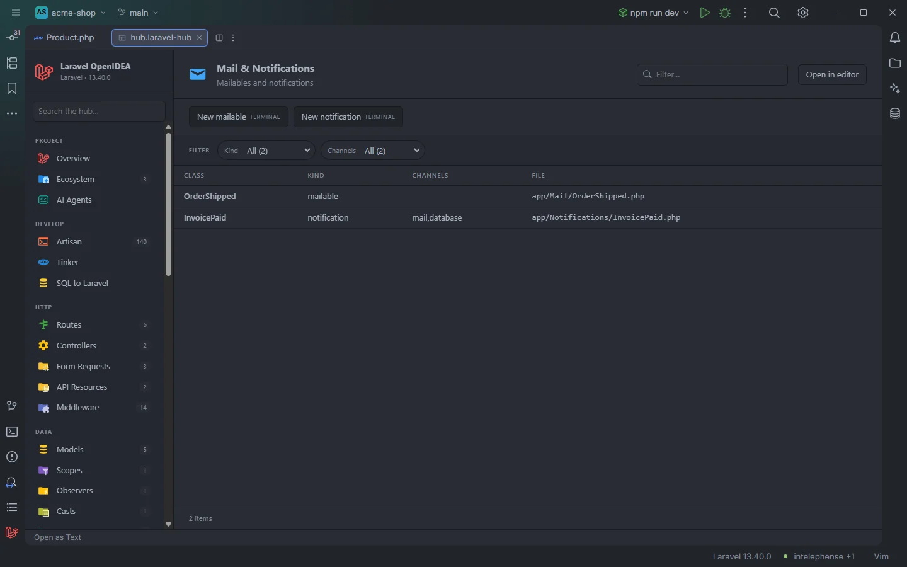

# Mail & Notifications

The **Mail & Notifications** section lists the project's mailables and notifications, with the channels each notification is sent on.

Mailables and notifications of the acme-shop demo

## How to use it

Open the hub and pick **Mail & Notifications** in the **Run** group of the sidebar.

- Click a row to open the class.
- Use **Kind** to separate mailables from notifications, and **Channels** to find every notification sent by `mail`, `database`, `broadcast` or a custom channel.
- Use **New mailable** or **New notification** to generate one.

Search, filters, sorting and paging are described in [The hub](Hub.md).

## What you see

| Column | Content |
| --- | --- |
| **Class** | The class name. |
| **Kind** | `mailable` or `notification`. |
| **Channels** | For a notification, the channels of its `via()` method, comma separated: `mail,database`. Empty for a mailable. |
| **File** | The file, relative to the project root. |

Rows are sorted by file path.

### Filters

| Filter | Values |
| --- | --- |
| **Kind** | `mailable`, `notification`. |
| **Channels** | Each channel; a notification with several channels is counted under each. Mailables count as `—`. |

### Toolbar buttons

| Button | Runs | Where |
| --- | --- | --- |
| **New mailable** | `php artisan make:mail` | Terminal |
| **New notification** | `php artisan make:notification` | Terminal |

Each button opens an IDE terminal tab titled with the command, where recent Laravel versions ask for the class name. In OpenIDEA 0.1.40 the tab closes when the command exits. See [The hub](Hub.md).

## Details

- **Data source:** every file under `app/**/*.php` (up to 20,000) is read each time the section opens. A class is listed when its file contains `extends Mailable` (a mailable) or `extends Notification` (a notification). No PHP is run.
- **Channels** is read from the source of `via()`: the text between the first `[` and `]` after `function via`, with quotes and spaces removed. A `via()` that returns something else than an array literal, such as `$notifiable->prefersSms() ? ['vonage'] : ['mail']`, shows the first array it finds. Channel classes (`WebPushChannel::class`) are shown as written.
- A mailable or notification that extends your own base class (`extends BaseMail`) is not listed, because the check looks for `extends Mailable` and `extends Notification` literally.
- Each row opens the file at the class declaration.
- Empty state: *Nothing found in this project yet.*

## Settings and permissions

The table needs only the required permissions. The buttons run Artisan and need `process:php` or `process:docker`. See [Settings](Settings.md) and [Permissions](Permissions.md).

## Related

- [The hub](Hub.md)
- [Queues & Workers](Hub-Queues.md): queued mailables and notifications
- [Live Audit](Hub-Live-Audit.md): mail and notifications as they are sent
- [File templates](File-Templates.md)

---
[← Wiki home](Home.md)
