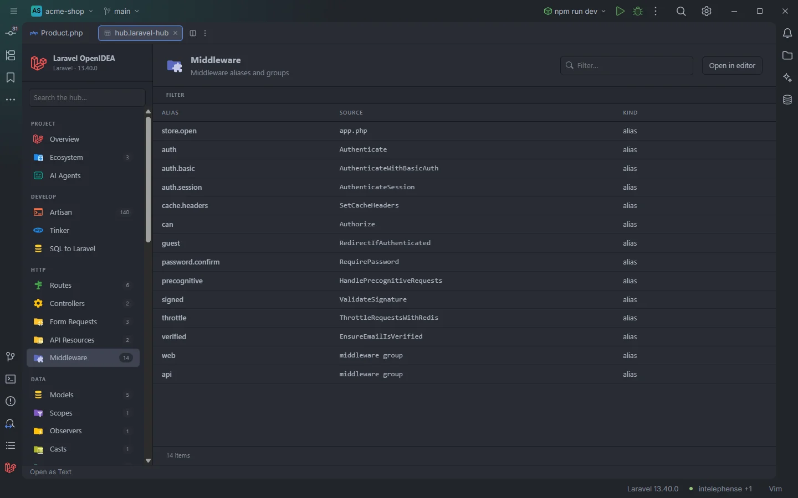

# Middleware

The middleware aliases and groups you can use in `->middleware()`: the ones your app declares and the ones Laravel registers by default. A click opens the line that declares the alias.

An app alias (<code>store.open</code>) followed by Laravel's defaults

## How to use it

Click **Middleware** under **HTTP** in the sidebar, the **Middleware** card on Overview, or open `storage/openidea/hub/middleware.laravel-hub`. Type in **Filter…** to find an alias or the class behind it (`Throttle`).

## What you see

### Columns

| Column | Content |
| --- | --- |
| Alias | The name used in routes: `auth`, `verified`, `store.open`, `web` |
| Source | Where it comes from: the file that declares an app alias (`app.php`, `Kernel.php`), the class of a Laravel default (`Authenticate`, `ThrottleRequestsWithRedis`), or `middleware group` for Laravel's default groups |
| Kind | `group` or `alias` |

**Kind** is `group` when the Source text starts with `[` or contains a comma, and `alias` otherwise. Since Source holds a file or class name, nearly every row reads `alias`, Laravel's `web` and `api` groups included, and the **Kind** facet is then hidden because it has a single value.

### Facets

**Kind**. The section has no action buttons.

## Details

### Where the names come from

1. **Your app**, in this order:
   - `bootstrap/app.php` (Laravel 11 and later): the keys of `$middleware->alias([...])`, and the group names given to `$middleware->group()`, `appendToGroup()` and `prependToGroup()`, as first argument or as array keys.
   - `app/Http/Kernel.php` (Laravel 10 and earlier): the keys of `$middlewareAliases`, `$routeMiddleware` and `$middlewareGroups`.
2. **Laravel's defaults**, read from `vendor/laravel/framework`: the aliases of `Illuminate\Foundation\Configuration\Middleware::defaultAliases()` (with the class they point to; when the class depends on a condition, such as `throttle` with Redis, the first class written there) and the groups of `getMiddlewareGroups()`. An alias your app already declares isn't repeated.
3. When the framework source can't be read, a built-in list instead: `auth`, `auth.basic`, `auth.session`, `cache.headers`, `can`, `guest`, `password.confirm`, `precognitive`, `signed`, `throttle`, `verified`, `web`, `api` and `bindings`. These rows have no file to open, and their Source carries a usage hint such as `Authenticate (auth:guard)`; the hint of `can`, `Authorize (can:ability,model)`, contains a comma, so that row reads `group`.

### Opening

- App rows open `bootstrap/app.php` or `app/Http/Kernel.php` at the alias.
- Laravel's defaults open the framework's `Middleware.php` in `vendor/` at the alias.

### Freshness

The list is rebuilt when `bootstrap/app.php`, `app/Http/Kernel.php`, `composer.lock` or `vendor/composer/installed.json` changes, so a framework update brings its new defaults.

The same names are what the plugin completes in `->middleware('…')` and checks with the unknown middleware inspection; see [Middleware, gates and policies](Middleware-Gates-and-Policies.md).

## Settings and permissions

Only `project.read`. See [Permissions](Permissions.md).

## Related

- [Middleware, gates and policies](Middleware-Gates-and-Policies.md)
- [Unknown middleware and abilities](Inspection-Unknown-Middleware.md)
- [Routes](Hub-Routes.md)
- [Auth & Policies](Hub-Auth-and-Policies.md)
- [The hub](Hub.md)

---
[← Wiki home](Home.md)
