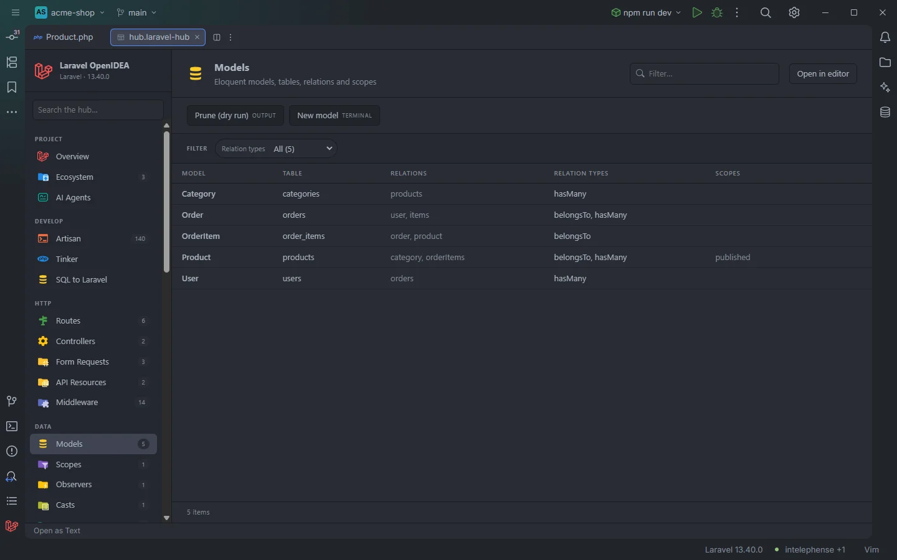
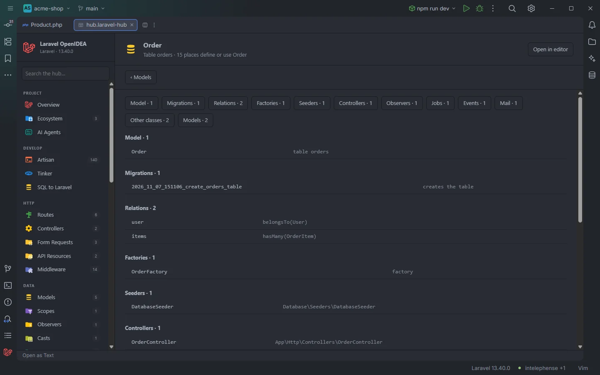

# Models

Every Eloquent model with its table, relations and local scopes. Clicking a model opens a page with everything that defines or uses it: its migrations, relations, scopes, enum casts, factory and seeders, the controllers, requests, resources, policies, observers, jobs, events, listeners, mail, commands, routes and tests that mention it.

The models of the demo shop

## How to use it

1. Click **Models** under **Data** in the sidebar, the **Models** card on Overview, or open `storage/openidea/hub/models.laravel-hub`.
2. Filter by name, table or relation, or pick a **Relation types** value (`belongsToMany`) to see which models use it.
3. Click a row to open the model's detail page, or hover it and click **Open ›** to open the model's file.

## What you see

### Columns

| Column | Content |
| --- | --- |
| Model | The class name |
| Table | `$table`, the `#[Table]` attribute, or the name Laravel derives: snake case, last word in the plural (`OrderItem` → `order_items`, `Category` → `categories`) |
| Relations | The relation methods, comma separated |
| Relation types | The kinds of relation it uses, each once, alphabetical: `belongsTo, hasMany` |
| Scopes | The local scopes, by the name you call them with |

### Facets

**Relation types**, split, so a model with `belongsTo, hasMany` counts for both.

### Actions

| Button | Command | Mode |
| --- | --- | --- |
| **Prune (dry run)** | `model:prune --pretend` | Output |
| **New model** | `make:model` | Terminal |

## A model's detail page

Everything about <code>Order</code>

Clicking a model replaces the table with a page titled after the model, described as `Table orders · 15 places define or use Order`. **‹ Models** goes back. A row of buttons (`Relations · 2`, `Controllers · 1`…) jumps to each group, and every row opens its file at the line shown.

The groups, in this order, each only when it has rows:

| Group | Rows |
| --- | --- |
| Model | The model itself, `table orders` |
| Migrations | Each migration that names the table in quotes on a line with `Schema::` or `constrained(`: `creates the table`, `changes the table` or `points a foreign key at it` |
| Relations | Each relation with its type and model: `user` · `belongsTo(User)` |
| Scopes | Each local scope |
| Casts | Each column cast to a backed enum, as `status → OrderStatus` with the enum's values |
| Factories | The model's own factory first (the class in `#[UseFactory(…)]` or returned by `newFactory()`, else `database/factories/OrderFactory.php`, else the factory mirroring a nested model's namespace), then other factories that mention the model |
| Seeders | Seeders that mention the model |
| Controllers, Form Requests, API Resources, Policies, Observers, Middleware, Jobs, Events, Listeners, Notifications, Mail, Livewire, Filament, Nova, Commands | Classes that mention the model, grouped by folder (`app/Http/Controllers/`, `app/Policies/`, `app/Filament/`, `app/Console/`…), with their full class name |
| Routes | Each line of a `routes/` file that mentions the model, after any registration call made on it there (`Order::observe(…)` shows as `Order::observe()` with `routes/web.php:12`) |
| Other classes | Classes in other folders that mention it |
| Models | Other models under `app/Models/` that mention it |
| Tests | Each line of a file under `tests/` that mentions the model |

A class counts as an API resource when it extends `JsonResource` or `ResourceCollection`, wherever it lives.

## Details

### What is a model

The plugin reads the PHP files under `app/Models/` and under any `Models/` folder inside `app/` (up to 5,000 each). A class is a model when it extends `Model`, `Authenticatable`, `Pivot`, `MorphPivot`, `User` or a class whose name ends in `Model`, or extends another model found there (at any depth).

### Relations and scopes

- A relation is a public method whose body calls `hasOne`, `hasMany`, `belongsTo`, `belongsToMany`, `morphTo`, `morphOne`, `morphMany`, `morphToMany`, `morphedByMany`, `hasOneThrough`, `hasManyThrough` or `hasOneOrMany`. The related model is the first `X::class` argument.
- A local scope is a `scopeActive()` method (listed as `active`) or a method with the `#[Scope]` attribute.
- A model that extends another model inherits its relations and scopes; they point at the parent's file.

### Mentions

The detail page uses the plugin's usage index, the same one behind [Gutter usages](Gutter-Usages.md): a file mentions the model when the model's name appears as a whole word in its code. `$order` doesn't count, nor does `OrderStatus`, and neither do comments or `use` imports. The row opens the first line that mentions it. Routes and Tests list every matching line (cut to 120 characters, at most 200 per group).

### Data source

Everything on this page is read from files: no PHP runs. The model list follows edits to files under `app/` whose path contains `/Models/`; the migrations are read again each time the detail page opens, and the IDE shows the task `Laravel: everything about Order` meanwhile. A model name that isn't in the index shows `Order is not a model of this project`.

The filter box and **Open in editor** are hidden on the detail page.

## Settings and permissions

Reading needs only `project.read`. **Prune (dry run)** and **New model** need `process:php` or `process:docker`. See [Permissions](Permissions.md).

## Related

- [Database](Hub-Database.md)
- [Scopes](Hub-Scopes.md)
- [Casts](Hub-Casts.md)
- [Observers](Hub-Observers.md)
- [Factories & Seeders](Hub-Factories.md)
- [Model members](Model-Members.md)
- [Eloquent columns and relations](Eloquent-Columns-and-Relations.md)
- [Generate model PHPDoc](Generate-Model-PHPDoc.md)
- [Gutter usages](Gutter-Usages.md)
- [The hub](Hub.md)

---
[← Wiki home](Home.md)
