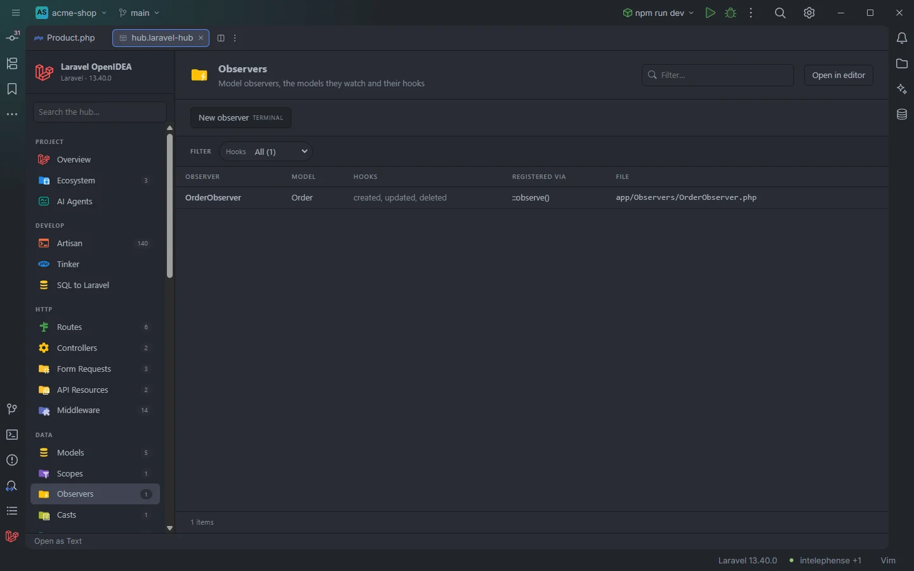

# Observers

Every model observer of the app, the models it watches, the model events it handles and how it is registered. Observers that nothing registers stand out as `not registered`.

An observer registered with <code>Order::observe()</code>

## How to use it

Click **Observers** under **Data** in the sidebar, or open `storage/openidea/hub/observers.laravel-hub`. Pick a **Model**, a **Hook** (`deleting`) or **Registered via: not registered** to narrow the list.

## What you see

### Columns

| Column | Content |
| --- | --- |
| Observer | The class name |
| Model | The models it is registered on, comma separated. When nothing registers it, the name without `Observer` (`OrderObserver` → `Order`) as a guess |
| Hooks | The model events it handles, in the order they are declared |
| Registered via | `#[ObservedBy]`, `::observe()`, both separated by a comma, or `not registered` |
| File | The file, relative to the project |

### Facets

**Model** and **Hooks** (both split: an observer with three hooks counts for each), and **Registered via**.

### Actions

| Button | Command | Mode |
| --- | --- | --- |
| **New observer** | `make:observer` | Terminal |

## Details

- A class is listed when it lives in an `/Observers/` folder, its name ends in `Observer`, or something registers it as an observer.
- Registrations found:
  - `#[ObservedBy(OrderObserver::class)]` or `#[ObservedBy([…])]` on a model;
  - `Order::observe(OrderObserver::class)` (or `new OrderObserver`) anywhere in the scanned code, usually a service provider's `boot()`. A call on a variable or `$this->…` records the registration but not the model.
- Hooks are the public methods named after a model event: `retrieved`, `creating`, `created`, `updating`, `updated`, `saving`, `saved`, `deleting`, `deleted`, `trashed`, `forceDeleting`, `forceDeleted`, `restoring`, `restored`, `replicating` and `booted`. Other methods aren't listed.
- Classes come from the plugin's token scan of `app/`, `database/factories/`, `database/seeders/`, `routes/` and the bootstrap files, so nothing runs.
- A click opens the observer at its class name.
- With no observer the section reads `Nothing found in this project yet.`

## Settings and permissions

The table needs only `project.read`. **New observer** needs `process:php` or `process:docker`. See [Permissions](Permissions.md).

## Related

- [Models](Hub-Models.md)
- [Events](Hub-Events.md)
- [Listeners](Hub-Listeners.md)
- [AI agents and MCP](AI-Agents.md) (`list_models` lists observers at runtime)
- [The hub](Hub.md)

---
[← Wiki home](Home.md)
