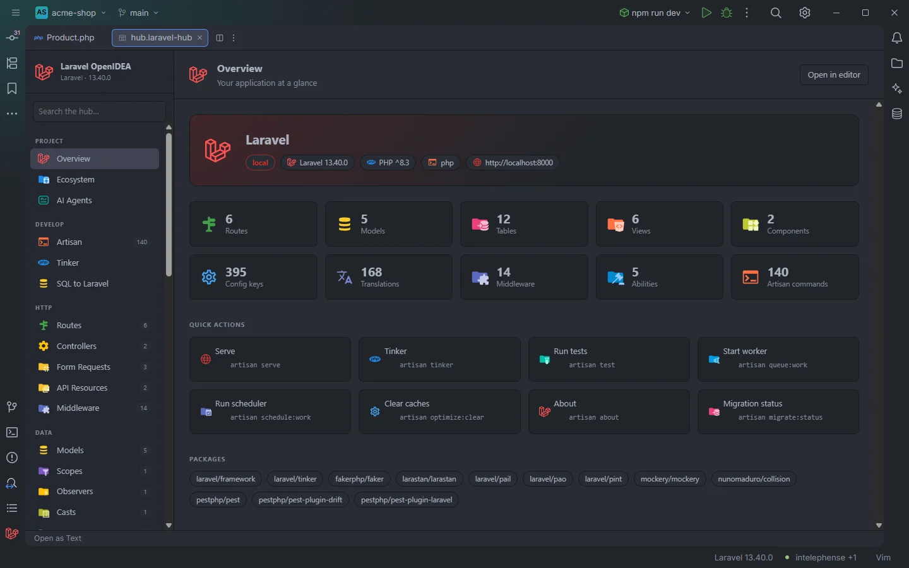

# Overview

The first section of the hub: your app's name, environment, versions and runner, the size of each part of the project, eight one-click Artisan actions and the Composer packages it requires. Every card is a shortcut into the section it counts.

Overview of the acme-shop demo

## How to use it

- The hub opens on Overview, in the tool window and in `hub.laravel-hub`.
- Click **Overview** under **Project** in the sidebar to come back.
- Clearing the **Search the hub…** box also returns here.
- **Open in editor** on this page opens the whole hub (`hub.laravel-hub`) in an editor tab, not a single section.

Overview has no filter box.

## What you see

### The banner

The app's name in large type and a row of chips:

| Chip | Source |
| --- | --- |
| Environment (red), for example `local` | `APP_ENV` in `.env`, else `.env.example` |
| `Laravel 13.40.0` | The `laravel/framework` version in `composer.lock` |
| `PHP ^8.3` | The `php` constraint in the `require` of `composer.json` (the constraint, not the PHP that runs) |
| Runner, for example `php` or `docker compose run --rm app` | How Artisan runs (tooltip **How Artisan runs**), with the Docker icon for a Compose runner |
| `http://localhost:8000` | `APP_URL` in `.env`, else `.env.example` |

The name is `APP_NAME` from `.env`, else `.env.example`, else the project folder's name. Surrounding quotes are removed. A chip is left out when its value is missing. The same name and Laravel version appear under **Laravel OpenIDEA** in the sidebar.

### Count cards

Ten cards, each opening its section:

| Card | Counts | Opens |
| --- | --- | --- |
| Routes | Routes with a controller action or a name, whichever is larger | [Routes](Hub-Routes.md) |
| Models | Eloquent models under `app/Models` and `app/**/Models` | [Models](Hub-Models.md) |
| Tables | Tables created by `Schema::create` in the migrations | [Database](Hub-Database.md) |
| Views | Blade views | [Views](Hub-Views.md) |
| Components | Blade components plus Livewire components | [Components](Hub-Components.md) |
| Config keys | Keys found in `config/` | [Config](Hub-Config.md) |
| Translations | Translation keys | [Translations](Hub-Translations.md) |
| Middleware | Middleware aliases and groups | [Middleware](Hub-Middleware.md) |
| Abilities | Gate abilities | [Auth & Policies](Hub-Auth-and-Policies.md) |
| Artisan commands | Commands found in the app and its packages | [Artisan](Hub-Artisan.md) |

The same request also fills the sidebar badges of the other counted sections.

### Quick actions

| Button | Command | Runs |
| --- | --- | --- |
| **Serve** | `artisan serve` | In a terminal |
| **Tinker** | `artisan tinker` | In a terminal |
| **Run tests** | `artisan test` | In a terminal |
| **Start worker** | `artisan queue:work` | In a terminal |
| **Run scheduler** | `artisan schedule:work` | In a terminal |
| **Clear caches** | `artisan optimize:clear` | Output in the hub's drawer |
| **About** | `artisan about` | Output in the hub's drawer |
| **Migration status** | `artisan migrate:status` | Output in the hub's drawer |

Each button shows its label and the command under it. Terminal runs open an IDE terminal tab titled with the command; output runs show the drawer described in [The hub](Hub.md#actions-output-and-terminal). Every run goes through the project's runner (php or Docker Compose) and is added to the Artisan history.

### Packages

A chip for every package in the `require` and `require-dev` of `composer.json` (entries with a `/`, so `php` and `ext-*` are left out): the `require` ones first, then the `require-dev` ones, each group in alphabetical order. The block is hidden when there are none. For versions and details of the first-party and popular ones, see [Ecosystem](Hub-Ecosystem.md).

## Details

- Everything on this page is read from files and the plugin's indexes; nothing runs PHP until you click a quick action.
- The page asks for fresh data each time you open it, so counts follow your edits.
- While the data loads the page shows grey placeholder bars.

## Settings and permissions

- `artisanRunner` and `dockerService` decide the runner shown in the banner and used by the quick actions.
- The quick actions need `process:php` (or `process:docker` with a Compose runner).

See [Settings](Settings.md) and [Permissions](Permissions.md).

## Related

- [The hub](Hub.md)
- [Artisan](Hub-Artisan.md)
- [Ecosystem](Hub-Ecosystem.md)
- [Status bar](Status-Bar.md)

---
[← Wiki home](Home.md)
