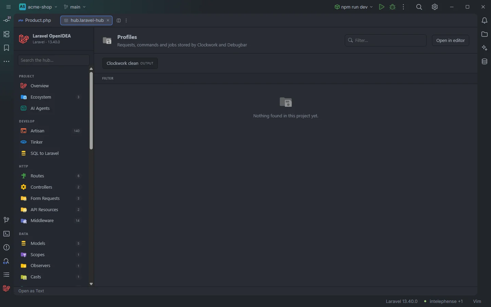

# Profiles

The **Profiles** section lists the requests, Artisan commands and queue jobs that Clockwork and Laravel Debugbar have stored on disk, with status, duration and query totals, so you can scan recent profiles without opening their web UIs.

The section in a project without Clockwork or Debugbar storage

## How to use it

Install [Clockwork](https://github.com/itsgoingd/clockwork) or [Laravel Debugbar](https://github.com/barryvdh/laravel-debugbar) with file storage enabled, use the app, then open the hub and pick **Profiles** in the **Observe** group of the sidebar.

- Use **Source** to see only Clockwork or Debugbar profiles, **Kind** to separate requests, commands and jobs, and **Status** to find the failing ones.
- Type in **Filter…** to find a URI, command or controller.
- Sort by **Duration** or **Queries** to find the slow requests.

Search, filters, sorting and paging are described in [The hub](Hub.md).

## What you see

| Column | Clockwork | Debugbar |
| --- | --- | --- |
| **When** | The request time in UTC, `2026-11-09 19:47:22 UTC` | `__meta.datetime` as stored |
| **Source** | `Clockwork` | `Debugbar` |
| **Kind** | `request`, `command` or `job` (from the profile type) | `request` |
| **Target** | `METHOD /uri`, the command name or the job name | `METHOD /uri` |
| **Status** | The response status, or `—` | `request.status_code`, or `—` |
| **Duration** | The response duration, `123.4 ms`, or `—` | `time.duration_str` as stored, or `—` |
| **Queries** | The number of queries and their total time: `12 (34.5 ms)` | `nb_statements` (or `count`) and the accumulated duration in ms |
| **Action** | The controller | `route.uses` |

Clockwork profiles come first, then Debugbar profiles, each newest first (by file name).

### Filters

| Filter | Values |
| --- | --- |
| **Source** | `Clockwork`, `Debugbar`. |
| **Kind** | `request`, `command`, `job`. |
| **Status** | Each status code. |

### Toolbar buttons

| Button | Runs | Where the output goes |
| --- | --- | --- |
| **Clockwork clean** | `php artisan clockwork:clean` | Output drawer |

`clockwork:clean` is Clockwork's command for removing stored profiles. The button is shown whether or not Clockwork is installed; without Clockwork, Artisan reports that the command is not defined. The drawer is described in [The hub](Hub.md).

## Details

- **Data source:** the JSON files in `storage/clockwork/*.json` and `storage/debugbar/*.json`. The 300 newest files of each folder are read each time the section opens. Files that are not valid JSON are skipped. No PHP is run.
- Profiles kept in a database, Redis or any storage other than files are not read.
- Rows have no file to open; use Clockwork's `/clockwork` page or the Debugbar UI for the full profile.
- Empty state: *Nothing found in this project yet.* when neither folder has a profile.

## Settings and permissions

The table needs only the required permissions. **Clockwork clean** runs Artisan and needs `process:php` or `process:docker`. See [Settings](Settings.md) and [Permissions](Permissions.md).

## Related

- [The hub](Hub.md)
- [Debug Tools](Hub-Debug-Tools.md): which profilers are installed
- [Live Audit](Hub-Live-Audit.md): the plugin's own recorder, which needs no package

---
[← Wiki home](Home.md)
