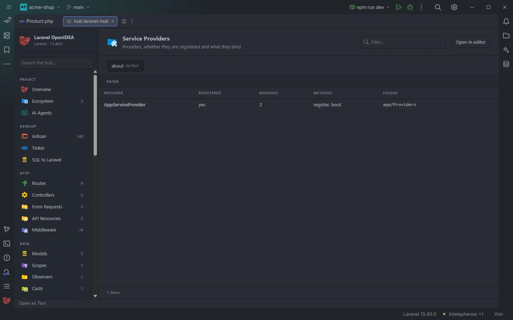

# Service Providers

The **Service Providers** section lists the project's service providers, tells you whether each one is registered, how many container bindings it declares and whether it has `register()` and `boot()`. A provider that exists but is never registered is easy to spot.

Providers of the acme-shop demo

## How to use it

Open the hub and pick **Service Providers** in the **App** group of the sidebar. The badge counts the providers.

- Click a row to open the provider at its class declaration.
- Set **Registered** to `no` to find providers that are not listed in `bootstrap/providers.php` or `config/app.php`.
- Type in **Filter…** to search, click a header to sort (for example by **Bindings**).

Search, filters, sorting and paging are described in [The hub](Hub.md).

## What you see

| Column | Content |
| --- | --- |
| **Provider** | The class name. |
| **Registered** | `yes` when the class name appears in `bootstrap/providers.php` or `config/app.php`, `no` otherwise. |
| **Bindings** | How many `bind`, `singleton`, `scoped` and `instance` registrations (and their `…If` forms) the provider's file contains. They are listed in [Container Bindings](Hub-Bindings.md). |
| **Methods** | `register`, `boot`, both, or `—`. |
| **Folder** | The directory of the file. |

### Filters

| Filter | Values |
| --- | --- |
| **Registered** | `yes`, `no`. |

### Toolbar buttons

| Button | Runs | Where the output goes |
| --- | --- | --- |
| **about** | `php artisan about` | Output drawer (*OUTPUT*) |

`about` prints the environment, cache and driver summary of the running app. The drawer is described in [The hub](Hub.md).

## Details

- **Data source:** the plugin's scan of the project's PHP files (`app/`, `database/factories/`, `database/seeders/`, `routes/`, `bootstrap/app.php`, `bootstrap/providers.php`). A class is a provider when it extends `ServiceProvider`, `EventServiceProvider`, `AuthServiceProvider` or `RouteServiceProvider` (compared by short name). Nothing is run.
- **Registered** is a text search: the provider's short name must appear anywhere in `bootstrap/providers.php` (Laravel 11 and later) or `config/app.php` (Laravel 10 and earlier). Providers registered another way, such as `$this->app->register()` from another provider, package auto-discovery or a conditional in `AppServiceProvider`, show `no`. A name that only appears in a comment shows `yes`.
- **Bindings** counts the binding calls whose file is the provider's file, so bindings made on `App::`, `app()`, `$this->app`, `$app`, `Container` or `$container` all count.
- Package providers in `vendor/` are not listed.
- Each row opens the file at the line of the class name.
- Empty state: *Nothing found in this project yet.*

## Settings and permissions

The table needs only the required permissions. **about** runs Artisan and needs `process:php` or `process:docker`. See [Settings](Settings.md) and [Permissions](Permissions.md).

## Related

- [The hub](Hub.md)
- [Container Bindings](Hub-Bindings.md)
- [All Classes](Hub-Classes.md)
- [Macros](Hub-Macros.md), often registered in a provider's `boot()`

---
[← Wiki home](Home.md)
