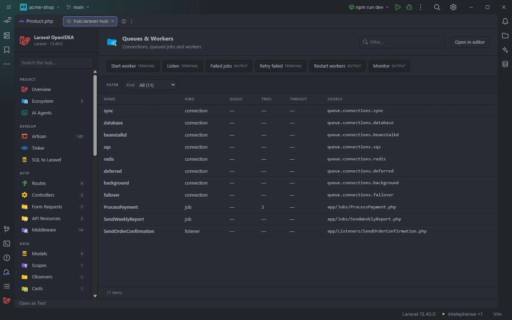

# Queues & Workers

The **Queues & Workers** section lists the queue connections the project configures and every class that is pushed to a queue (jobs, queued listeners, queued mailables and notifications), with their queue, retries and timeout. Its toolbar starts and manages workers.

Connections and queued classes of the acme-shop demo, with the worker buttons

## How to use it

Open the hub and pick **Queues & Workers** in the **Run** group of the sidebar.

- Click a connection to open `config/queue.php` at it, or a class to open it.
- Use **Kind** to list only jobs, listeners, mail or notifications, and **Queue** to see what runs on one queue.
- Use the toolbar to start a worker, see failed jobs or retry them.

Search, filters, sorting and paging are described in [The hub](Hub.md).

## What you see

| Column | Content |
| --- | --- |
| **Name** | The connection name (`redis`, `database`) or the class name (`ProcessPayment`). |
| **Kind** | `connection`, `job`, `listener`, `mail` or `notification`. |
| **Queue** | The class's `$queue` property, or `—`. |
| **Tries** | The class's `$tries` property, or `—`. |
| **Timeout** | The class's `$timeout` property, or `—`. |
| **Source** | For a connection, its config key (`queue.connections.redis`); for a class, its file. |

Connections come first, then the classes sorted by path.

| Kind | Rule |
| --- | --- |
| `connection` | A key of `queue.connections` in `config/queue.php`. |
| `mail` | A queued class whose file contains `extends Mailable`. |
| `notification` | A queued class whose file contains `extends Notification`. |
| `listener` | A queued class under a `/Listeners/` folder. |
| `job` | Any other queued class. |

A class is queued when its file in `app/**/*.php` contains both `implements` and `ShouldQueue`.

### Filters

| Filter | Values |
| --- | --- |
| **Kind** | Each kind, with its count. |
| **Queue** | Each queue name found (shown when at least two values exist). |

### Toolbar buttons

| Button | Runs | Where |
| --- | --- | --- |
| **Horizon** | `php artisan horizon` | Terminal. Only shown when `config/horizon.php` exists; it comes first. |
| **Start worker** | `php artisan queue:work` | Terminal |
| **Listen** | `php artisan queue:listen` | Terminal |
| **Failed jobs** | `php artisan queue:failed` | Output drawer |
| **Retry failed** | `php artisan queue:retry all` | Terminal |
| **Restart workers** | `php artisan queue:restart` | Output drawer |
| **Monitor** | `php artisan queue:monitor default` | Output drawer |

Terminal buttons open an IDE terminal tab titled with the command (`artisan queue:work`), so a worker keeps running there until you stop it. In OpenIDEA 0.1.40 the tab closes when the command exits, so a short command such as `queue:retry all` disappears once it finishes; use the [Artisan](Hub-Artisan.md) section's *Show output here* to keep its output. *OUTPUT* buttons show the coloured output in the drawer at the bottom of the hub. See [The hub](Hub.md).

## Details

- **Data source:**
  - Connections come from the plugin's config index (direct children of `queue.connections`); they are rebuilt when `config/` changes.
  - Queued classes are read from `app/**/*.php` each time the section opens (up to 20,000 files). No PHP is run.
- **Queue**, **Tries** and **Timeout** come from the first assignment of `$queue`, `$tries` or `$timeout` to a string or number literal in the file, such as `public $tries = 3;`. Values set at runtime with `onQueue()`, returned by methods such as `tries()`, or given in attributes are not read.
- A queued class outside `app/`, or one that only gets `ShouldQueue` from a parent class, is not listed.
- The **Horizon** button depends on the published `config/horizon.php`, not on `composer.json`.
- Each row opens its definition: the config key for a connection, the class declaration for a class.
- Empty state: *Nothing found in this project yet.* when there is neither a queue config nor a queued class.

## Settings and permissions

The table needs only the required permissions. The buttons run Artisan and need `process:php` or `process:docker`; `artisanRunner` and `dockerService` decide whether a worker runs on the host or in a Docker Compose service. See [Settings](Settings.md) and [Permissions](Permissions.md).

## Related

- [The hub](Hub.md)
- [Live Audit](Hub-Live-Audit.md): jobs queued, processed and failed, as they happen
- [Listeners](Hub-Listeners.md) and [Mail & Notifications](Hub-Mail.md)
- [Drivers & Connections](Hub-Drivers-and-Connections.md)
- [Ecosystem](Hub-Ecosystem.md): Horizon

---
[← Wiki home](Home.md)
