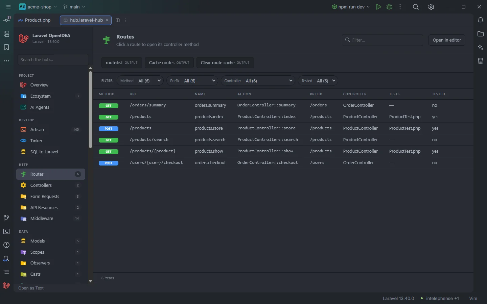

# Routes

Every route of the app in one table: method, URI, name, action, prefix, controller and the tests that call it. Clicking a route opens its controller method.

Routes of the demo shop, three of them covered by ProductTest.php

## How to use it

Click **Routes** under **HTTP** in the sidebar, the **Routes** card on Overview, or open `storage/openidea/hub/routes.laravel-hub`. Filter with the **Filter…** box (it matches every column, so `orders.` finds the route names and `/api` the URIs), narrow with the facets, sort by any column, and click a row to open its code.

## What you see

### Columns

| Column | Content |
| --- | --- |
| Method | `GET`, `POST`, `PUT`, `PATCH`, `DELETE`, `OPTIONS`, `ANY`, `VIEW` or `RESOURCE` as a coloured badge; one badge per verb for `Route::match(['get', 'post'], …)` |
| URI | The full URI with group prefixes applied, always starting with `/` |
| Name | The route name with the group's `as`/`name()` prefixes, empty when the route has none |
| Action | `ProductController::index`, `closure`, `Folio page`, or the cached action |
| Prefix | The first segment of the URI (`/products`), or `/` when the URI is `/` or starts with a parameter |
| Controller | The controller's short class name, `closure` or `folio` |
| Tests | The first test file that hits the route, with `+N` for the others (`ProductTest.php +2`), or `—` |
| Tested | `yes` or `no` |

The method badge is green for GET (and HEAD), blue for POST, orange for PUT and PATCH, red for DELETE and purple for everything else.

### Facets

**Method** (split, so a cell with several methods counts for each), **Prefix**, **Controller** and **Tested**. Choosing **Tested: no** lists the routes no test touches.

### Actions

| Button | Command | Mode |
| --- | --- | --- |
| **route:list** | `route:list` | Output |
| **Cache routes** | `route:cache` | Output |
| **Clear route cache** | `route:clear` | Output |

`route:list` shows what Laravel itself registered, including package routes; the table shows what the plugin reads from your files.

## Details

### Where the routes come from

The table is read statically from the project, without booting the app:

1. **Routes with a controller action** from every file under `routes/` (`routes/**/*.php`): `Route::get/post/put/patch/delete/options/any/match(…)` with `[Controller::class, 'method']` or `Controller::class` (invokable, method `__invoke`), named or not. Group `prefix()` and `name()` (or the `prefix` and `as` keys of a group array) are applied, also when nested.
2. **`Route::resource()` and `Route::apiResource()`**: one row per action (`index`, `create`, `store`, `show`, `edit`, `update`, `destroy`; the API variant without `create` and `edit`), respecting `only()` and `except()`. Their Method cell is `RESOURCE` and their URI the resource's base URI, since the static reader doesn't expand each action's verb and path; the name is `products.index` and so on.
3. **Named routes without a controller**: closure routes and `Route::view()` with a name, with `closure` as action and controller. Routes that have neither a name nor a controller action aren't listed.
4. **Cached routes**: when `bootstrap/cache/routes-v7.php` exists (after `php artisan route:cache`), the named routes in it that the files don't declare, such as package routes (Sanctum, Horizon, Filament…). Their action comes from the cache (`closure` when it was a closure), and the controller is the action's class. Names starting with `generated::` are skipped.
5. **Folio pages**: every page under the paths of `FolioServiceProvider` (or `resources/views/pages`), as `GET` with the page's URI and name, action `Folio page`, controller `folio`.

The rows are sorted by URI, then by method. A route found twice (as an action and as a named route at the same line) appears once.

### What a click opens

- A route with a controller action opens the controller method, when the plugin knows it; otherwise the route's line.
- Other rows open the route's line in `routes/`, the entry in the route cache or the Folio page.

### Tests

For each route the plugin reads every PHP file under `tests/` (up to 20,000 files) and counts it as a test of the route when:

- the route's name appears in quotes (`'products.index'` or `"products.index"`), or
- a string literal in the file with a `/`, no spaces and fewer than 200 characters matches the URI pattern: same number of segments, `{param}` matching any non-empty segment, a query string ignored. `/orders/{order}` matches `'/orders/7'`; `/api/products` matches `'api/products?page=2'`; `/orders/{order}/checkout` doesn't match `'/orders/7'`. The URI `/` alone is never matched this way.

Only the file name is shown, not its folder.

### Freshness

The route index is rebuilt after a change under `routes/`, in `bootstrap/app.php`, `bootstrap/cache/`, `app/Providers/` or `resources/views/`. The tests are read again each time you open the section. The count in the sidebar and on Overview is the larger of the number of routes with a controller action and the number of named routes.

### Empty states

`Nothing found in this project yet.` when no route was found; `No match for “…”.` or `No item matches the filters.` when the filter hides everything.

## Settings and permissions

Reading routes needs only `project.read`. The three buttons run Artisan with the project's runner and need `process:php` or `process:docker`. See [Settings](Settings.md) and [Permissions](Permissions.md).

## Related

- [Route names](Route-Names.md)
- [Gutter markers](Gutter-Markers.md)
- [Rename route](Rename-Route.md)
- [Controllers](Hub-Controllers.md)
- [Middleware](Hub-Middleware.md)
- [Tests](Hub-Tests.md)
- [The hub](Hub.md)

---
[← Wiki home](Home.md)
