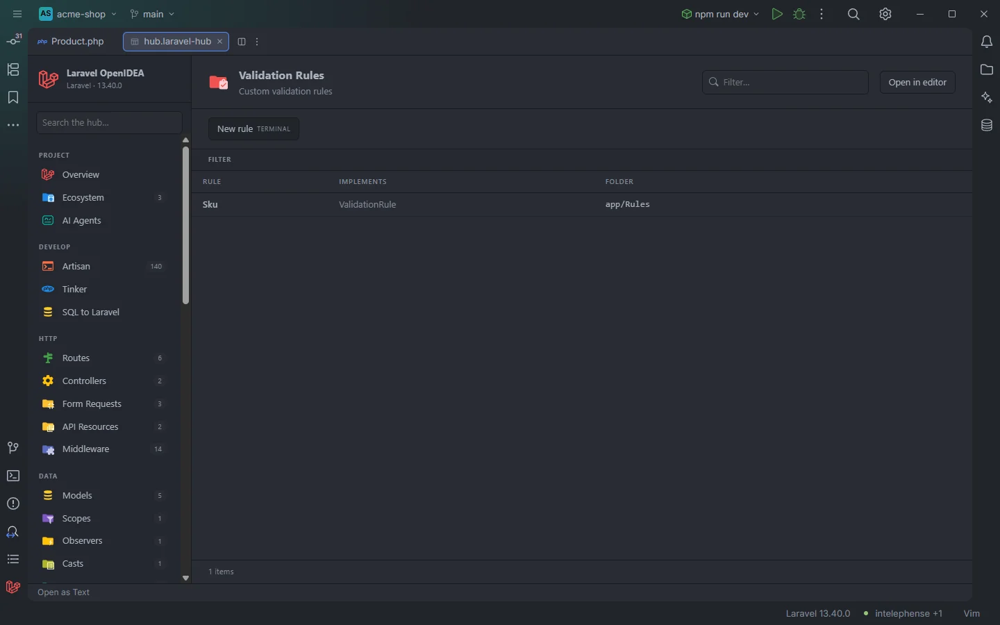

# Validation Rules

The **Validation Rules** section lists the custom validation rule classes of the project and the rule interfaces each one implements.

Custom rules of the acme-shop demo

## How to use it

Open the hub and pick **Validation Rules** in the **App** group of the sidebar. The badge counts the rule classes.

- Click a row to open the rule class.
- Use **Implements** to separate `ValidationRule` classes from older `Rule` or `InvokableRule` ones, or **Folder** to see one directory.
- Use **New rule** to generate one.

Search, filters, sorting and paging are described in [The hub](Hub.md).

## What you see

| Column | Content |
| --- | --- |
| **Rule** | The class name. |
| **Implements** | The interfaces it implements, comma separated, or `—`. |
| **Folder** | The directory of the file. |

### Filters

| Filter | Values |
| --- | --- |
| **Implements** | Each interface; a class implementing several is counted under each. |
| **Folder** | Each directory. |

### Toolbar buttons

| Button | Runs | Where it runs |
| --- | --- | --- |
| **New rule** | `php artisan make:rule` | IDE terminal (*TERMINAL*) |

The button opens an IDE terminal tab titled `artisan make:rule`. On recent Laravel versions `make:rule` asks for the class name there, then creates it in `app/Rules`; the new class appears in the section the next time you open it. In OpenIDEA 0.1.40 the terminal tab closes when the command exits. See [The hub](Hub.md).

## Details

- **Data source:** the plugin's scan of the project's PHP files (`app/`, `database/factories/`, `database/seeders/`, `routes/`, `bootstrap/app.php`, `bootstrap/providers.php`). Nothing is run.
- A class is listed when it implements `ValidationRule`, `Rule`, `InvokableRule`, `DataAwareRule` or `ValidatorAwareRule` (short names), or lives in a `/Rules/` folder, and no earlier role matched first (a class under `/Http/Requests/` is a Form Request, for example). The full order is on the [All Classes](Hub-Classes.md) page.
- Rule objects created inline (`Rule::in()`, closures) and the framework's string rules are not classes and are not listed here; the editor completes them, see [Validation rules](Validation-Rules.md).
- Each row opens the file at the class name.
- Empty state: *Nothing found in this project yet.*

## Settings and permissions

The table needs only the required permissions. **New rule** runs Artisan and needs `process:php` or `process:docker`. See [Settings](Settings.md) and [Permissions](Permissions.md).

## Related

- [The hub](Hub.md)
- [Validation rules in the editor](Validation-Rules.md)
- [Unknown validation rules](Inspection-Unknown-Rules.md)
- [Form Requests](Hub-Form-Requests.md)

---
[← Wiki home](Home.md)
