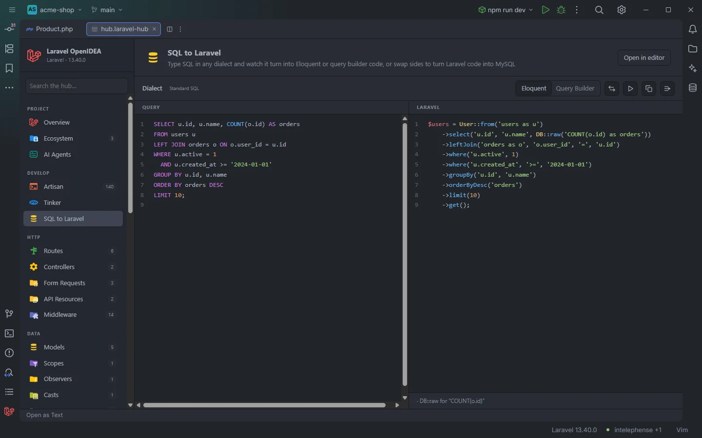
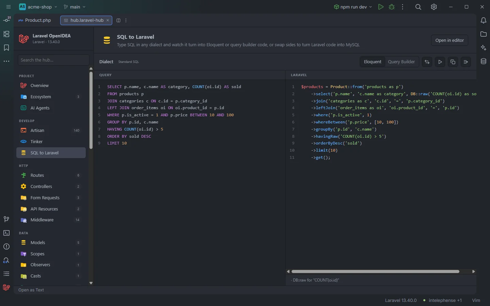
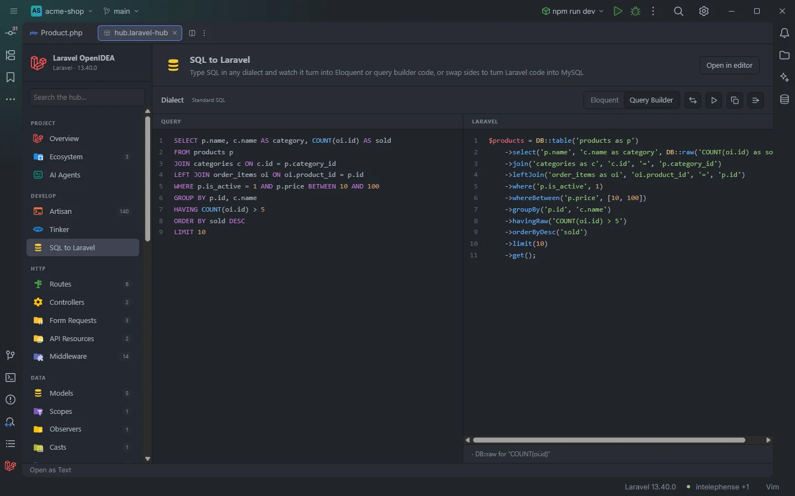
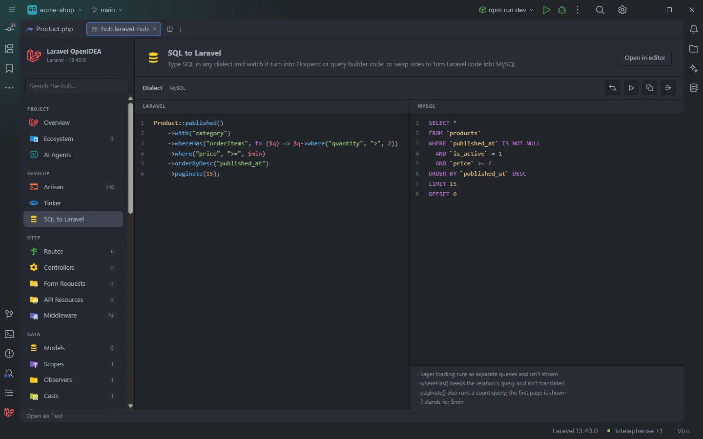

# SQL to Laravel

Type a SQL query in any dialect and the Eloquent or query builder code that runs it appears next to it as you type. Swap the sides and it works the other way: Eloquent or query builder code becomes the MySQL it runs. The result can be copied, inserted at the cursor or run in Tinker.

The sample query turned into Eloquent

## How to use it

1. Click **SQL to Laravel** under **Develop** in the sidebar.
2. Type or paste one SQL statement in the **Query** pane. The **Laravel** pane updates on every keystroke.
3. Choose **Eloquent** or **Query Builder** in the toolbar.
4. Use the buttons on the right of the toolbar:

| Button | Does |
| --- | --- |
| Swap sides (two arrows) | Switches to Laravel → MySQL, or back. The current output moves to the other side as its input |
| Run (play) | Runs the Laravel code in a new Tinker tab |
| Copy | Copies the output to the clipboard |
| Insert | Inserts the output at the cursor of the editor, indented like the line |

The text of both sides, the mode and the direction are saved in the plugin's storage, so the page comes back as you left it.

## What you see

- **Dialect** and a badge. In SQL → Laravel the badge shows the dialect detected from the syntax: **MySQL**, **SQL Server**, **PostgreSQL**, **Oracle**, **SQLite** or **Standard SQL**. In Laravel → MySQL it reads **MySQL**.
- The **Eloquent** / **Query Builder** switch (hidden in Laravel → MySQL).
- Two panes with line numbers and highlighting, **Query** and **Laravel** (or **Laravel** and **MySQL** after a swap).
- Under the output, the notes about what was approximated, each starting with `·`, or the error in red. While the input has an error, the output keeps the last good result, dimmed.

On a first visit the panes hold a sample query and a sample Eloquent chain.

Eloquent: the <code>products</code> table belongs to the <code>Product</code> model

The same query as query builder code

## SQL to Laravel

The conversion runs in the page itself; no PHP runs. The models and their tables come from the plugin's model index.

### Eloquent or query builder

- **Eloquent**: when a model uses the query's table, the code starts from it: `Product::query()`, `Product::where(…)`, `Product::from('products as p')` when the table has an alias, `Product::all()` for a bare `SELECT *`, `Product::find($id)` when the only condition is on `id`. Without a model the code stays on `DB::table()` with the note `No model uses the “x” table, so it stays on the query builder`. UNION queries stay on the query builder.
- **Query Builder**: always `DB::table('products as p')`.

The result goes into a variable named after the table: `$products` for many rows, `$product` for one; `$count`, `$total`, `$average`, `$min` or `$max` for an aggregate; `$names` or `$name` for a single column.

### What is translated

| SQL | Laravel |
| --- | --- |
| `SELECT DISTINCT a, b AS c, t.*` | `select('a', 'b as c', 't.*')`, `distinct()` |
| Expressions in the select list | `DB::raw('…')`, with a note |
| A subquery in the select list | `selectSub(…, 'alias')` |
| `SELECT COUNT(*)`, `SUM(x)`, `AVG(x)`, `MIN(x)`, `MAX(x)` alone | `count()`, `sum('x')`, `avg('x')`, `min('x')`, `max('x')` as the last call; `COUNT(DISTINCT x)` adds `distinct()` |
| A single column | `pluck('name')`, or `value('name')` with `LIMIT 1` |
| `LIMIT 1` | `first()` |
| `TOP n`, `LIMIT n`, `LIMIT a, b`, `OFFSET`, `FETCH FIRST n ROWS ONLY` | `limit()`, `offset()` |
| `FROM a, b` | `crossJoin('b')` |
| `JOIN`, `INNER JOIN`, `STRAIGHT_JOIN`, `LEFT [OUTER] JOIN`, `RIGHT [OUTER] JOIN`, `CROSS JOIN` | `join`, `leftJoin`, `rightJoin`, `crossJoin`; a single `ON a = b` becomes arguments, anything longer a closure with `on`/`orOn`/`where…` |
| `JOIN … USING (col)` | The same join on `left.col = right.col` |
| A subquery in `FROM` or a join | `DB::query()->fromSub(…)`, `joinSub`, `leftJoinSub`, `rightJoinSub`, `crossJoinSub` |
| `col = value`, `<>`, `!=`, `<`, `>`, `<=`, `>=` (either side) | `where('col', value)`, `where('col', '>', value)` |
| `col = NULL`, `IS NULL`, `IS NOT NULL` | `whereNull`, `whereNotNull` |
| `IS TRUE`, `IS FALSE` | `where('col', true)` |
| `a.col = b.col` | `whereColumn('a.col', 'b.col')` |
| `LIKE`, `ILIKE`, `NOT LIKE` | `where('col', 'like', value)` |
| `IN (…)`, `NOT IN (…)`, `IN (SELECT …)` | `whereIn`, `whereNotIn`, with a closure for a subquery |
| `BETWEEN a AND b` (values or columns) | `whereBetween`, `whereNotBetween`, `whereBetweenColumns` |
| `EXISTS (…)`, `NOT EXISTS (…)` | `whereExists`, `whereNotExists` |
| `DATE(col)`, `YEAR(col)`, `MONTH(col)`, `DAY(col)`, `TIME(col)` compared to a value | `whereDate`, `whereYear`, `whereMonth`, `whereDay`, `whereTime` |
| `col = (SELECT …)` | `where('col', function ($query) { … })` |
| A bare column (`WHERE active`) | `where('active', true)` |
| `OR`, parentheses | `orWhere…`, and `where(function ($query) { … })` groups |
| `NOT (…)` | Negates `IN`, `BETWEEN`, `NULL`, `EXISTS` and `LIKE`; otherwise `whereNot(function …)` |
| `NOW()`, `CURRENT_TIMESTAMP`, `GETDATE()`, `SYSDATE`… as a value | `now()` |
| `GROUP BY` | `groupBy()`, or `groupByRaw()` for expressions |
| `HAVING col > value` | `having()`, otherwise `havingRaw()` |
| `ORDER BY col [DESC]` | `orderBy`, `orderByDesc`; `created_at` becomes `latest()` / `oldest()`; `RAND()`, `RANDOM()`, `NEWID()` become `inRandomOrder()`; `ORDER BY 2` uses the second column; expressions use `orderByRaw()` |
| `FOR UPDATE`, `FOR SHARE`, `LOCK IN SHARE MODE` | `lockForUpdate()`, `sharedLock()` |
| `UNION`, `UNION ALL` | `union()`, `unionAll()` |
| `INSERT INTO t (a, b) VALUES (…), (…)` | `insert([…])`; one row on a model becomes `Model::create([…])` |
| `INSERT IGNORE`, `INSERT OR IGNORE`, `ON CONFLICT DO NOTHING` | `insertOrIgnore()` |
| `ON DUPLICATE KEY UPDATE`, `ON CONFLICT (…) DO UPDATE` | `upsert($rows, [unique], [update])` |
| `INSERT … RETURNING` (one row, no model) | `$id = …->insertGetId([…])` |
| `INSERT INTO t (cols) SELECT …` | `insertUsing([…], …)` |
| `REPLACE INTO` | `insert()`, with a note |
| `UPDATE … SET col = col + n` | `increment('col', n)` or `decrement()` |
| `UPDATE … SET …` | `$affected = …->update([…])`, with `DB::raw()` for expressions; joins, `WHERE`, `ORDER BY` and `LIMIT` are kept |
| `DELETE FROM … WHERE …` | `$deleted = …->delete()` |
| `TRUNCATE [TABLE] t` | `truncate()` |

Parameters become PHP variables: `?` becomes `$value1`, `$value2`…, `:name` and `@name` become `$name` (camelCase), `$1` becomes `$param1`.

Anything else in a condition is kept as raw SQL (`whereRaw('…')`, `selectRaw`, `groupByRaw`, `havingRaw`, `orderByRaw`), each with a note such as `· whereRaw for “…”`. `CASE`, window functions (`OVER`, `FILTER`, `WITHIN GROUP`), `CAST`, `EXTRACT`, `INTERVAL`, `::type` casts and `COLLATE` are kept raw.

### What isn't

| Input | Result |
| --- | --- |
| `WITH …` (common table expressions) | `$rows = DB::select('…')` with the note `WITH (common table expressions) has no query builder method` |
| Any statement other than SELECT, INSERT, UPDATE, DELETE and TRUNCATE | `DB::statement('…')` with a note |
| `INSERT` without a column list | `DB::insert('…')` with a note |
| `EXCEPT`, `INTERSECT`, `NATURAL JOIN`, `FULL OUTER JOIN`, `TOP … PERCENT`, `SELECT … INTO`, `UPDATE … FROM`, `DELETE … USING`, `= ANY (…)` / `SOME` / `ALL` | An error such as `FULL OUTER JOIN has no query builder method` |
| Two statements | `Only one statement at a time` |
| A syntax error | The error with what was expected, the text near it and the line, for example `expected ) near “FROM” (line 3)` |

### Dialect detection

The badge is a guess from the syntax, checked in this order:

| Dialect | Signs |
| --- | --- |
| MySQL | Backticks, `LIMIT a, b`, `ON DUPLICATE KEY`, `AUTO_INCREMENT`, `INSERT IGNORE`, `IFNULL(` |
| SQL Server | `[brackets]`, `TOP n`, `N'…'`, `GETDATE(`, `ISNULL(`, `NEWID(` |
| PostgreSQL | `::type`, `ILIKE`, `RETURNING`, `$1`, `ON CONFLICT`, `E'…'`, `$$`, `SERIAL` |
| Oracle | `ROWNUM`, `FROM DUAL`, `NVL(`, `SYSDATE`, `FETCH FIRST` |
| SQLite | `AUTOINCREMENT`, `INSERT OR IGNORE` / `OR REPLACE`, `GLOB` |

Otherwise **Standard SQL**. Quoting with `"…"`, backticks or `[…]`, `--`, `#` and `/* */` comments, `''` and `\'` escapes, and `$$…$$` strings are understood whatever the badge says.

## Laravel to MySQL

Laravel → MySQL, with notes for what isn't shown

After **Swap sides** the left pane takes PHP and the right pane shows MySQL. Here the plugin does the translation (it is the same translator as [Copy Query as MySQL](Copy-Query-as-MySQL.md)), 120 ms after you stop typing, without running anything:

- The chain must start from a model or `DB::table('…')`; otherwise the error says so, for example `Start the chain with DB::table('…') or a model, like User::query()`.
- Models give their table, soft deletes (`deleted_at IS NULL`) and local scopes, which are expanded into their conditions.
- Values from variables become `?`, with a note such as `? stands for $min`.
- Notes list what isn't part of the SQL shown: `Eager loading runs as separate queries and isn't shown`, `whereHas() needs the relation's query and isn't translated`, `paginate() also runs a count query; the first page is shown`, `withCount() adds a subquery per relation and isn't translated`, and so on.

## Details

- **Run** works on the Laravel side: the generated code in SQL → Laravel, your code in Laravel → MySQL. It opens [Tinker](Hub-Tinker.md) on a new tab named `SQL <n>` and runs it. When the code writes (`update`, `delete`, `forceDelete`, `insert…`, `upsert`, `increment…`, `decrement…`, `truncate`, `create`, `forceCreate`, `save`, `destroy`, or `DB::statement`, `DB::insert`, `DB::update`, `DB::delete`, `DB::unprepared`, `DB::affectingStatement`), a dialog asks first: `This code changes data in the database of php. Run it in Tinker?`
- **Copy** shows `Copied to the clipboard.` in a toast.
- **Insert** writes into the editor that has the cursor, replacing the selection, and indents every line after the first like the cursor's line; the toast reads `Inserted into OrderController.php.` Without an open editor it says `Open a file in the editor first.`
- In the SQL pane **Tab** inserts two spaces; in the PHP pane, four.
- Swapping copies the output to the other side: SQL gets a `;` at the end.
- Copy and Insert are disabled while there is no output; Run is disabled while there is no Laravel code.

## Settings and permissions

| Permission | Needed for |
| --- | --- |
| `clipboard` | **Copy**. Without it the toast says `Allow "clipboard" for Laravel OpenIDEA in Settings › Plugins to copy from the hub.` |
| `editor.read`, `editor.write` | **Insert**. Without them the toast names the missing one |
| `process:php` or `process:docker` | **Run**, which goes through Tinker |
| `storage` | Remembering the text, mode and direction |

See [Settings](Settings.md) and [Permissions](Permissions.md).

## Related

- [Copy Query as MySQL](Copy-Query-as-MySQL.md)
- [Tinker](Hub-Tinker.md)
- [Eloquent chains](Eloquent-Chains.md)
- [Scopes](Scopes.md)
- [The hub](Hub.md)

---
[← Wiki home](Home.md)
