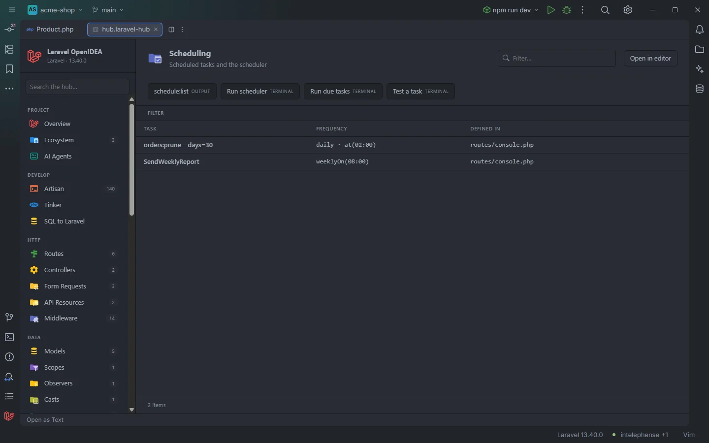

# Scheduling

The **Scheduling** section lists the tasks the project schedules, with the frequency and options chained after each one, and starts the scheduler from the toolbar.

Two scheduled tasks from routes/console.php

## How to use it

Open the hub and pick **Scheduling** in the **Run** group of the sidebar.

- Click a task to open the line that schedules it.
- Use **Defined in** when tasks are spread over several files.
- Use the toolbar to list the schedule as Laravel sees it, run the scheduler or test one task.

Search, filters, sorting and paging are described in [The hub](Hub.md).

## What you see

| Column | Content |
| --- | --- |
| **Task** | What runs (see below). |
| **Frequency** | Every method chained after the task, joined by ` · `, each with its first argument in parentheses: `dailyAt(01:10) · withoutOverlapping · onOneServer`. `—` when nothing is chained. |
| **Defined in** | `routes/console.php`, `app/Console/Kernel.php` or `bootstrap/app.php`. |

| Scheduled with | Task shown |
| --- | --- |
| `Schedule::command('orders:prune --days=30')` | `orders:prune --days=30` |
| `Schedule::command(PurgeCommand::class)` | `PurgeCommand` |
| `Schedule::job(new PruneJob)` | `PruneJob` |
| `Schedule::exec('node /home/forge/script.js')` | `node /home/forge/script.js` |
| `Schedule::call(fn () => …)` | `closure` |

The same works with `$schedule->command(…)` inside `app/Console/Kernel.php` (Laravel 10 and earlier) or `->withSchedule(function (Schedule $schedule) { … })` in `bootstrap/app.php`.

In **Frequency**, the argument shown is the first string inside the call, or the first number when there is no string: `weeklyOn(1, '08:00')` shows `weeklyOn(08:00)`, `everyMinute()` shows `everyMinute`. Chains that span several lines are read as one.

Rows are in file order: `routes/console.php`, then `app/Console/Kernel.php`, then `bootstrap/app.php`.

### Filters

| Filter | Values |
| --- | --- |
| **Defined in** | Each file that schedules tasks (shown when there are at least two). |

### Toolbar buttons

| Button | Runs | Where |
| --- | --- | --- |
| **schedule:list** | `php artisan schedule:list` | Output drawer |
| **Run scheduler** | `php artisan schedule:work` | Terminal |
| **Run due tasks** | `php artisan schedule:run` | Terminal |
| **Test a task** | `php artisan schedule:test` | Terminal |

`schedule:list` shows the resolved schedule with the next run time of each task, which is the authoritative version of this table. `schedule:work` keeps running in its terminal tab and runs tasks every minute. `schedule:test` asks in the terminal which task to run. In OpenIDEA 0.1.40 a terminal tab closes when its command exits, so the output of **Run due tasks** disappears when it finishes. See [The hub](Hub.md) for the drawer and terminal tabs.

## Details

- **Data source:** the three files above, read and tokenized each time the section opens. A task is a call to `command`, `job`, `call` or `exec` on `Schedule::` or on `$schedule->`. No PHP is run, so the table also works when the app doesn't boot.
- Tasks scheduled elsewhere (a service provider, a package, a loop) or on a variable with another name are not listed.
- Each row opens the file at the line of the task.
- Empty state: *Nothing found in this project yet.* when no task is found.

## Settings and permissions

The table needs only the required permissions. The buttons run Artisan and need `process:php` or `process:docker`. See [Settings](Settings.md) and [Permissions](Permissions.md).

## Related

- [The hub](Hub.md)
- [Queues & Workers](Hub-Queues.md)
- [Artisan](Hub-Artisan.md)
- [Live Audit](Hub-Live-Audit.md): Artisan commands and jobs as they run

---
[← Wiki home](Home.md)
