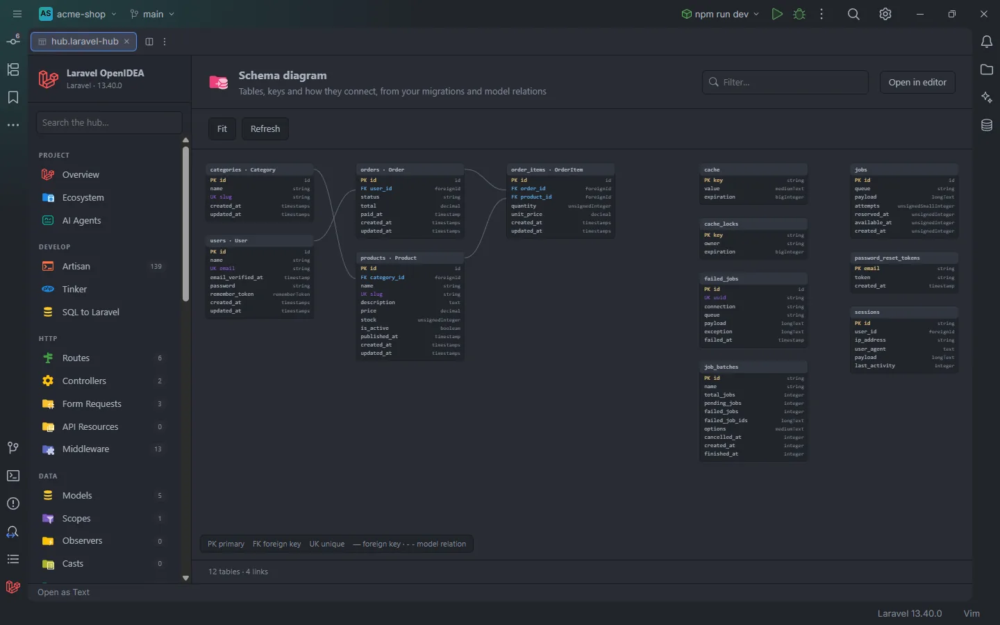

# Schema diagram

Every table your migrations create, drawn as a box with its columns and keys, linked to the tables it points at. Foreign keys come from the migrations; model relations that have no foreign key are drawn too, dashed. Pan, zoom, filter, and click a table to open its migration.

Tables linked by foreign keys on the left, tables without links on the right

## How to use it

Click **Schema diagram** under **Data** in the sidebar, or open `storage/openidea/hub/diagram.laravel-hub`.

- **Drag** the background to move around, and **scroll** to zoom in and out around the pointer.
- **Fit** zooms so the whole diagram fits the section; it also runs when the diagram first opens.
- **Refresh** reads the migrations and models again.
- Type in **Filter…** to highlight the tables whose name, model or one of whose columns contains the text, and to dim the rest and their links.
- **Hover** a table to highlight its links.
- **Click** a table's title to open the migration that creates it.

## What you see

### Tables

Each box is a table the migrations create (`Schema::create`). The title is the table name, followed by ` · ` and the models that use the table, such as `orders · Order`. Under it, each column with its Blueprint type on the right (`string`, `foreignId`, `timestamps`…), up to 14 columns, then `+3 more`.

| Mark | Meaning | Color |
| --- | --- | --- |
| `PK` | The first column of the primary key: `id()`, the `increments` types, `->primary()` | Warning |
| `FK` | A column with a foreign key | Info |
| `UK` | A column with a single-column unique index | Accent |

### Links

| Line | Meaning |
| --- | --- |
| Solid | A foreign key, from the column's row to the title of the table it references. Hover it to read `orders.user_id → users.id` |
| Dashed | A model relation between two tables that have no foreign key between them, such as a `hasMany` on a column that was never constrained. Hover it to read `Order::tags() hasMany` |

The legend at the bottom left recalls the marks and lines, and the count under the section reads `12 tables · 4 links`.

### Layout

Tables are placed in columns from left to right: tables that no foreign key leaves first, then the tables that point at them, and so on. Tables with no link at all are grouped at the right end. Within a column tables are sorted by name, and a column wraps when it grows taller than the section's proportions allow.

## Details

- Tables, columns, keys and foreign keys are the ones the [Database](Hub-Database.md#where-the-tables-come-from) section reads, with drops and renames followed. A foreign key that points at a table the migrations don't create isn't drawn.
- Models come from the model index: a model's table is its `#[Table]`, its `$table` or the plural of its name ([Eloquent columns and relations](Eloquent-Columns-and-Relations.md)). Relations come from the same index as relation completion.
- Nothing runs in your app, and the live database isn't read.
- With no `Schema::create` in the migrations, the section reads `No table is created by your migrations yet.`

## Settings and permissions

None beyond `project.read`. See [Permissions](Permissions.md).

## Related

- [Database](Hub-Database.md)
- [Models](Hub-Models.md)
- [Eloquent columns and relations](Eloquent-Columns-and-Relations.md)
- [The hub](Hub.md)

---
[← Wiki home](Home.md)
