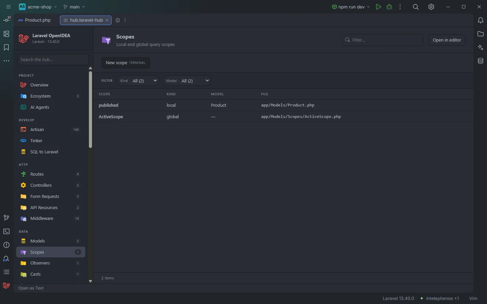

# Scopes

Every query scope of the app: the local scopes of each model and the global scopes with the models they apply to. A click opens the scope.

A local scope and a global scope class

## How to use it

Click **Scopes** under **Data** in the sidebar, or open `storage/openidea/hub/scopes.laravel-hub`. Pick a **Kind** to see only local or global scopes, or a **Model** to see every scope that applies to it.

## What you see

### Columns

| Column | Content |
| --- | --- |
| Scope | The name you call it with (`published` for `scopePublished()` or a `#[Scope] published()` method), the class of a global scope, or the name given to a closure global scope |
| Kind | `local`, `global` or `global (closure)` |
| Model | For a local scope, its model. For a global scope class, the models that apply it, comma separated, or `—` when none was found. For a closure scope, the class that adds it |
| File | The file, relative to the project |

### Facets

**Kind** and **Model** (split, so a global scope applied to several models counts for each).

### Actions

| Button | Command | Mode |
| --- | --- | --- |
| **New scope** | `make:scope` | Terminal |

## Details

### Local scopes

Read from the model index (see [Models](Hub-Models.md#what-is-a-model)): every method named `scope` followed by an upper-case letter, listed with the first letter in lower case, and every method with the `#[Scope]` attribute. A model that extends another model also lists its parent's scopes; they open the parent's file. Local scopes come first in the table.

### Global scopes

From the plugin's token scan of `app/`, `database/factories/`, `database/seeders/`, `routes/` and the bootstrap files:

- A **global scope class** is a class that implements `Scope` or lives in a `/Scopes/` folder.
- Its **models** are the classes with `#[ScopedBy(ActiveScope::class)]` (or `#[ScopedBy([…])]`), and the classes whose code calls `addGlobalScope(new ActiveScope)` or `addGlobalScope(ActiveScope::class)`, usually in `booted()`.
- A call such as `static::addGlobalScope('ancient', function (Builder $builder) { … })` is a `global (closure)` row named `ancient` (or `closure` when the first argument is the closure itself), with the calling class as model. It opens the line of the call.

### Count

The sidebar badge (and the Overview count) is the number of local scopes; global ones are only in the table.

With no scope at all the section reads `Nothing found in this project yet.`

## Settings and permissions

The table needs only `project.read`. **New scope** needs `process:php` or `process:docker`. See [Permissions](Permissions.md).

## Related

- [Scopes in the editor](Scopes.md)
- [Models](Hub-Models.md)
- [Eloquent chains](Eloquent-Chains.md)
- [Gutter usages](Gutter-Usages.md)
- [The hub](Hub.md)

---
[← Wiki home](Home.md)
