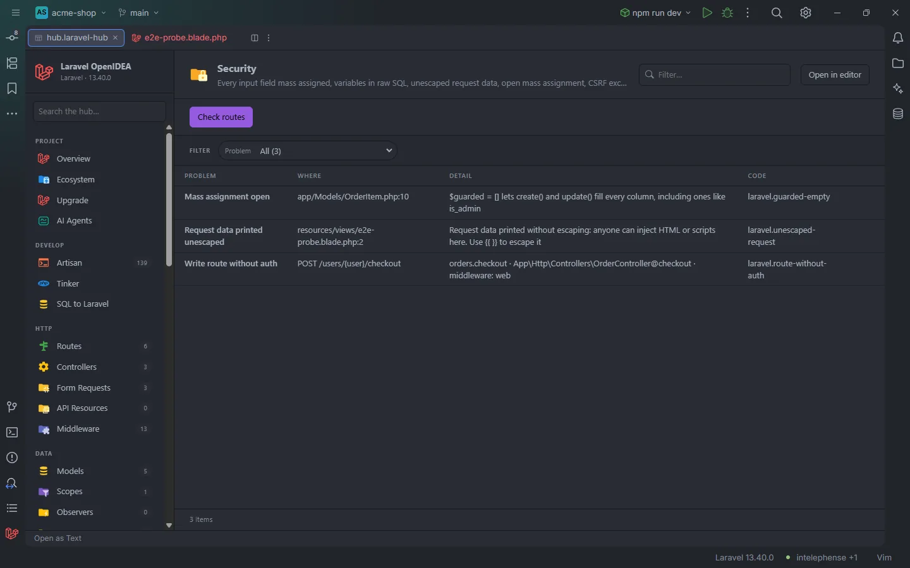

# Security

One table with the security problems the plugin finds in the whole project: every input field mass assigned, variables in raw SQL, request data printed unescaped in Blade, models open to mass assignment and routes excluded from the CSRF check. **Check routes** adds the POST, PUT, PATCH and DELETE routes that have no auth middleware.

Three findings, the last one from <strong>Check routes</strong>

## How to use it

Click **Security** under **App** in the sidebar, or open `storage/openidea/hub/security.laravel-hub`. Pick a **Problem** to see one kind, and click a row to open the line.

## What you see

### Columns

| Column | Content |
| --- | --- |
| Problem | The kind of finding (see below) |
| Where | `file:line`, or the method and URI of a route |
| Detail | What is wrong and how to fix it |
| Code | The diagnostic code, the same as in the editor when there is one |

| Problem | Code | Found in |
| --- | --- | --- |
| **Every input field mass assigned** | `laravel.mass-assign-input` | `$request->all()` passed to `create()`, `update()`, `fill()` and the like ([details](Inspection-Security.md)) |
| **Variable in raw SQL** | `laravel.raw-sql-variable` | A variable in `whereRaw()`, `DB::select()` and the other raw SQL calls ([details](Inspection-Security.md)) |
| **Request data printed unescaped** | `laravel.unescaped-request` | `{!! request('q') !!}` and similar in Blade ([details](Inspection-Security.md)) |
| **Mass assignment open** | `laravel.guarded-empty`, `laravel.unguard` | `protected $guarded = [];` in a class, or a `Model::unguard()` call |
| **CSRF check skipped** | `laravel.csrf-except` | Each URI in `$middleware->validateCsrfTokens(except: [...])` (`bootstrap/app.php`) or in the `$except` array of `VerifyCsrfToken` |
| **Write route without auth** | `laravel.route-without-auth` | **Check routes** only |

### Facets

**Problem**.

### Check routes

**Check routes** runs `php artisan route:list --json` and lists the routes that accept POST, PUT, PATCH or DELETE and have no middleware starting with `auth`, `can:`, `signed`, `guest`, `ability`, `abilities`, `role` or `permission`, nor an `Authenticate`, `Authorize`, `ValidateSignature` or `RedirectIfAuthenticated` class. **Where** shows the methods and URI, **Detail** the name, the action and the middleware it has. Routes of packages and the framework (`sanctum.*`, `livewire.*`, `storage.*`, `horizon.*`, `telescope.*`, `filament.*`, `pulse.*`, `ignition.*`, `boost.*`, `passport.*`) are left out.

Not every one is a mistake: a webhook or a public form may be open on purpose. When none is found, a message says that every write route has an auth, guest, can or signed middleware. `route:list --json` needs Laravel 9 or newer.

## Details

- The table reads PHP files under `app/` and `routes/`, `bootstrap/app.php` and Blade views under `resources/views/` (up to 20,000 per folder), from disk, each time the section opens.
- The code checks are the [security inspections](Inspection-Security.md), with the same rules. They show here even when `securityInspection` is off.
- Nothing runs in the app except **Check routes**.

## Settings and permissions

The table needs only `project.read`. **Check routes** runs Artisan with the project's runner and needs `process:php` or `process:docker`. See [Permissions](Permissions.md).

## Related

- [Security inspections](Inspection-Security.md)
- [Routes](Hub-Routes.md)
- [The hub](Hub.md)

---
[← Wiki home](Home.md)
