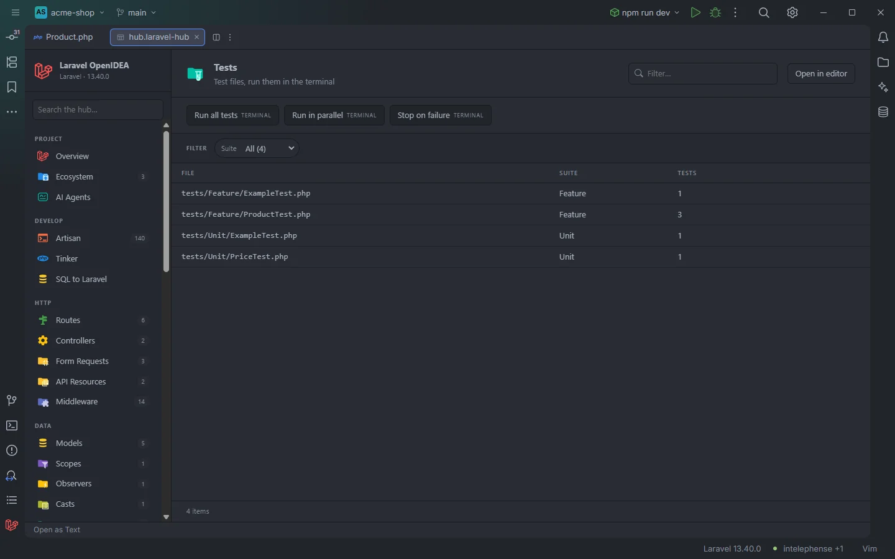

# Tests

The **Tests** section lists the project's test files with their suite and number of tests, and runs the test suite in an IDE terminal.

Four test files and the run buttons

## How to use it

Open the hub and pick **Tests** in the **Run** group of the sidebar.

- Click a row to open the test file.
- Use **Suite** to list only `Feature` or `Unit` tests, and sort by **Tests** to find the biggest files.
- Use the toolbar to run the whole suite.

Search, filters, sorting and paging are described in [The hub](Hub.md).

## What you see

| Column | Content |
| --- | --- |
| **File** | The test file, relative to the project root. |
| **Suite** | The folder right under `tests/`: `Feature`, `Unit`, `Browser`… |
| **Tests** | The number of tests counted in the file (see below). |

Rows are sorted by path. A file with no test in it (`tests/TestCase.php`, `tests/Pest.php`) is not listed.

### How tests are counted

The count adds up, in the file's text:

| Pattern | Style |
| --- | --- |
| `public function test` | PHPUnit methods named `test…` |
| `#[Test]` | PHPUnit attribute |
| `test(` at the start of a line | Pest |
| `it(` at the start of a line | Pest |

Pest tests indented inside `describe()` blocks, `/** @test */` annotations and dataset rows are not counted, so the number can be lower than what PHPUnit or Pest reports.

### Filters

| Filter | Values |
| --- | --- |
| **Suite** | Each suite folder, with its number of files. |

### Toolbar buttons

| Button | Runs | Where |
| --- | --- | --- |
| **Run all tests** | `php artisan test` | Terminal |
| **Run in parallel** | `php artisan test --parallel` | Terminal |
| **Stop on failure** | `php artisan test --stop-on-failure` | Terminal |

Each button opens an IDE terminal tab titled with the command (`artisan test --parallel`). `--parallel` needs `brianium/paratest` in the project. In OpenIDEA 0.1.40 a terminal tab closes when its process exits, so the results disappear with it once the run ends; running `test` from the [Artisan](Hub-Artisan.md) section with *Show output here* keeps the output in the drawer. See [The hub](Hub.md).

## Details

- **Data source:** every file under `tests/**/*.php` (up to 20,000), read each time the section opens. No PHP is run to build the table.
- The section runs the whole suite; to run one file or one test, use [Run configurations](Run-Configurations.md) or the [Artisan](Hub-Artisan.md) form for `test` with `--filter`.
- Each row opens the file at line 1.
- Empty state: *Nothing found in this project yet.* when no file under `tests/` contains a test.

## Settings and permissions

The table needs only the required permissions. The buttons run Artisan and need `process:php` or `process:docker`; with Docker Compose the tests run in the configured service. See [Settings](Settings.md) and [Permissions](Permissions.md).

## Related

- [The hub](Hub.md)
- [Run configurations](Run-Configurations.md)
- [Pest](Pest.md): datasets and groups
- [phpunit.xml](PHPUnit-Xml.md)
- [Routes](Hub-Routes.md): the tests that hit each route

---
[← Wiki home](Home.md)
