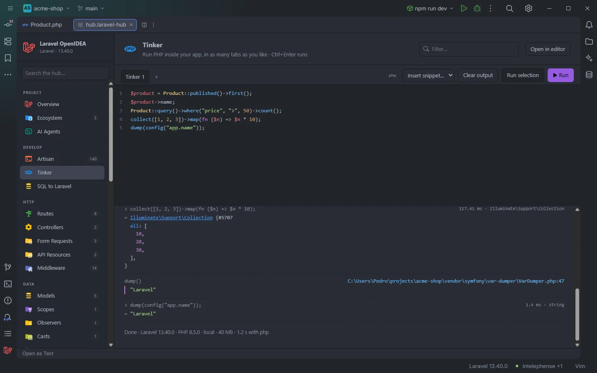
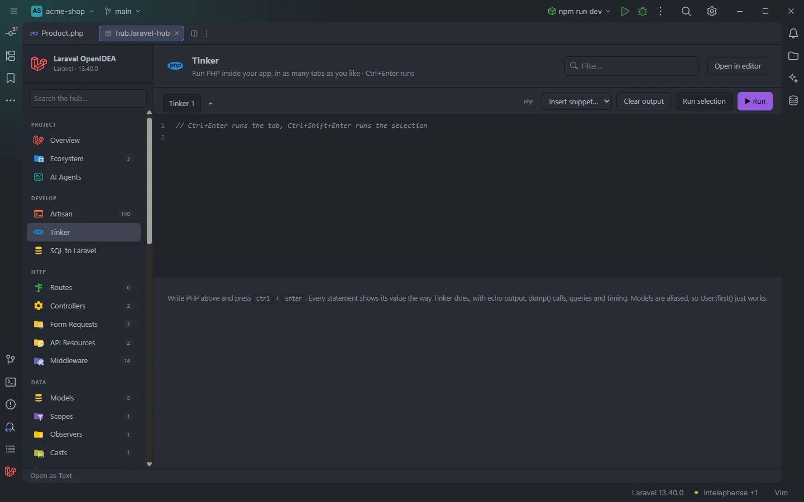
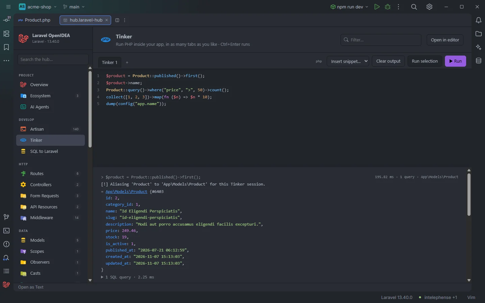

# Tinker

PHP that runs inside your booted Laravel app, written in tabs with PHP highlighting. Each statement gets its own result the way `artisan tinker` presents it, with echo output, `dump()` calls, the SQL it ran and its timing, and errors link to the line that threw.

<p align="center"></p>
<p align="center"><sub>A run with a collection, a <code>dump()</code> and the summary line</sub></p>

## How to use it

1. Click **Tinker** under **Develop** in the sidebar.
2. Write PHP in the editor. No `<?php` is needed, and model classes work by their short name.
3. Press **Ctrl+Enter** (Cmd+Enter on macOS) or click **▶ Run** to run the whole tab.
4. Select some lines and press **Ctrl+Shift+Enter** or click **Run selection** to run only them. Without a selection, both run the whole tab.

```php
$product = Product::published()->first();
$product->name;
Product::query()->where('price', '>', 50)->count();
collect([1, 2, 3])->map(fn ($n) => $n * 10);
dump(config('app.name'));
```

<p align="center"></p>
<p align="center"><sub>A tab before running anything</sub></p>

## What you see

### Tabs and toolbar

- One tab per scratch file: **Tinker 1**, **Tinker 2**… **+** adds a tab, **×** closes one (shown when there is more than one), and a double-click renames it (up to 40 characters). A tab that is running shows a pulsing dot.
- On the right: the runner badge (`php`, `docker compose run --rm app`…), **Insert snippet…**, **Clear output**, **Run selection** and **▶ Run**.
- The tabs, their code and the active tab are saved in the plugin's storage half a second after each change, so they come back after a restart. Output isn't saved.
- A new hub starts with one tab that holds a comment about the shortcuts, `$users = User::count();` and `config('app.name');`.

### The editor

- PHP highlighting for keywords, strings, variables, numbers, comments, class names and function calls, with line numbers.
- **Tab** inserts four spaces. **Enter** keeps the indentation of the line and adds four spaces after `{`, `[` or `(`.
- The bar between the editor and the output can be dragged to give either side between 15% and 85% of the height.

**Insert snippet…** adds one of these on a new line at the cursor:

| Snippet | Code |
| --- | --- |
| First user | `User::first();` |
| Count models | `User::count();` |
| Latest 5 | `User::latest()->take(5)->get(['id', 'created_at']);` |
| Raw query | `DB::select('select 1 as ok');` |
| Query log | `DB::enableQueryLog();`, `User::first();`, `DB::getQueryLog();` |
| Config value | `config('app.name');` |
| Env | `app()->environment();` |
| Routes | `collect(Route::getRoutes())->map(fn ($r) => $r->uri())->take(20);` |
| Cache | `Cache::remember('openidea', 60, fn () => now());` |
| Dispatch event | `event('openidea.ping', ['at' => now()]);` |
| Fake a factory | `User::factory()->make();` |
| Str helpers | `str('Laravel OpenIDEA')->slug();` |

### The output

Before the first run the output pane explains the shortcuts. While running it shows `Running with php…` (or the Docker runner). Then, for each statement:

- `> ` and the statement, with `12.4 ms · 1 query · App\Models\Product` on the right: its time, the number of queries and the type of its value.
- What it printed (`echo`, `print`), in the brighter text colour.
- `= ` and the value, presented like Tinker does, in colour: models show their attributes, collections their items.
- A `dump()` block with a purple bar and a link to a file and line: the first frame of the call stack outside `vendor/`. On Windows, where paths use backslashes, the link can point at `vendor\symfony\var-dumper` instead, as in the screenshot.
- An error block with the exception's short class name and message, a link to the file and line, and up to 6 frames of the trace (leaving out PsySH and the evaluated code), each frame clickable.
- `▶ 1 SQL query · 2.25 ms`: click to expand every query with its bindings filled in and its time.

<p align="center"></p>
<p align="center"><sub>A model result, the alias notice and the collapsed SQL</sub></p>

The run ends with `Done · Laravel 13.40.0 · PHP 8.5.0 · local · 40 MB · 1.2 s with php`: the framework and PHP versions inside the app, the environment, peak memory and the total time with the runner. When the app can't boot, the output is a single error with the exception and the file and line that failed. Anything else printed on stderr (warnings, notices) appears in a red block at the end; Docker's own `Container …`, `Network …` and `Pulling` lines are left out. A run with nothing to show says `No output.`

**Clear output** empties the output of the current tab.

## Details

- Each run starts a new PHP process with the project's runner and passes your code on stdin. Variables live for one run: statements of the same run share them, the next run starts fresh.
- The script loads `vendor/autoload.php` and `bootstrap/app.php` and bootstraps the console kernel, like `artisan tinker`.
- When PsySH is installed (it comes with `laravel/tinker`), statements run in a PsySH shell with Laravel Tinker's casters for collections, models, the application, stringables, HTML strings and process results, and Tinker's class alias loader (honouring `tinker.alias` and `tinker.dont_alias` in config). That is what prints `[!] Aliasing 'Product' to 'App\Models\Product' for this Tinker session.` Without PsySH each statement is evaluated with `eval`.
- On top of that, a short class name such as `Product` resolves to `App\Models\Product` or `App\Product` when the file exists under `app/`, even before `composer dump-autoload`.
- The code is split into statements at the top-level `;`. A block statement (`if`, `foreach`, `for`, `while`, `switch`, `try`, `function`, `class`, `enum`, `interface`, `trait`, `do`…) ends at its closing brace, unless `else`, `elseif`, `catch`, `finally` or `while` follows.
- Statements that start with `echo`, `print`, `unset`, `use`, `namespace`, `function`, `class`, `enum`, `interface`, `trait`, `if`, `foreach`, `for`, `while`, `switch` or `try` show no `=` value.
- The run stops at the first statement that throws.
- Queries are captured with `DB::listen`; object bindings show as their class name.
- Error and dump links map container paths (`/var/www/html/app/…`) back to the project file.
- **SQL to Laravel**'s run button opens a new tab named `SQL <n>` with the generated code and runs it right away (see [SQL to Laravel](Hub-SQL-to-Laravel.md)).
- This is real code against your real database: writes are written. The header has no **Filter…** box on this page.

## Settings and permissions

| Setting | Effect |
| --- | --- |
| `artisanRunner`, `dockerService` | Where the code runs: php on your machine, a throwaway Compose container (`run --rm`) or the running one (`exec`) |

Running needs `process:php` (on Windows, `process:php-win` avoids a console window) or `process:docker`. Saving tabs needs `storage`. See [Settings](Settings.md) and [Permissions](Permissions.md).

## Related

- [Run Selection in Tinker](Run-Selection-in-Tinker.md)
- [SQL to Laravel](Hub-SQL-to-Laravel.md)
- [Artisan](Hub-Artisan.md)
- [AI agents and MCP](AI-Agents.md) (`run_tinker`)
- [The hub](Hub.md)

---
[← Wiki home](Home.md)
