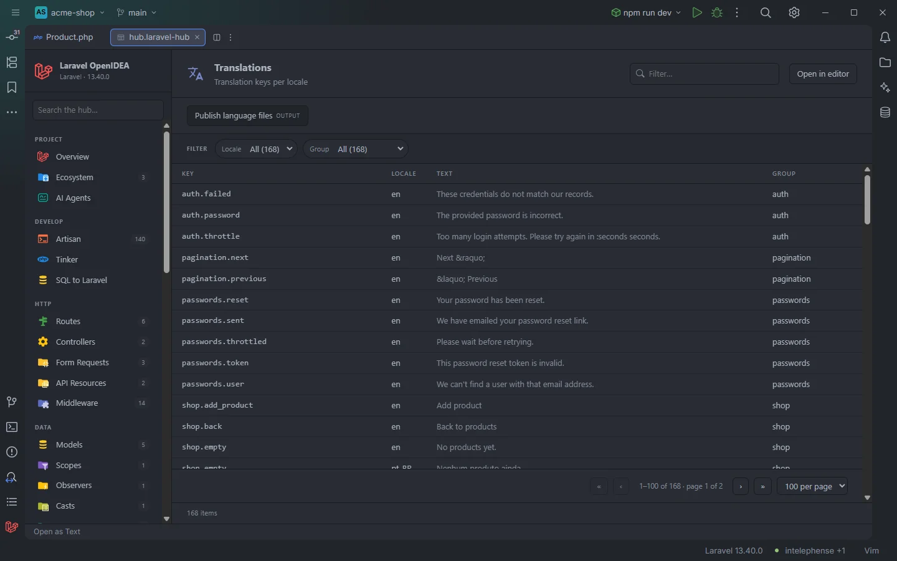

# Translations

The **Translations** section lists every translation key of the project once per locale that defines it, with the translated text. It shows at a glance which locales have a key and what each one says.

168 rows across two locales, paged 100 at a time

## How to use it

Open the hub and pick **Translations** in the **Views** group of the sidebar. The badge shows the number of rows (keys × locales that define them).

- Click a row to open the translation file at the key.
- Type in **Filter…** to search keys, locales and texts: searching for a word finds the keys whose text contains it.
- Use **Locale** to see one language, or **Group** to see one translation file.
- Click a header to sort, for example by **Locale**.

Search, filters, sorting and paging are described in [The hub](Hub.md).

## What you see

| Column | Content |
| --- | --- |
| **Key** | The key as used in `__()`: `auth.failed` for PHP files, the text itself for JSON files. Keys inside nested arrays are dotted: `validation.custom.email.required`. |
| **Locale** | The locale folder or JSON file name: `en`, `pt_BR`. |
| **Text** | The translated string. Empty for a key whose value is a nested array (its children have their own rows) or anything other than a string literal. |
| **Group** | The file the key lives in: the first segment of a PHP key (`auth`, `shop`), or `json` for keys from `lang/<locale>.json`. |

Rows are sorted by key. When a key exists in several locales, the row of the preferred locale (the `locale` setting, `en` by default) comes first, then the others.

### Filters

| Filter | Values |
| --- | --- |
| **Locale** | Each locale with its number of keys. |
| **Group** | Each translation file, plus `json`. |

### Toolbar buttons

| Button | Runs | Where the output goes |
| --- | --- | --- |
| **Publish language files** | `php artisan lang:publish` | Output drawer (*OUTPUT*) |

Recent Laravel skeletons ship without a `lang/` folder; `lang:publish` copies the framework's `auth`, `pagination`, `passwords` and `validation` files into it, and they show up here. The drawer is described in [The hub](Hub.md).

## Details

- **Data source:** the plugin's translation index, the one behind `__()`, `trans()` and `@lang` completion. It reads:
  - `lang/<locale>/**/*.php` and `resources/lang/<locale>/**/*.php`. A file in a sub-folder gets a dotted prefix: `lang/en/admin/users.php` gives `admin.users.*`.
  - `lang/<locale>.json` and `resources/lang/<locale>.json` (top-level keys only).
  - `lang/vendor/` (package overrides) is skipped.
- PHP files are read as source, not executed: a literal string or number is shown as written (for a concatenation, only its first literal), and a value that starts with a function call shows an empty text.
- **Group** is `json` for a key that contains a space or has no dot. A JSON key written like a PHP key (`"auth.failed"` in `en.json`) is grouped under its first segment.
- Up to 5,000 files are read per pattern, and the section shows at most 5,000 rows.
- The index is rebuilt when a file under `lang/` or `resources/lang/` changes. The `locale` setting is read when the plugin starts, so a new value changes the order after the plugin (or the IDE) restarts.
- Each row opens the file at the key.
- Empty state: *Nothing found in this project yet.* when the project has no translation files.

## Settings and permissions

| Setting | Effect here |
| --- | --- |
| `locale` (*Preferred translation locale*, default `en`) | The locale listed first for each key. |

The table only needs the required permissions; **Publish language files** runs Artisan and needs `process:php` or `process:docker`. See [Settings](Settings.md) and [Permissions](Permissions.md).

## Related

- [The hub](Hub.md)
- [Translations in the editor](Translations.md): completion, Ctrl+click and the add-translation quick fix
- [Rename translation](Rename-Translation.md)
- [Front-end files](Frontend-Files.md): translation keys in JavaScript and TypeScript

---
[← Wiki home](Home.md)
