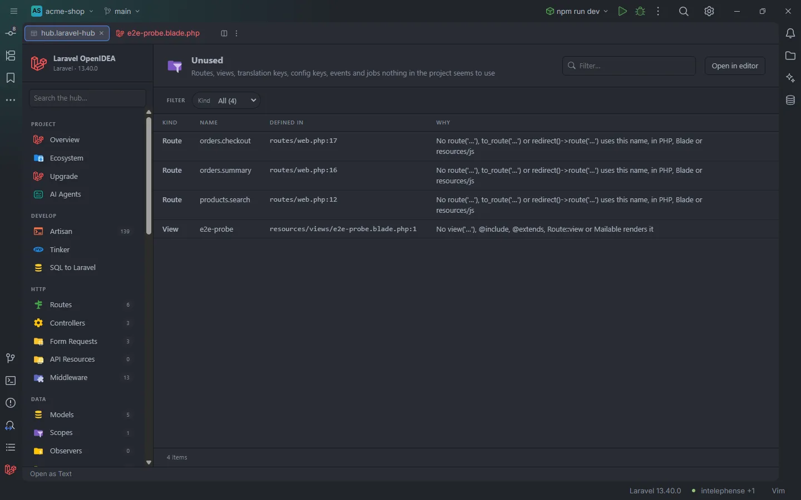

# Unused

Named routes, views, translation keys, config keys, events and jobs that nothing in the project seems to use. Each row says why it looks unused and opens the place it is defined, so you can check it and delete it.

Three named routes no code refers to, and a view nothing renders

## How to use it

Click **Unused** under **App** in the sidebar, or open `storage/openidea/hub/unused.laravel-hub`. Pick a **Kind** to see one kind of item. Treat each row as a lead, not a verdict: a name built at runtime, a route called from another app or a view rendered by a package can't be seen.

## What you see

| Column | Content |
| --- | --- |
| Kind | `Route`, `View`, `Translation`, `Config key`, `Event` or `Job` |
| Name | The route name, view name, key or class |
| Defined in | `file:line` where it is defined |
| Why | What was looked for and not found |

### Facets

**Kind**.

## Details

### What counts as a use

The plugin reads every PHP file under `app/`, `routes/`, `database/`, `tests/` and `config/`, `bootstrap/app.php`, every Blade view, and JavaScript, TypeScript, Vue and Svelte files under `resources/js/`. It collects the strings that [completion](Route-Names.md) understands: route names in `route()`, `to_route()`, `redirect()->route()`, `URL::route()`; views in `view()`, `@include`, `@extends`, `@component`, `Route::view()`, Mailables and the rest; translation keys in `__()`, `trans()`, `@lang`; config keys in `config()` and `Config::get()`. Blade `<x-…>` tags count as uses of `components.…` views. In `resources/js/`, `route('…')`, `__('…')`, `trans('…')` and `$t('…')` count.

A string built from a prefix and a variable (`route('orders.'.$action)`, `` route(`orders.${x}`) ``, `__("shop.status.$s")`) counts as a use of every name that starts with the prefix.

### Per kind

| Kind | Listed when | Left out |
| --- | --- | --- |
| **Route** | A named route of the app that no use names | Routes from `bootstrap/cache/` and `vendor/`; `login`, `logout`, `register`, `home`, `dashboard` and the `password.*` and `verification.*` names Laravel uses itself; package prefixes (`sanctum.`, `livewire.`, `storage.`, `horizon.`, `telescope.`, `filament.`, `pulse.`, `ignition.`, `boost.`, `passport.`) |
| **View** | A view of the app that no use names | Namespaced views (`mail::…`), `errors.*`, `vendor.*`, `mail.*`; `pages.*` when Laravel Folio is installed |
| **Translation** | A key that no use names, and no use names a key under it | The `auth`, `pagination`, `passwords` and `validation` groups, which the framework reads; keys that have children (their children are listed instead) |
| **Config key** | A top-level key (`shop.currency`) of a config file of your own that nothing reads, alone or under it, and nothing reads the whole file (`config('shop')`) | The files of Laravel and common packages (`app`, `auth`, `database`, `queue`, `services`, `horizon`, `livewire`… 52 names) |
| **Event** | An event class of the app with no listener (the [Events](Hub-Events.md) section shows 0) | Broadcast events, which the frontend may listen to |
| **Job** | A queued job class (not a Mailable, notification or listener) that no other file names | |

Jobs are matched by class name through the same index as [gutter usages](Gutter-Usages.md), so a job named only in a comment or a string doesn't count as used.

### Reading and freshness

The files are read each time the section opens, as a background task (*Laravel: looking for unused code*). The indexes are the ones completion uses.

## Settings and permissions

Only `project.read`. Nothing runs in your app.

## Related

- [Routes](Hub-Routes.md), [Views](Hub-Views.md), [Translations](Hub-Translations.md), [Config](Hub-Config.md), [Events](Hub-Events.md), [Queues & Workers](Hub-Queues.md)
- [The hub](Hub.md)

---
[← Wiki home](Home.md)
