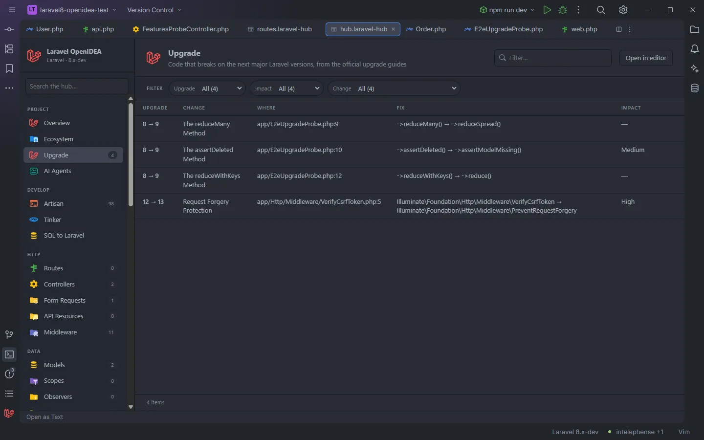

# Upgrade

Code that breaks on each major Laravel version after the one installed, from the official upgrade guides: every match with the version that breaks it, the section of the guide, the line and the replacement. It turns an upgrade guide into a to-do list for your project.

A Laravel 8 project: what breaks on 9, and further on

## How to use it

Click **Upgrade** under **Project** in the sidebar, or open `storage/openidea/hub/upgrade.laravel-hub`. Pick an **Upgrade** step to see what the next version needs, and click a row to open the line. In the editor the same code is underlined for the next version ([Upgrade inspection](Inspection-Upgrade.md)), with a quick fix for plain renames.

## What you see

### Columns

| Column | Content |
| --- | --- |
| Upgrade | The step that breaks it: `8 → 9`, `12 → 13` |
| Change | The section of that version's upgrade guide |
| Where | `file:line` |
| Fix | `old → new`, as the guide writes it, or `… was removed` |
| Impact | The guide's impact: High, Medium, Low, Very Low, or `—` when the guide gives none |

Rows are sorted by version, then by file and line.

### Facets

**Upgrade**, **Impact** and **Change**.

### The rules

| Step | Guide | Rules |
| --- | --- | --- |
| 6 → 7 | [laravel.com/docs/7.x/upgrade](https://laravel.com/docs/7.x/upgrade) | 10: `Blade::component`, `addHidden`/`addVisible`, `Json\Resource`, the testing `TestResponse` and `Assert` classes, the Swift Mailer bindings, the exception handler signatures |
| 7 → 8 | [laravel.com/docs/8.x/upgrade](https://laravel.com/docs/8.x/upgrade) | 9: `retryAfter`, `timeoutAt`, `allOnQueue`/`allOnConnection`, `elixir()`, `Mail::sendNow`, `decodeResponseJson`, `castUsing()` |
| 8 → 9 | [laravel.com/docs/9.x/upgrade](https://laravel.com/docs/9.x/upgrade) | 12: `reduceWithKeys`, `reduceMany`, `registerCustomDoctrineType`, `assertDeleted`, the Swift methods, Fideloper's TrustProxies and `HEADER_X_FORWARDED_ALL`, `SerializableClosure`, the handler's `ignore()` |
| 9 → 10 | [laravel.com/docs/10.x/upgrade](https://laravel.com/docs/10.x/upgrade) | 8: `$dates`, `Bus::dispatchNow`, `dispatch_now`, `Redirect::home`, `expectsEvents`/`expectsJobs`/`expectsNotifications`, `(string) DB::raw` |
| 10 → 11 | [laravel.com/docs/11.x/upgrade](https://laravel.com/docs/11.x/upgrade) | 15: the `unsigned` float types, `isGeometry`, the Doctrine DBAL methods, `Schema::getAllTables`/`Views`/`Types`, `decayMinutes` |
| 11 → 12 | [laravel.com/docs/12.x/upgrade](https://laravel.com/docs/12.x/upgrade) | 2: `HasVersion7Uuids`, `withTablePrefix` |
| 12 → 13 | [laravel.com/docs/13.x/upgrade](https://laravel.com/docs/13.x/upgrade) | 7: `VerifyCsrfToken` and `ValidateCsrfToken` (deprecated aliases of `PreventRequestForgery`), `exceptionOccurred`, the Bootstrap 3 pagination views, `array_first`/`array_last` with `laravel/helpers` |

Only steps from the installed version on are checked: a Laravel 11 project sees 11 → 12 and 12 → 13. When the latest guide is the installed version's (Laravel 13 today), the table is empty.

## Details

- The installed version is read from `composer.lock`. Without it the table is empty.
- The files read and the matching rules are those of the [Upgrade inspection](Inspection-Upgrade.md#details): comments skipped, whole words, and the two conditional rules.
- The rules were taken from the guides' text, keeping only changes a text match finds reliably. Behaviour changes (a default value, a new argument's meaning, a dependency) aren't listed: read the whole guide before upgrading.
- Nothing runs in your app.

## Settings and permissions

Only `project.read`. The `upgradeInspection` setting turns off the editor underlines, not this section.

## Related

- [Upgrade inspection](Inspection-Upgrade.md)
- [Ecosystem](Hub-Ecosystem.md)
- [The hub](Hub.md)

---
[← Wiki home](Home.md)
