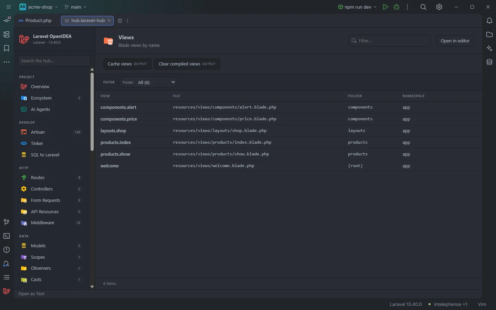

# Views

The **Views** section lists every Blade view of the project under the name you pass to `view()`, with its file and folder. It is the quickest way to find a view by name and open it.

Views in the acme-shop demo, with the view cache buttons above the table

## How to use it

Open the hub and pick **Views** in the **Views** group of the sidebar. The sidebar badge shows how many views the project has.

- Click a row to open the view file.
- Type in the **Filter…** box to keep the rows whose cells contain the text (the view name, the file path or the folder).
- Use the **Folder** and **Namespace** selects to narrow the list, and click a column header to sort.

Search, filters, sorting, paging and *Open in editor* work the same way in every table section. They are described once in [The hub](Hub.md).

## What you see

| Column | Content |
| --- | --- |
| **View** | The dotted view name: `resources/views/products/index.blade.php` is `products.index`. |
| **File** | The file, relative to the project root. |
| **Folder** | Everything before the last dot of the name: `products` for `products.index`, `admin.users` for `admin.users.edit`. A view directly under `resources/views` shows `(root)`. |
| **Namespace** | `app` for the project's own views. |

Rows are sorted by view name. The count under the table reads `6 items`, or `2 of 6 items` while a search or filter is active.

### Filters

| Filter | Values |
| --- | --- |
| **Folder** | Every folder, with the number of views in it. |
| **Namespace** | The namespaces found. |

A filter only appears when its column has at least two different values, so in a project where every view is in the `app` namespace only **Folder** is shown.

### Toolbar buttons

| Button | Runs | Where the output goes |
| --- | --- | --- |
| **Cache views** | `php artisan view:cache` | Output drawer (*OUTPUT*) |
| **Clear compiled views** | `php artisan view:clear` | Output drawer (*OUTPUT*) |

Buttons tagged *OUTPUT* run the command and show its coloured output in the drawer at the bottom of the hub, with *Run again* and *Close*. Hovering a button shows the exact command line. See [The hub](Hub.md) for the drawer and [Artisan](Hub-Artisan.md) for how commands run.

## Details

- **Data source:** the plugin's view index, the same one that completes `view('…')`. It lists every `*.php` file under `resources/views/` (Blade or plain PHP). `.blade.php` is removed first, then `.php`, and `/` becomes `.`. No PHP is run to build the table.
- Component and Livewire views (`resources/views/components/…`, `resources/views/livewire/…`) are views too, so they appear here as `components.alert` and so on. The [Components](Hub-Components.md) section lists them as tags.
- Package views (`vendor/…`, `mail::`, `pagination::`) are not part of the index and are not listed. Because only `resources/views` is read, the **Namespace** column shows `app` for every row.
- Up to 10,000 view files are read, and the section shows at most 5,000 views.
- The index is rebuilt when a file under `resources/views/` is created, changed or deleted, so the table is current the next time you open the section.
- Each row opens its file at line 1.
- Empty states: *Nothing found in this project yet.* when the project has no views, *No match for "…"* when the search hides every row, and *No item matches the filters.* when the selects do.

## Settings and permissions

The table only needs the plugin's required permissions. The two buttons run Artisan, which needs `process:php` (or `process:docker` when Artisan runs through Docker Compose); without it the drawer shows *Allow "process:php" for Laravel OpenIdea in Settings › Plugins to run Artisan with php*. The `artisanRunner` and `dockerService` settings decide how Artisan runs. See [Settings](Settings.md) and [Permissions](Permissions.md).

## Related

- [The hub](Hub.md)
- [Views in the editor](Views.md): completion and Ctrl+click for `view()`, `@include` and friends
- [Unknown views](Inspection-Unknown-Views.md)
- [Components](Hub-Components.md)
- [Blade](Blade.md)

---
[← Wiki home](Home.md)
