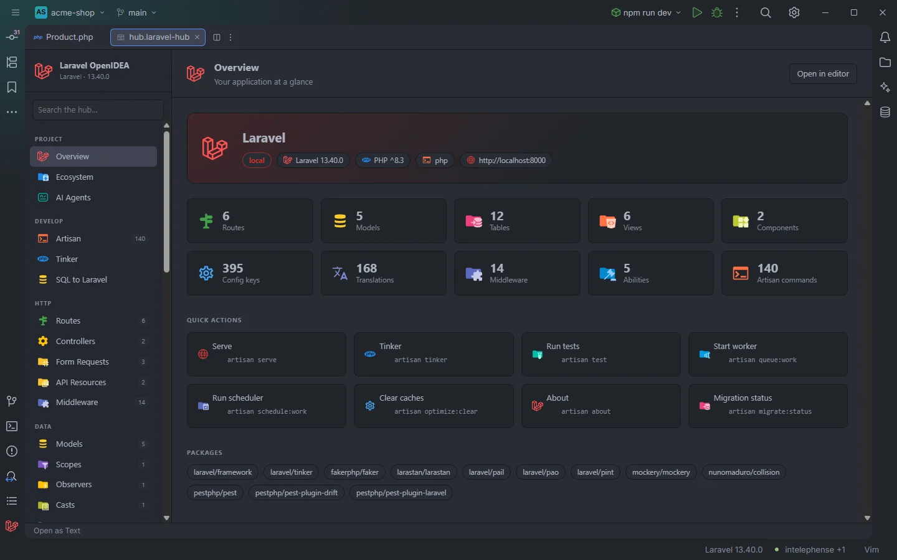
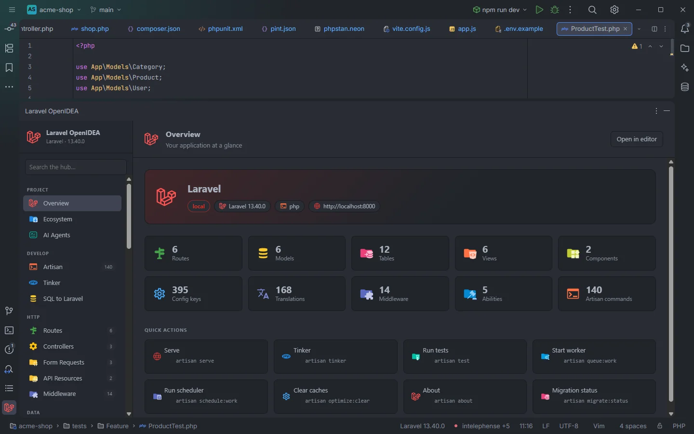
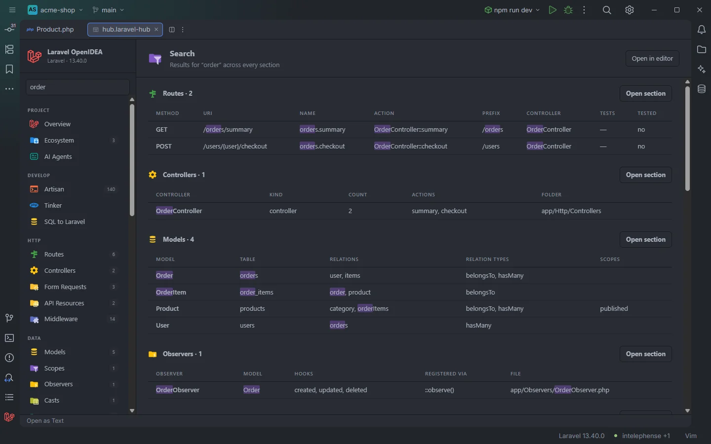

# The hub

The Laravel OpenIDEA hub is a page with 43 sections that shows your application from the inside: Artisan and Tinker, routes, models, the database, cache keys, config, queues, events, logs, a Live Audit recorder and more. Every table row opens the file it comes from, and every section can live in the bottom tool window or in its own editor tab.

The hub in an editor tab, on its Overview section

## How to use it

### Open the hub

There are three ways in:

| Where | What it opens |
| --- | --- |
| The **Laravel** icon at the bottom of the left tool bar | The **Laravel OpenIDEA** tool window, docked at the bottom of the window |
| **Laravel: Open the Hub in an Editor Tab** (command palette, see [Commands](Commands.md)) | The whole hub in an editor tab, on the Overview section |
| **Open in editor**, the button in the top right corner of every section | The current section in its own editor tab (the whole hub when you are on Overview) |

The hub as the bottom tool window

The tool window and the editor tabs run the same page. Each tab is its own copy with its own state (section, filter text, facets, sorting, page, Tinker output), so you can drag a tab into a split and keep, say, Routes next to Models.

### The `.laravel-hub` files

An editor tab of the hub is a small file in `storage/openidea/hub/`, opened by the plugin's custom editor for the `*.laravel-hub` pattern:

- `hub.laravel-hub` opens the whole hub on Overview.
- `<section>.laravel-hub` (for example `routes.laravel-hub`, `cache.laravel-hub`) opens that section. There is one file for each of the 43 sections.
- `sections` lists the expected files. When it matches, nothing is rewritten.

The files are written by a small PHP script run with the project's runner (php or Docker Compose), because the plugin itself can only read the project. This happens when you focus an editor in a Laravel project, and again (forced) when you use **Open in editor** or **Laravel: Open the Hub in an Editor Tab**. The script creates `storage/openidea/` with a `.gitignore` that ignores everything in it, removes `.laravel-hub` files of sections that no longer exist, and only rewrites a file whose content changed. Each file holds a single line such as `{"section":"routes"}`. The files have the Laravel file icon in the project tree.

If the files can't be written, the editor-tab actions report `The hub tab files couldn't be written to storage/openidea/hub: …` with the reason, for example `allow process:php for Laravel OpenIDEA in Settings › Plugins`. After a failed automatic attempt, the plugin waits for an explicit **Open in editor** before trying again in the same session.

**Open as Text**, the link the IDE shows under a custom editor, opens the `.laravel-hub` file as plain text; you will only see that one JSON line.

## What you see

### The sidebar

The left column shows **Laravel OpenIDEA** with your app name and Laravel version under it (`APP_NAME · 13.40.0`), the **Search the hub…** box and the sections in nine groups:

| Group | Sections |
| --- | --- |
| Project | [Overview](Hub-Overview.md), [Ecosystem](Hub-Ecosystem.md), [AI Agents](Hub-AI-Agents.md) |
| Develop | [Artisan](Hub-Artisan.md), [Tinker](Hub-Tinker.md), [SQL to Laravel](Hub-SQL-to-Laravel.md) |
| HTTP | [Routes](Hub-Routes.md), [Controllers](Hub-Controllers.md), [Form Requests](Hub-Form-Requests.md), [API Resources](Hub-API-Resources.md), [Middleware](Hub-Middleware.md) |
| Data | [Models](Hub-Models.md), [Scopes](Hub-Scopes.md), [Observers](Hub-Observers.md), [Casts](Hub-Casts.md), [Enums](Hub-Enums.md), [Database](Hub-Database.md), [Cache](Hub-Cache.md), [Factories & Seeders](Hub-Factories.md) |
| Views | [Views](Hub-Views.md), [Components](Hub-Components.md), [Frontend](Hub-Frontend.md), [Translations](Hub-Translations.md) |
| App | [All Classes](Hub-Classes.md), [Service Providers](Hub-Providers.md), [Container Bindings](Hub-Bindings.md), [Validation Rules](Hub-Rules.md), [Macros](Hub-Macros.md) |
| Configure | [Config](Hub-Config.md), [Environment](Hub-Environment.md), [Drivers & Connections](Hub-Drivers-and-Connections.md), [Auth & Policies](Hub-Auth-and-Policies.md) |
| Run | [Queues & Workers](Hub-Queues.md), [Scheduling](Hub-Scheduling.md), [Events](Hub-Events.md), [Listeners](Hub-Listeners.md), [Mail & Notifications](Hub-Mail.md), [Tests](Hub-Tests.md) |
| Observe | [Live Audit](Hub-Live-Audit.md), [Logs](Hub-Logs.md), [Profiles](Hub-Profiles.md), [Debug Calls](Hub-Debug-Calls.md), [Debug Tools](Hub-Debug-Tools.md) |

The badge next to a section is its size. Routes, Controllers, Form Requests, API Resources, Middleware, Models, Scopes, Observers, Casts, Enums, Database (tables), Factories & Seeders, Views, Components, Translations, All Classes, Service Providers, Container Bindings, Validation Rules, Macros, Config, Auth & Policies (abilities), Events and Listeners get their count with the Overview, and Artisan shows the number of commands. The other sections show a badge once you have opened them, with the number of rows they loaded. The Scopes badge counts local scopes only, while the section also lists global ones.

### The header

Every section has a header with its icon, title and a one-line description, a **Filter…** box and the **Open in editor** button. The filter box is hidden on Overview, Tinker, SQL to Laravel, AI Agents, the search results and a model's detail page; **Open in editor** is hidden on the search results and on a model's detail page.

### Tables

Most sections are a table. Under the header there may be:

1. **Action buttons**, the Artisan commands that fit the section, each tagged **OUTPUT** or **TERMINAL** (see [Actions](#actions-output-and-terminal)).
2. The **Filter** bar with one drop-down per facet.
3. The table, with sortable column headers.
4. A pager when there are more than 50 rows.
5. A count line at the bottom: `12 items` (`1 item` for a single row), or `3 of 12 items` while a filter is active.

Columns that hold code (URIs, keys, files, actions, migrations…) use the editor's monospace font, and long lists (fields, relations, hooks, cases, listeners…) wrap instead of being cut. In Routes, the method is a coloured badge: green for GET and HEAD, blue for POST, orange for PUT and PATCH, red for DELETE and purple for anything else.

## Search the whole hub

The **Search the hub…** box at the top of the sidebar searches 32 table sections at once: Routes, Controllers, Form Requests, API Resources, Middleware, Models, Scopes, Observers, Casts, Enums, Database, Factories & Seeders, Views, Components, Frontend, Translations, All Classes, Service Providers, Container Bindings, Validation Rules, Macros, Config, Environment, Drivers & Connections, Auth & Policies, Queues & Workers, Scheduling, Events, Listeners, Mail & Notifications, Tests and Debug Calls.

Searching the whole hub for “order”

- The search starts 350 ms after you stop typing and needs at least 2 characters. Clearing the box (or leaving fewer than 2 characters) goes back to Overview.
- Matching is a case-insensitive substring match against every cell of every row, and matches are highlighted.
- The page is titled **Search** with `Results for “order” across every section`. First come buttons for the sections whose name or description contains the text, then one group per section with matches: `Routes · 2`, the section's columns and its first 6 matching rows.
- Each group has **Open section**, or **Show all 14** when there are more matches than shown. Both open the section with the same text in its filter box.
- Rows open their file like in the section itself.
- Nothing found shows `Nothing in the hub matches “…”.`

The first search builds every searchable table (the IDE shows the task **Laravel: indexing the hub for search**) and keeps them until a file of the project is saved or changes on disk; the next searches only scan those tables.

## Filter, facets and sorting

**The filter box.** Typing in **Filter…** keeps the rows where any cell contains the text, ignoring case, and highlights it. It goes back to the first page. Artisan, Logs, Live Audit and Cache use the box in their own way (described on their pages).

**Facets.** Most sections declare facet columns (Method, Prefix, Controller, Kind, Folder, Year, Locale…). Each facet is a drop-down labelled with its column:

- `All (n)` keeps every row; each value shows how many rows have it, most frequent first, then alphabetical. A drop-down lists at most 400 values.
- Counts follow the filter text and the other facets, so they always say what you would get.
- A facet with fewer than 2 distinct values is hidden, unless it is the one you selected.
- Some facets split their cells: a value is counted for each item of a comma- or `|`-separated list. In Models, the **Relation types** facet finds every model with a `belongsTo` even when the cell reads `belongsTo, hasMany`.
- A selected facet is highlighted, and **Clear filters** removes them all.
- Facets stay selected when you leave the section and come back during the same session; the filter text is cleared.

The **Filter** label shows even when no facet has enough values to be offered.

**Sorting.** Click a column header to sort ascending (▲), again for descending (▼), a third time to go back to the original order. When both cells are numbers they compare as numbers; otherwise the comparison is natural (`file2` before `file10`) and ignores case. Sorting goes back to the first page and is remembered per section during the session.

## Paging

Tables, Logs, Live Audit and Cache show 100 rows per page. With more than 50 rows a pager stays at the bottom of the section:

- `«` first page, `‹` previous, `›` next, `»` last.
- `1–100 of 250 · page 1 of 3`.
- A rows-per-page drop-down: **50**, **100**, **200** or **500 per page**. Changing it goes back to the first page.

Searching, filtering and sorting go back to the first page, and moving to another page scrolls back to the top.

## How rows open files

A row with a file shows **Open ›** when you hover it, and its tooltip is the target as `path:line`. Clicking the row opens the file at that line, usually the declaration: the controller method of a route, the `Schema::create` of a table, the class line of a controller, the `definition()` of a factory.

- Paths are matched to the project. A path from inside a Docker container, such as `/var/www/html/app/Models/User.php`, is mapped to `app/Models/User.php` by looking for `app/`, `routes/`, `config/`, `database/`, `resources/`, `vendor/`, `bootstrap/`, `tests/`, `lang/` or `public/` in it.
- A path that isn't a file of the project shows `… is not a file of this project` in a toast at the bottom right.
- Rows without a file (framework events, packages in Ecosystem…) aren't clickable.
- In Models a click opens the model's detail page instead, and **Open ›** opens the file.

## Actions: output and terminal

The buttons above a table, the Overview quick actions and the Artisan page run Artisan in one of two ways.

**TERMINAL** opens an IDE terminal tab titled with the command (`artisan migrate`) and runs it there, so it can ask questions and keep running (`serve`, `queue:work`, generators that prompt for a name). In OpenIDEA 0.1.40 a terminal tab closes when its process exits, so a short command's output disappears with it; use the output drawer for those.

**OUTPUT** runs the command in the background (the IDE shows the task `php artisan …`) and shows the result in a drawer that slides up over the lower half of the hub:

- A status dot: pulsing while it runs, green when it exits with 0, red otherwise.
- The command line, the runner badge (`php` or `docker compose run --rm app`), **Run again** and **Close**.
- The output with its colours: the plugin adds `--ansi` unless you passed `--ansi` or `--no-ansi`. Errors written to stderr are appended. Output is cut at 400,000 bytes, and an empty result reads `(no output)`.

Both ways add the command to the Artisan history (see [Artisan](Hub-Artisan.md)). If the runner's permission is denied, the toast or the drawer says `Allow "process:php" for Laravel OpenIdea in Settings › Plugins to run Artisan with php` (or the Docker variant).

## The runner: php or Docker Compose

Everything the hub runs (Artisan, Tinker, Cache, Live Audit, the AI Agents setup, the hub tab files) goes through one runner, chosen by the `artisanRunner` setting:

| `artisanRunner` | Runs |
| --- | --- |
| `auto` (default) | Docker Compose when the project has `compose.yaml`, `compose.yml`, `docker-compose.yaml` or `docker-compose.yml`, as `docker compose run --rm`; otherwise `php` |
| `php` | `php artisan …` in the project folder |
| `docker-run` | `docker compose run --rm --no-deps --entrypoint php <service> artisan …`, a throwaway container |
| `docker` | `docker compose exec <service> php artisan …`, inside the running container |

The Compose service is the `dockerService` setting when it is set. Otherwise the plugin reads the `services:` of the compose file and picks the first of `app`, `laravel.test`, `laravel`, `php`, `api` and `web` that exists, then the first service, then `app`. Background runs add `-T` (no TTY); terminal runs don't.

On Windows, background PHP runs (Tinker, Cache, captured Artisan output, the hub files…) use `php-win` when the optional `process:php-win` permission is allowed, so no console window flashes; without it they use `php`. Terminal tabs always use `php`. Scripts longer than 1 KB are passed on stdin instead of the command line, because OpenIDEA accepts process arguments of at most 4096 bytes.

The runner in use is shown on Overview, in the Tinker toolbar and in the output drawer.

## Refreshing

There is no global refresh button, because there is nothing to refresh by hand:

- Each time you open a section, the plugin rebuilds its table from its indexes. The indexes follow every save in the editor and every change on disk (a `git checkout`, a generator run in a terminal), so the next visit shows the new state. When more than 200 files change at once, everything is forgotten and read again.
- **Laravel: Refresh Index**, also behind the Laravel version in the status bar (see [Status bar](Status-Bar.md)), clears every index and reads the project again.
- Sections that read live data have their own controls: **Refresh** in [Cache](Hub-Cache.md), **Live** and **Follow** in [Logs](Hub-Logs.md), the recorder in [Live Audit](Hub-Live-Audit.md).
- The list of Artisan commands is read again when a PHP file under `app/`, `composer.lock`, `vendor/composer/installed.json` or the Composer class map changes, and the section asks for it each time it opens. Its **Refresh** button reads it again by hand.

Some data survives the session in the plugin's storage: the Tinker tabs and their code, the last 20 Artisan commands, and the text and mode of SQL to Laravel.

## Details

- The hub is a web page shipped with the plugin (`web/hub.html`); it uses the IDE's theme colours and fonts, so it follows light and dark themes.
- Messages between the page and the plugin carry the tab's identity, so two tabs never receive each other's answers.
- A section's table keeps at most 20,000 rows; lists read from an index (routes, models, tables, views, config keys, translations…) keep at most 5,000 entries per kind.
- Toasts (errors, "Copied to the clipboard.") appear at the bottom right for 6 seconds.
- Ctrl+click on a cache key in PHP (`Cache::get('key')`, `cache('key')`, `cache()->remember('key', …)`) opens the [Cache](Hub-Cache.md) section in an editor tab, searched for that key and expanded.

## Settings and permissions

| Setting | Effect on the hub |
| --- | --- |
| `artisanRunner` | How Artisan, Tinker and the other PHP calls run: `auto`, `php`, `docker-run` or `docker` |
| `dockerService` | The Compose service to run in (empty: detect) |
| `mcpAccess` | What the MCP server on the [AI Agents](Hub-AI-Agents.md) page allows |

| Permission | What needs it |
| --- | --- |
| `project.read` (required) | Every table |
| `storage` (required) | Tinker tabs, Artisan history, SQL to Laravel state |
| `process:php` | Artisan, Tinker, Cache, Live Audit, AI Agents and the `.laravel-hub` files with the php runner |
| `process:php-win` | The same on Windows without a console window |
| `process:docker` | The same with a Docker Compose runner |
| `clipboard` | The copy button of SQL to Laravel |
| `editor.read`, `editor.write` | Inserting SQL to Laravel output at the cursor |

Without a process permission the tables still work; only what has to run PHP fails, with a message that names the permission. See [Settings](Settings.md) and [Permissions](Permissions.md).

## Related

- [Overview](Hub-Overview.md)
- [Commands and shortcuts](Commands.md)
- [Status bar](Status-Bar.md)
- [How it works](How-It-Works.md)
- [Privacy and security](Privacy-and-Security.md)
- [AI agents and MCP](AI-Agents.md)

---
[← Wiki home](Home.md)
