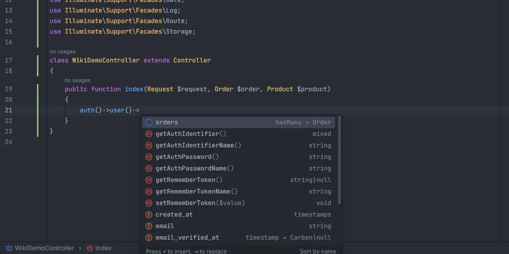

# IDE helpers

Laravel's `auth()` helper is declared to return a factory interface, so Intelephense doesn't know that `auth()->user()` exists, or that it returns your `User` model, and reports "Undefined method". Laravel OpenIDEA keeps a small stub in `storage/openidea/ide-helpers.php` that gives `auth()` the right types, so the warnings go away and `auth()->user()->` is typed as your user model.

<p align="center">user()-> in a controller, completing the User model's orders relation, authentication methods and columns" width="760"></p>
<p align="center"><sub><code>auth()->user()-></code> completes the members of the configured user model</sub></p>

## How to use it

Nothing to do: `ideHelpers` is on by default. With `process:php` (or `process:docker`) allowed, the plugin writes the stub when it starts and whenever you focus an editor, if the stub is missing or out of date. Intelephense indexes it like any other PHP file of the project.

```php
auth()->user()->orders;   // no "Undefined method 'user'"
auth()->check();
auth()->id();
auth('admin')->user();
```

The plugin's own completion after `auth()->` (the guard methods) and `auth()->user()->` (your model's columns and relations) works with or without the stub; see [Helpers](Helpers.md) and [Model members](Model-Members.md).

## What you get

For the default `App\Models\User`, `storage/openidea/ide-helpers.php` contains:

```php
<?php

namespace OpenIdea\Stubs {
    /**
     * @method \App\Models\User|null user()
     */
    class AuthManager extends \Illuminate\Auth\AuthManager
    {
    }
}

namespace {
    /**
     * @return ($guard is null ? \OpenIdea\Stubs\AuthManager|\Illuminate\Contracts\Auth\StatefulGuard : \Illuminate\Contracts\Auth\StatefulGuard)
     */
    function auth($guard = null)
    {
    }
}
```

- `auth()` without a guard returns the auth manager (whose `user()` returns your model or `null`) together with the stateful guard methods (`check()`, `id()`, `login()`, `logout()`…).
- `auth('admin')` returns a stateful guard.

The stub is never loaded by PHP: nothing includes it, and it lives in a folder your app doesn't autoload. It only exists for the editor.

## Details

### The user model

The model comes from `config/auth.php`: the first `'model' =>` under `'providers'`, written as `App\Models\Customer::class`, as `env('AUTH_MODEL', App\Models\Customer::class)`, or as a quoted class name. Without one (or without `config/auth.php`), `App\Models\User` is used. Saving `config/auth.php` rewrites the stub right away with the new model.

### When it is written

| Moment | What happens |
| --- | --- |
| The plugin starts | For each open Laravel project, the stub is compared with what it should be and written if different |
| An editor gets focus | The same check |
| `config/auth.php` is saved | The stub is rebuilt with the model from the new config |

The stub is written by `php/install.php` run with your [runner](Settings.md#artisanrunner), as the background task *Laravel: updating the IDE helper stubs*. It creates `storage/openidea` and its `.gitignore` (`*`) when needed, so the stub is never committed. When the write fails, the plugin doesn't retry with the same content in the same session; the failure is in the IDE log as `IDE helper sync: …`, including "storage/openidea/ide-helpers.php is still out of date after the sync" when the file didn't change.

### Turning it off

Turn off **Write IDE helper stubs to storage/openidea so Intelephense knows auth() returns the auth manager and your user model** (`ideHelpers`). On the next start or editor focus the plugin deletes `storage/openidea/ide-helpers.php`, and removes `storage/openidea` too if nothing else is left in it.

## Settings and permissions

- `ideHelpers` (default on) turns the stub on or off.
- Writing the stub needs `process:php` or `process:docker`. Without them the stub isn't written, and the denial is logged once.
- `artisanRunner` and `dockerService` decide where the PHP that writes it runs.

See [Settings](Settings.md) and [Permissions](Permissions.md).

## Related

- [Helpers](Helpers.md)
- [Model members](Model-Members.md)
- [Generate model PHPDoc](Generate-Model-PHPDoc.md)
- [Privacy and security](Privacy-and-Security.md)
- [Troubleshooting and logs](Troubleshooting.md)

---
[← Wiki home](Home.md)
