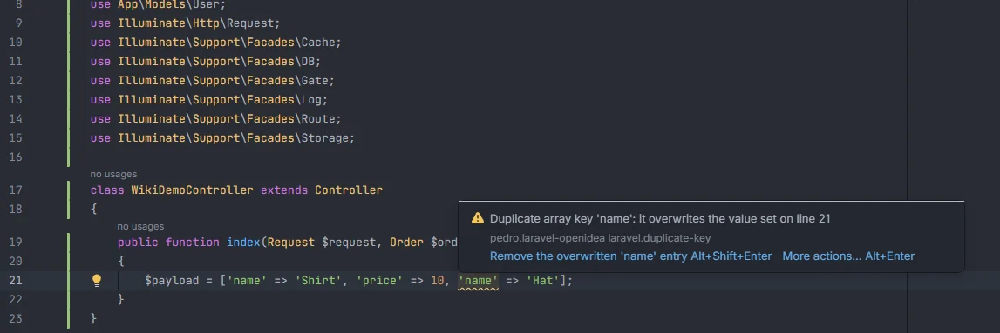

# Duplicate array keys

Reports a key written twice in the same array literal. PHP keeps only the last value, so the first one is silently lost; in a `create()` payload, a validation array or a config file that is almost always a copy and paste mistake. The quick fix removes the entry that gets overwritten.

<p align="center"></p>
<p align="center"><sub>The second 'name' overwrites the first</sub></p>

## How to use it

The check runs by itself on every array literal of every PHP file, config files included:

```php
$payload = ['name' => 'Shirt', 'price' => 10, 'name' => 'Hat'];   // 'name' reported

return [
    'stock' => $data['stock'],
    'stock' => 1,                  // Duplicate array key 'stock': it overwrites the value set on line 4
    "name" => 'x',
    'name' => 'y',                 // double and single quotes are the same key
    1 => 'a',
    '1' => 'b',                    // the string '1' and the integer 1 are the same key in PHP
];

$old = array('k' => 1, 'k' => 2); // array() counts too
```

## What you see

- **Severity:** Warning.
- **Code:** `laravel.duplicate-key`.
- **Message:** `Duplicate array key '<key>': it overwrites the value set on line <n>`, where `<n>` is the line of the previous occurrence. String keys are shown in single quotes whatever quotes the code uses; integer keys are shown bare (`Duplicate array key 1: …`).
- **Range:** the repeated key, quotes included.
- A key written three times is reported twice, each repeat pointing at the occurrence just before it.

**Quick fix.** *Remove the overwritten '&lt;key&gt;' entry* deletes the earlier entry: from its key through its value, the comma after it and the whitespace up to the next entry, so the line disappears cleanly. The tooltip offers it directly with Alt+Shift+Enter.

## Details

- **What is an array.** `[...]` and `array(...)` literals. A `[` right after a variable, a string, a number, `)`, `]` or `}` is an index (`$rows['k']`, `foo()['k']`) and is ignored, as is the `#[` of an attribute. After a bare word, `[` only opens an array when the word is a keyword such as `return`, `yield`, `echo`, `print`, `case`, `else`, `throw`, `in`, `as`, `default`, `clone`, `and`, `or` or `xor`. `array(` after `->`, `?->` or `::` is a method call, not an array.
- **Which keys.** Keys at the top level of the array, at the start of an entry:
  - string literals, single or double quoted, except double-quoted strings with a `$` in them (`"$prefix.name"` depends on a variable);
  - integer literals; leading zeros are ignored, and floats are skipped.
  
  Keys that are constants (`Status::Paid =>`), variables or expressions are not compared. Lists without keys (`[1, 1, 'a', 'a']`) are fine.
- **Nested arrays are separate.** `['x' => ['k' => 1], 'y' => ['k' => 2]]` has no duplicate; each inner array is checked on its own.
- **Comments are skipped.** Blade files are not checked.

## Settings and permissions

| Setting | Label | Default |
| --- | --- | --- |
| `duplicateKeyInspection` | Report keys repeated in the same array (the last value wins) | on |

See [Settings](Settings.md). No optional permission is needed.

## Related

- [Inspections overview](Inspections.md)
- [Keys `$fillable` leaves out](Inspection-Fillable.md)
- [Config keys](Config-Keys.md)

---
[← Wiki home](Home.md)
