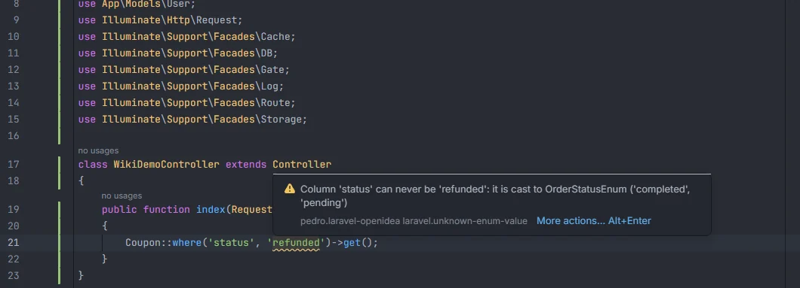
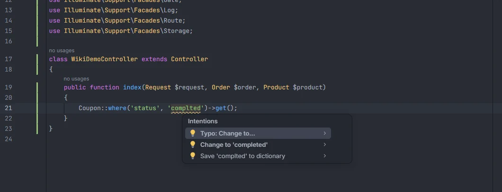

# Enum values

Reports a value compared with an enum-cast column that the backed enum doesn't have. `Order::where('status', 'refused')` is a valid query that silently finds nothing when `OrderStatus` has no `refused` case; this inspection points it out and offers the closest real value.

<p align="center"></p>
<p align="center"><sub>The warning lists the values the enum allows</sub></p>

## How to use it

The check runs by itself in PHP files, on query chains that start with a model whose `casts()` method or `$casts` property casts a column to a backed enum:

```php
// app/Models/Order.php: 'status' => OrderStatus::class
// enum OrderStatus: string { case Pending = 'pending'; case Paid = 'paid'; case Refunded = 'refunded'; }

Order::where('status', 'refused')->get();                     // reported
Order::query()->where('status', '!=', 'paied')->get();        // reported
Order::whereIn('status', ['pending', 'lost'])->get();         // 'lost' reported
```

| Methods | Value checked |
| --- | --- |
| `where`, `orWhere`, `whereNot`, `orWhereNot`, `firstWhere` | the second argument, or the third when the second is an operator: `=`, `==`, `!=`, `<>`, `<`, `>`, `<=`, `>=`, `<=>` |
| `whereIn`, `orWhereIn`, `whereNotIn`, `orWhereNotIn` | every string and number in the second argument |

The column (the first argument) must be a string literal naming a column with an enum cast.

## What you see

- **Severity:** Warning.
- **Code:** `laravel.unknown-enum-value`.
- **Message:** `Column '<column>' can never be '<value>': it is cast to <Enum> ('<value1>', '<value2>', …)`, with every backing value of the enum in declaration order.
- **Range:** the value inside the quotes (or the number).

<p align="center"></p>
<p align="center"><sub>The quick fix next to the IDE's own spelling suggestions</sub></p>

**Quick fix.** Alt+Enter offers *Change to '&lt;value&gt;'* with the closest backing value: the smallest edit distance, at most a third of the value's length (at least 2), the shorter value on a tie. It replaces the text inside the quotes. When no value is that close there is no fix, as with `refunded` against `completed` and `pending` in the first screenshot.

Completion of the value argument lists the enum's values, each with its case as detail (`pending`, `OrderStatus::Pending`); see [Casts](Casts.md).

## Details

- **Which casts count.** A cast written as `Enum::class` in `casts()` or `$casts`, and also the class inside `X::of(Enum::class)` or `X::using(Enum::class)`. The class is resolved through the model's `use` statements and namespace and found through the PSR-4 map of `composer.json`. It must be a backed enum (`enum X: string` or `enum X: int`) with at least one case; pure enums and other cast classes are ignored.
- **Which values are compared.** The backing values (`'pending'`), not the case names (`Pending`). Integer-backed enums are compared with number literals the same way.
- **Only literals.** A value that is a variable, a constant, an enum case (`OrderStatus::Paid`), a function call or an expression is not checked. Empty strings are not reported. With two or three arguments the value must be a single literal; a `where()` with an array or a closure is skipped.
- **Which chains.** The chain must start with `Model::method(…)`, like `Order::where()` or `Order::query()->where()`. Variables holding a query, relations and closures are not followed. The model is found by its short class name.
- **Comments are skipped.**
- **Refresh.** The enum casts of every model are part of the project facts, rebuilt after any save or change on disk. Adding a case to the enum and saving it clears the warning. Edits to the file you are in are checked as you type.

## Settings and permissions

| Setting | Label | Default |
| --- | --- | --- |
| `enumValueInspection` | Report where() values that the column's enum cast doesn't have | on |

See [Settings](Settings.md). No optional permission is needed.

## Related

- [Inspections overview](Inspections.md)
- [Casts](Casts.md): enum casts, their values in completion and Ctrl+click to the enum
- [Unknown columns](Inspection-Unknown-Columns.md)
- [Enums in the hub](Hub-Enums.md)

---
[← Wiki home](Home.md)
