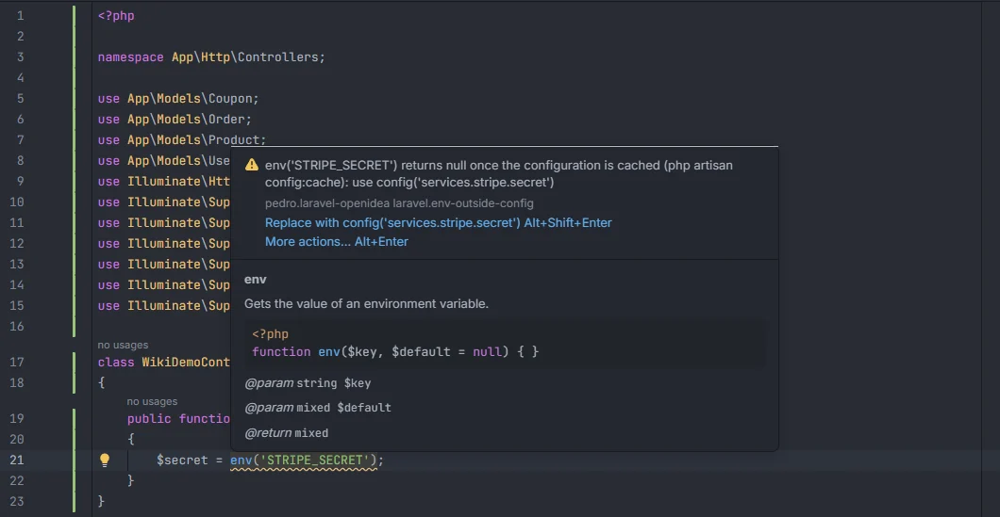
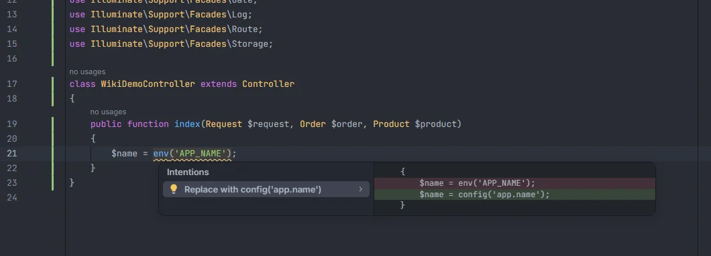

# `env()` outside config

Reports `env()` calls outside the `config/` folder. Once the configuration is cached with `php artisan config:cache` (as it usually is in production), Laravel no longer loads `.env` and `env()` returns `null` everywhere except in config files. The quick fix replaces the call with the `config()` key that already reads the same variable.

<p align="center"></p>
<p align="center"><sub>The warning names the config key to use instead</sub></p>

## How to use it

The check runs by itself in every PHP file except those under `config/`, `bootstrap/cache/` and any `vendor/` folder:

```php
$secret = env('STRIPE_SECRET');           // use config('services.stripe.secret')
$debug  = \env('APP_DEBUG', false);       // the leading backslash counts too
$flag   = env('FEATURE_X');               // no config key reads it: read it in a config file
```

The call must be the global `env` function with a string literal as its first argument.

## What you see

- **Severity:** Warning.
- **Code:** `laravel.env-outside-config`.
- **Message:** `env('<KEY>') returns null once the configuration is cached (php artisan config:cache)`, followed by
  - `: use config('<key>')` when a config key reads the variable, or
  - `: read it in a config file and use config() here` when none does.
- **Range:** the whole call, from `env` to the closing parenthesis, default value included.

<p align="center"></p>
<p align="center"><sub>The quick fix swaps the call for the config key</sub></p>

**Quick fix.** One *Replace with config('&lt;key&gt;')* action for each config key that reads the variable, up to three, in the order the config files are indexed. It replaces the whole call, including any default value, with `config('<key>')`; the default in the config file applies instead. The tooltip offers the first one directly with Alt+Shift+Enter. When no config key reads the variable there is no fix.

## Details

- **How a config key is matched.** The plugin indexes every key of every file under `config/` (nested keys too: `services.stripe.secret`). A key matches when the line it is defined on reads `env('<KEY>')` after the `=>`, with single or double quotes, even inside an expression such as `(bool) env('APP_DEBUG', false)`. A value that calls `env()` on a later line isn't matched.
- **What isn't reported.** Methods named `env` (`$this->env(…)`, `$app->env(…)`, `App::env(…)`, `Foo?->env(…)`), a function or closure *declared* with that name, `new env(…)`, calls whose first argument isn't a string literal (`env($key)`), and `Env::get()`. Comments are skipped. Blade files are not checked.
- **Which files.** Everything else in the project: `app/`, `routes/`, `database/`, `tests/`, `bootstrap/app.php` and so on. The path is taken relative to the project root.
- **Refresh.** The config keys are part of the project facts, rebuilt after any save or change on disk, so a key added to a config file is offered once the file is saved.

## Settings and permissions

| Setting | Label | Default |
| --- | --- | --- |
| `envCallInspection` | Report env() calls outside config files | on |

See [Settings](Settings.md). No optional permission is needed.

## Related

- [Inspections overview](Inspections.md)
- [Environment variables](Environment-Variables.md): `env()` keys and values in completion
- [Config keys](Config-Keys.md)
- [`.env` keys](Inspection-Env-Keys.md)
- [Config in the hub](Hub-Config.md) and [Environment in the hub](Hub-Environment.md)

---
[← Wiki home](Home.md)
