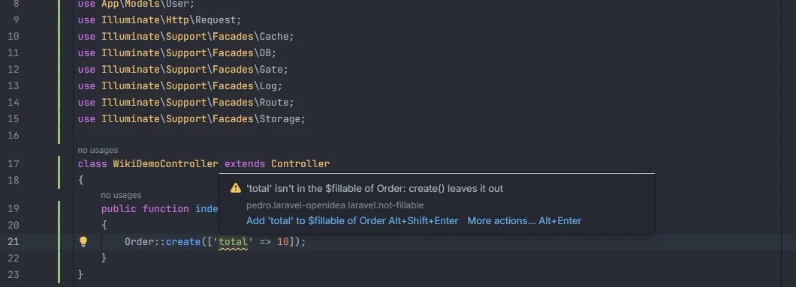
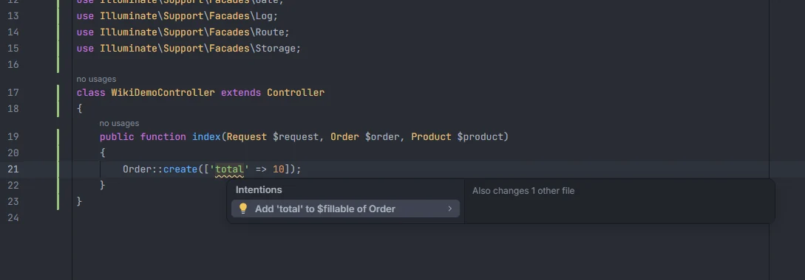

# Keys `$fillable` leaves out

Reports keys passed to `Model::create()` and the other mass-assignment methods that the model's `$fillable` doesn't list, or that its `$guarded` lists. Laravel silently drops those keys (or throws `MassAssignmentException` when you prevent silently discarding attributes), so the row is saved without them. The quick fix adds the key to the model.

<p align="center"></p>
<p align="center"><sub>A key the model's $fillable doesn't allow</sub></p>

## How to use it

The check runs by itself in PHP files, on calls that start a chain with a model:

| Methods | Arrays checked |
| --- | --- |
| `create`, `make`, `createQuietly` | the attributes array |
| `firstOrCreate`, `firstOrNew`, `updateOrCreate` | both arrays (the attributes to look for and the values) |

```php
// class Order extends Model { protected $fillable = ['user_id', 'status']; }

Order::create(['user_id' => $id, 'total' => 10]);                  // 'total' reported
Order::firstOrCreate(['user_id' => $id], ['notes' => 'x']);        // 'notes' reported
Order::query()->where('x', 1)->create(['status' => 'paid']);       // fine
```

Every string key at the top level of each `[...]` array argument is compared with the model.

## What you see

- **Severity:** Warning.
- **Code:** `laravel.not-fillable`.
- **Range:** the key inside its quotes.
- **Message**, depending on how the model protects its attributes:

| The model has | A key is reported when | Message |
| --- | --- | --- |
| `$fillable` (or `#[Fillable([...])]`) | it isn't in the list | `'<key>' isn't in the $fillable of <Model>: <method>() leaves it out` |
| no `$fillable`, and a `$guarded` (or `#[Guarded([...])]`) that isn't empty and isn't `['*']` | it is in the list | `'<key>' is in the $guarded of <Model>: <method>() leaves it out` |
| neither, an empty `$guarded`, or `$guarded = ['*']` | never | |

<p align="center"></p>
<p align="center"><sub>The fix edits the model file, so the preview says it also changes another file</sub></p>

**Quick fix.** For `$fillable`, *Add '&lt;key&gt;' to $fillable of &lt;Model&gt;* writes the key into the model's list, in the model's file:

| The list looks like | The key is added |
| --- | --- |
| over several lines | on a new line before `]`, with the indentation of the last item and a trailing comma; a comma is added after the last item if it had none |
| on one line | after the last item: `['user_id', 'status', 'total']` |
| empty `[]` | as the only item: `['total']` |
| `#[Fillable(['user_id', 'status'])]` | inside the attribute's array: `#[Fillable(['user_id', 'status', 'total'])]` |

The tooltip offers the fix directly with Alt+Shift+Enter. For `$guarded` there is no quick fix; remove the key from `$guarded` yourself if it should be assignable.

## Details

- **Which models.** The chain must start with `Model::method(…)` (`Order::create()`, `Order::query()->create()`); the model is found by its short class name among the models in `app/Models/` and `app/**/Models/`. Calls on an instance or a relation (`$user->orders()->create([...])`, `$order->update([...])`, `$order->fill([...])`) are not checked.
- **How `$fillable` is read.** From the model's source: the first `[...]` after the first `$fillable` in the file, else the array of a `#[Fillable(...)]` attribute. `$guarded` and `#[Guarded(...)]` are read the same way. Only string items count. A `$fillable` filled at runtime, in a trait or in a parent class is not seen.
- **Which keys.** String keys followed by `=>` at the top level of a `[...]` argument. Nested arrays, numeric keys, variables (`Order::create($data)`) and `array(...)` are not checked.
- **The model as saved.** The model's lists and the place to insert are read from the model file as it was when the project facts were last built, that is its saved state. Save the model first if it has unsaved edits.
- **Comments are skipped.**
- **Refresh.** Models are part of the project facts, rebuilt after any save or change on disk: saving the model with the new key clears the warning.

## Settings and permissions

| Setting | Label | Default |
| --- | --- | --- |
| `fillableInspection` | Report create() and similar keys that $fillable leaves out | on |

See [Settings](Settings.md). No optional permission is needed.

## Related

- [Inspections overview](Inspections.md)
- [Eloquent columns and relations](Eloquent-Columns-and-Relations.md): column names complete as keys of `create()` and in `$fillable`
- [Duplicate array keys](Inspection-Duplicate-Keys.md)
- [Generate model PHPDoc](Generate-Model-PHPDoc.md)
- [Models in the hub](Hub-Models.md)

---
[← Wiki home](Home.md)
