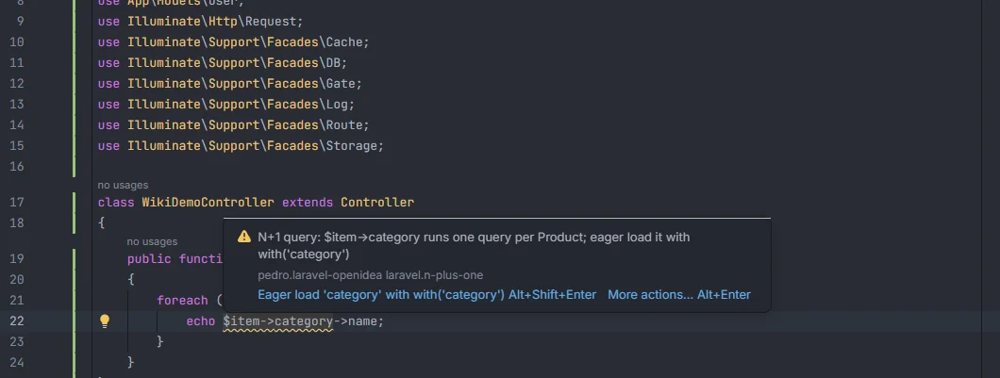
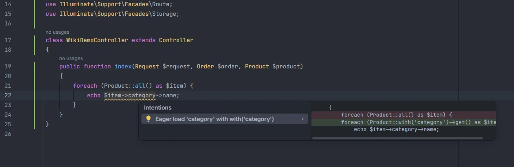

# N+1 queries

Reports a relation read on each item of a `foreach` over a query that doesn't eager load it. `$post->user` inside the loop runs one extra query per post (the "N+1" problem); the quick fix adds `with('user')` to the query so all users load in one query.

<p align="center">category runs one query per Product; eager load it with with('category')" width="760"></p>
<p align="center"><sub>A relation read inside a loop over Product::all()</sub></p>

## How to use it

The check runs by itself in PHP files. It looks for this shape:

```php
$posts = Post::latest()->get();
foreach ($posts as $post) {
    echo $post->user->name;      // N+1 query: $post->user runs one query per Post; eager load it with with('user')
    echo $post->user->email;     // same relation: reported once
    echo $post->title;           // a column: fine
}

foreach (Product::all() as $item) {
    echo $item->category->name;  // reported
}
```

1. A `foreach (… as $item)` (or `as $key => $item`) whose body is in braces.
2. The loop runs over either a query chain written in the `foreach` itself, or a variable whose closest assignment above the loop is `$var = Model::…`.
3. The chain starts with a model (`Post::…`) and its **last** call returns a collection: `get`, `all`, `paginate`, `simplePaginate`, `cursorPaginate`, `cursor`, `lazy`, `findMany` or `lazyById`.
4. In the loop body, `$item->name` or `$item?->name` where `name` is a relation of that model and is not followed by `(`.
5. The relation is not eager loaded by a `with()`, `load()`, `loadMissing()` or `withWhereHas()` call of the same chain.

## What you see

- **Severity:** Warning.
- **Code:** `laravel.n-plus-one`.
- **Message:** `N+1 query: $<item>-><relation> runs one query per <Model>; eager load it with with('<relation>')`.
- **Range:** `$item->relation`.
- Each relation is reported once per loop, on its first use.

<p align="center">get()" width="760"></p>
<p align="center"><sub>The fix turns Product::all() into Product::with('category')->get()</sub></p>

**Quick fix.** *Eager load '&lt;relation&gt;' with with('&lt;relation&gt;')* edits the query, wherever it is (in the `foreach` or in the assignment above it):

| Query | After the fix |
| --- | --- |
| `Product::all()` | `Product::with('category')->get()` |
| `Post::latest()->get()` | `Post::latest()->with('user')->get()` |
| `Post::where('published', true)->paginate()` | `Post::where('published', true)->with('user')->paginate()` |

`->with('…')` is inserted right before the last call. The tooltip offers the fix directly with Alt+Shift+Enter.

## Details

- **What counts as a relation.** The relation methods of the model's class found in `app/Models/` and `app/**/Models/` (methods returning `hasMany`, `belongsTo`, `belongsToMany`, `morphTo` and the other relation types), including the ones a model inherits from a parent model. Columns, accessors and anything else are not relations.
- **What counts as eager loaded.** Every string inside the chain's `with(…)`, `load(…)`, `loadMissing(…)` and `withWhereHas(…)` calls, cut at the first `.` or `:`: `with('user.team')` and `with('user:id,name')` both load `user`. Array forms such as `with(['user' => fn ($q) => …])` count too.
- **Method calls are fine.** `$post->user()->first()` or `$post->comments()->count()` is a new query by design and is not reported.
- **Only the loop's own query.** The plugin doesn't follow a later `$posts->load('user')`, a `$with` property on the model, `Model::preventLazyLoading()`, a collection passed in from elsewhere, a relation chain (`$user->posts` as the loop source), or a loop over `$this->items`. If the closest assignment to the variable above the loop isn't a model query, nothing is reported.
- **The last call must return a collection.** `Post::where(…)->get()->filter(…)` ends with `filter`, so it isn't checked.
- **Loops without braces** (`foreach (…):` … `endforeach;`, or a single statement) are not checked. Blade `@foreach` is not checked.
- **Comments are skipped.**
- At runtime, the [Live Audit](Hub-Live-Audit.md) section of the hub finds N+1 queries in the queries your app actually ran.

## Settings and permissions

| Setting | Label | Default |
| --- | --- | --- |
| `nPlusOneInspection` | Report relations loaded once per item in a foreach (N+1 queries) | on |

See [Settings](Settings.md). No optional permission is needed.

## Related

- [Inspections overview](Inspections.md)
- [Eloquent columns and relations](Eloquent-Columns-and-Relations.md): relation names in `with()` complete
- [Model members](Model-Members.md)
- [Live Audit](Hub-Live-Audit.md): N+1 and slow query insights while the app runs
- [Models in the hub](Hub-Models.md)

---
[← Wiki home](Home.md)
