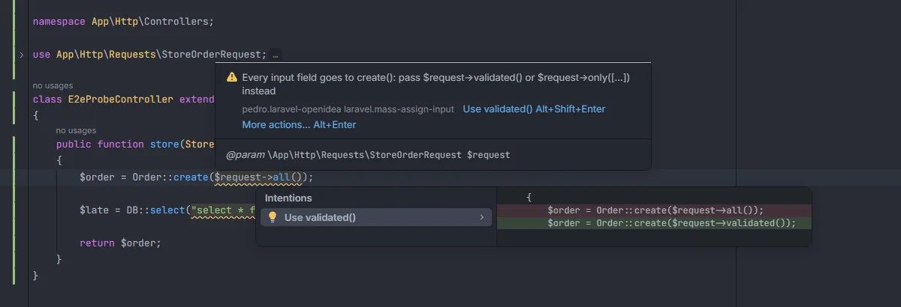
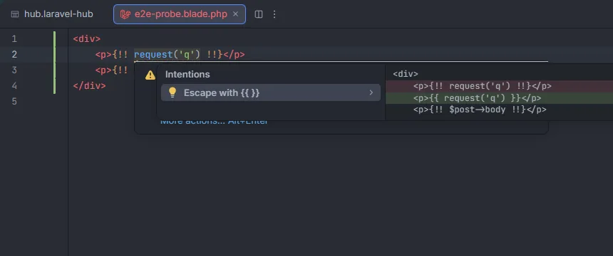

# Security

Three checks for mistakes that open a hole in the app: every input field passed to a mass assignment, a variable written into raw SQL, and request data printed in Blade without escaping. The first and the last come with a quick fix.

<p align="center">all()) underlined with Every input field goes to create(), the Use validated() fix and its preview, and the raw SQL warning on the next line" width="760"></p>
<p align="center"><sub><code>$request->all()</code> in <code>create()</code>, with <em>Use validated()</em>, and a variable in <code>DB::select()</code> under it</sub></p>

## How to use it

The checks run by themselves in PHP and Blade files:

```php
public function store(StoreOrderRequest $request)
{
    Order::create($request->all());                     // Every input field goes to create()
    $order->update(request()->all());                   // the same, with request()
    new Order(Request::all());                          // and with the facade, in a constructor

    DB::select("select * from orders where id = $id");  // Variable in the SQL of DB::select()
    $query->orderByRaw('total ' . $direction);          // Variable in the SQL of orderByRaw()

    Order::create($request->validated());               // fine
    $query->whereRaw('status = ?', [$status]);          // fine: the value is a binding
}
```

```blade
<p>{!! request('q') !!}</p>   {{-- Request data printed without escaping --}}
<p>{!! $post->body !!}</p>    {{-- not reported: it isn't request data --}}
```

## What you see

| Check | Code | Severity | Message | Quick fix |
| --- | --- | --- | --- | --- |
| Every input field mass assigned | `laravel.mass-assign-input` | Warning | `Every input field goes to create(): pass $request->validated() or $request->only([...]) instead` | **Use validated()** when the variable is a Form Request |
| Variable in raw SQL | `laravel.raw-sql-variable` | Warning | `Variable in the SQL of DB::select(): pass values as bindings (?) so they are escaped` | none |
| Request data printed unescaped | `laravel.unescaped-request` | Warning | `Request data printed without escaping: anyone can inject HTML or scripts here. Use {{ }} to escape it` | **Escape with {{ }}** |

<p align="center"></p>
<p align="center"><sub>Alt+Enter on unescaped request data in Blade</sub></p>

## Details

### Every input field mass assigned

- **What counts as every input field:** `$request->all()` and `$request->input()` without arguments, on a variable whose name contains `request` or that the file types as a class ending in `Request`; `request()->all()`, `request()->input()`, `Request::all()` and `Input::all()`.
- **Where it is reported:** when that expression is an argument of `create`, `createQuietly`, `forceCreate`, `forceCreateQuietly`, `update`, `updateQuietly`, `fill`, `forceFill`, `insert`, `insertOrIgnore`, `updateOrCreate`, `firstOrCreate`, `firstOrNew`, `createOrFirst`, `make`, `updateOrInsert` or `upsert` (after `->` or `::`), or of `new SomeModel(...)`. It still counts inside an array, such as `[...$request->all(), 'user_id' => 1]`. Passed to anything else (`collect($request->all())`), it isn't reported.
- **The quick fix:** when the variable is typed with a class ending in `Request` other than `Request` itself (a Form Request), *Use validated()* turns `all` or `input` into `validated`. With a plain `Request` there is no fix: pick the fields with `only([...])`.
- `$fillable` and `$guarded` still protect a model, but passing every field relies on them alone; the [Security](Hub-Security.md) section lists models with `$guarded = []`.

### Variable in raw SQL

- **Which calls:** the first argument of `whereRaw`, `orWhereRaw`, `havingRaw`, `orHavingRaw`, `orderByRaw`, `groupByRaw`, `selectRaw` and `fromRaw`, and of `DB::raw`, `DB::select`, `DB::selectOne`, `DB::scalar`, `DB::statement`, `DB::unprepared`, `DB::insert`, `DB::update`, `DB::delete` and `DB::affectingStatement`.
- **What is reported:** a variable anywhere in that argument (concatenated or alone), or a double-quoted string with an unescaped `$` (`"… $id"`, `"… {$id}"`). `$this->…` is left out, and so are values passed in the bindings array.
- The range is the whole first argument. There is no fix: rewrite it with `?` and a bindings array.

### Request data printed unescaped

- **Where:** Blade files, inside `{!! … !!}` (not `@{!! … !!}`, which Blade prints as text).
- **What is reported:** an expression that contains `request(`, `$request`, `Request::`, `old(`, `->input(`, `->query(`, `$_GET`, `$_POST`, `$_REQUEST` or `$_COOKIE`. Other unescaped output, like a model's HTML body, isn't reported.
- **The quick fix:** *Escape with {{ }}* replaces `{!!` with `{{` and `!!}` with `}}`.
- Blade files are checked when they are opened, saved or changed on disk, not while you type (see [Inspections](Inspections.md#when-inspections-run)).

## Settings and permissions

| Setting | Label | Default |
| --- | --- | --- |
| `securityInspection` | Report every input field passed to create() or update(), variables in raw SQL and request data printed with {!! !!} | on |

Nothing runs in your app. See [Settings](Settings.md).

## Related

- [Security](Hub-Security.md), the hub section that lists these findings for the whole project
- [Keys `$fillable` leaves out](Inspection-Fillable.md)
- [Inspections overview](Inspections.md)

---
[← Wiki home](Home.md)
