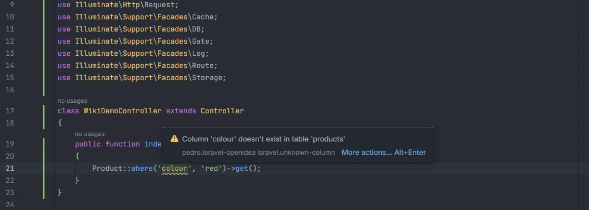
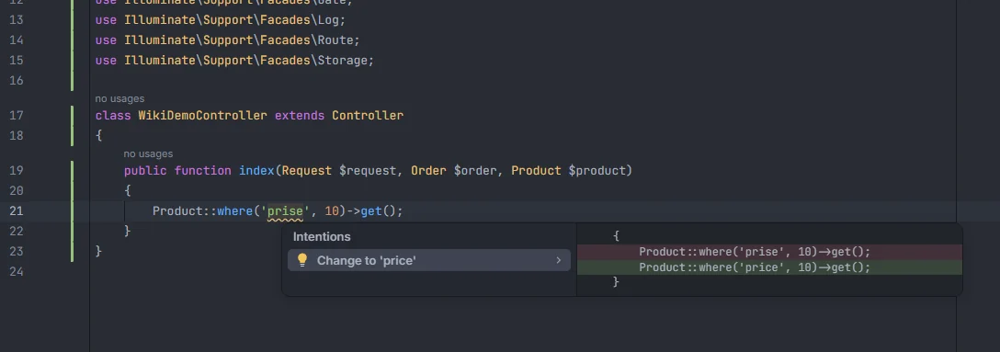

# Unknown columns

Reports a column name that isn't in the model's table, in `where()`, `orderBy()`, `pluck()` and the other query methods that take a column. The table's columns come from your migrations, so a typo such as `prise` for `price` is caught before the query fails with `Unknown column`.

<p align="center"></p>
<p align="center"><sub>A column that isn't in the products table</sub></p>

## How to use it

The check runs by itself in PHP files on query chains that start with a model or with `DB::table()`:

```php
Product::where('prise', 10)->get();                     // Column 'prise' doesn't exist in table 'products': did you mean 'price'?
Product::query()->orderBy('created')->pluck('nmae');    // both reported
DB::table('orders')->whereNull('shipped')->get();       // checked against the orders table
```

The first argument of these methods is checked:

| Group | Methods |
| --- | --- |
| Where clauses | `where`, `orWhere`, `whereNot`, `orWhereNot`, `whereIn`, `orWhereIn`, `whereNotIn`, `orWhereNotIn`, `whereNull`, `orWhereNull`, `whereNotNull`, `orWhereNotNull`, `whereBetween`, `orWhereBetween`, `whereNotBetween`, `whereDate`, `whereMonth`, `whereDay`, `whereYear`, `whereTime`, `whereLike`, `orWhereLike`, `whereNotLike`, `whereColumn`, `firstWhere` |
| Ordering and grouping | `orderBy`, `orderByDesc`, `latest`, `oldest`, `groupBy` |
| Values and aggregates | `pluck`, `value`, `increment`, `decrement`, `sum`, `avg`, `min`, `max` |

## What you see

- **Severity:** Warning.
- **Code:** `laravel.unknown-column`.
- **Message:** `Column '<column>' doesn't exist in table '<table>'`, followed by `: did you mean '<closest>'?` when a column is close enough.
- **Range:** the column name inside the quotes.

<p align="center"></p>
<p align="center"><sub>The quick fix replaces the name with the closest column</sub></p>

**Quick fix.** When the message suggests a column, Alt+Enter offers *Change to '&lt;column&gt;'*, which replaces the name inside the quotes. The closest column is the one with the smallest edit distance, at most a third of the name's length (at least 2); on a tie the shorter name wins. When nothing is that close there is no fix.

## Details

- **Which chains.** A chain must start with `Model::method(…)` or `DB::table('…')` (also `\DB::`, or any class ending in `\DB`), followed by `->` or `?->` calls. Chains on a variable (`$query->where(…)`), relation chains (`$user->posts()->where(…)`) and closures inside `where(fn ($q) => …)` are not checked.
- **Which model and table.** The model is found by its short class name among the models in `app/Models/` and any `app/**/Models/` folder (classes extending `Model`, `Authenticatable`, `Pivot` and similar, or another model). Its table is the one in `protected $table` or `#[Table('…')]`, or else the plural snake case of the class name (`OrderLine` → `order_lines`). For `DB::table('…')` the table is the literal string; a table with a space (`'orders as o'`) is skipped.
- **Which columns.** Every `Schema::create()` and `Schema::table()` in `database/migrations/` (up to 10,000 files): the column methods (`string`, `foreignId`, `decimal`, `json`…), `id()`, `timestamps()` (`created_at`, `updated_at`), `softDeletes()` (`deleted_at`), `rememberToken()`, and `morphs('x')` (`x_id`, `x_type`). Later migrations are followed: a column removed by `dropColumn()` or renamed by `renameColumn()` is reported under its old name, and a table removed by `Schema::drop()` is no longer known. The `down()` method is ignored.
- **Tables without columns are skipped.** If no migration gives the table a column (a squashed schema dump, a table from another connection), nothing is reported for it.
- **Chains with aliases are skipped.** When any call of the chain can introduce other names, the whole chain is left alone: `select`, `addSelect`, `selectRaw`, `selectSub`, the joins (`join`, `leftJoin`, `rightJoin`, `crossJoin`, `joinSub`, `leftJoinSub`), `from`, `fromSub`, `fromRaw`, `table`, `withCount`, `withSum`, `withAvg`, `withMin`, `withMax`, `withExists`, `withAggregate`, `having`, `havingRaw`, `union`, `unionAll`. For `DB::table()` the `table` call that starts the chain doesn't count.
- **Names that are not plain columns are skipped.** Only a first argument that is a single string literal is checked, and not when it is empty, `*`, or contains `.` (`posts.title`), a space, `(`, `-` or `>` (raw expressions and JSON paths such as `meta->color`). Variables, closures and arrays (`where(['a' => 1])`) are skipped.
- **Comments are skipped.**
- **Refresh.** The models and columns are part of the project facts, rebuilt after any save or change on disk, so a column added in a new migration stops being reported once the migration is saved.

## Settings and permissions

| Setting | Label | Default |
| --- | --- | --- |
| `unknownColumnInspection` | Report columns that don't exist in the model's table (where, orderBy, pluck…) | on |

See [Settings](Settings.md). No optional permission is needed: the database is never queried.

## Related

- [Inspections overview](Inspections.md)
- [Eloquent columns and relations](Eloquent-Columns-and-Relations.md): completion of the same columns
- [Enum values](Inspection-Enum-Values.md)
- [Database in the hub](Hub-Database.md): the tables and columns read from the migrations
- [Models in the hub](Hub-Models.md)

---
[← Wiki home](Home.md)
