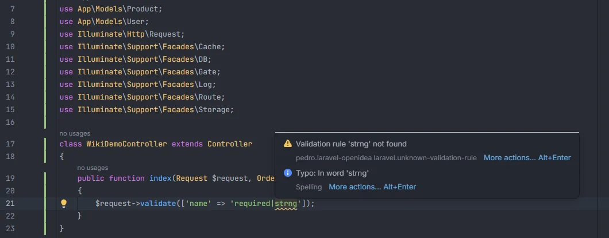

# Unknown validation rules

Reports a validation rule name that the project's Laravel version doesn't have, such as a typo (`strng`) or a rule added in a later Laravel (`hex_color` in a Laravel 10 project). Laravel throws `Method Illuminate\Validation\Validator::validateStrng does not exist` only when the rule runs; this catches it in the editor.

<p align="center">validate()" width="760"></p>
<p align="center"><sub>The warning on a misspelled rule of a pipe-separated string</sub></p>

## How to use it

The check runs by itself in PHP and Blade files, on the rule strings of:

| Where | Argument with the rules |
| --- | --- |
| `$request->validate([...])` | first |
| `$this->validate($request, [...])`, `->validateWithBag('bag', [...])` | second |
| `validator($data, [...])`, `Validator::make($data, [...])`, `Validator::validate($data, [...])` | second |
| `return [...]` inside a method named `rules()` (Form Requests, Livewire forms…) | the returned array |
| `$rules = [...]` (a property or variable named `$rules`, for example in Livewire components) | the assigned array |

Rules are read from the values of the array, both as strings and as arrays of strings:

```php
$request->validate([
    'name'  => 'required|strng',            // Validation rule 'strng' not found
    'email' => ['required', 'emial'],       // Validation rule 'emial' not found
    'color' => 'nullable|hex_color',        // reported on Laravel 10, which has no hex_color
]);
```

## What you see

- **Severity:** Warning.
- **Code:** `laravel.unknown-validation-rule`.
- **Message:** `Validation rule '<rule>' not found`.
- **Range:** the rule name only, not the rest of the string.

There is no quick fix. Completion inside the string lists the rules that exist (see [Validation rules](Validation-Rules.md)).

## Details

- **Where the rule names come from.** From the Laravel installed in `vendor/laravel/framework`: every `validateXxx($attribute, …)` method of `Illuminate\Validation\Concerns\ValidatesAttributes` and the traits it uses, turned into snake case (`validateHexColor` → `hex_color`), plus the rule names listed in the `implicitRules`, `dependentRules`, `excludeRules`, `sizeRules`, `numericRules` and `fileRules` properties of `Illuminate\Validation\Validator`. So the rules are exactly those of your Laravel version, tested with Laravel 6, 8, 9, 10, 11, 12 and 13.
- **Without `vendor/`** (before `composer install`) the plugin uses its built-in list of about 110 rules, written for recent Laravel.
- **Refresh.** The list is read again when `composer.lock` or `vendor/composer/installed.json` changes, so upgrading Laravel updates it.
- **Only framework rules are known.** String rules registered with `Validator::extend()` are not read, so they are reported. Rule objects (`new Uppercase`, `Rule::unique(...)`, closures) are not strings and are never checked; nor are the strings inside a call such as `Rule::in(['a', 'b'])`.
- **Every rule of a pipe-separated string.** In a string like `'required|strng|max:255'` each rule is checked, wherever it is and whether or not it has parameters: `'strng|required'`, `'required|strng|max:255'` and `'mx:255'` are all reported, on the misspelled rule only. Array items (`['required', 'strng', 'mx:255']`) are checked the same way.
- **Regular expressions.** After `regex:` or `not_regex:` the rest of the string is the pattern, so a `|` inside it (`'regex:/^(a|b)$/'`) doesn't start a new rule.
- **Parameters are not checked.** The part after `:` is not a rule name (`max:255`, `in:a,b`, `exists:users,email`); only the name before it is.
- **Keys are not rules.** Field names (`'items.*.price' =>`) are skipped.
- **Skipped strings.** Strings with `$`, `{` or `*`, concatenated strings, empty strings and strings you are still typing. Comments are skipped.

## Settings and permissions

| Setting | Label | Default |
| --- | --- | --- |
| `unknownRuleInspection` | Report unknown validation rules | on |

See [Settings](Settings.md). No optional permission is needed.

## Related

- [Inspections overview](Inspections.md)
- [Validation rules](Validation-Rules.md): completion and Ctrl+click on rules
- [Extract Form Request](Extract-Form-Request.md)
- [Validation Rules in the hub](Hub-Rules.md): your custom rule classes
- [Form Requests in the hub](Hub-Form-Requests.md)

---
[← Wiki home](Home.md)
