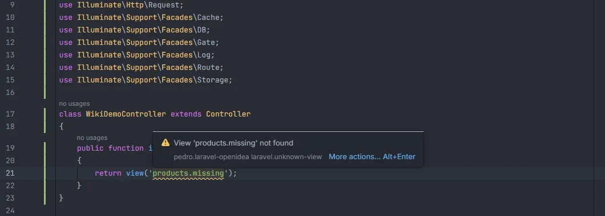
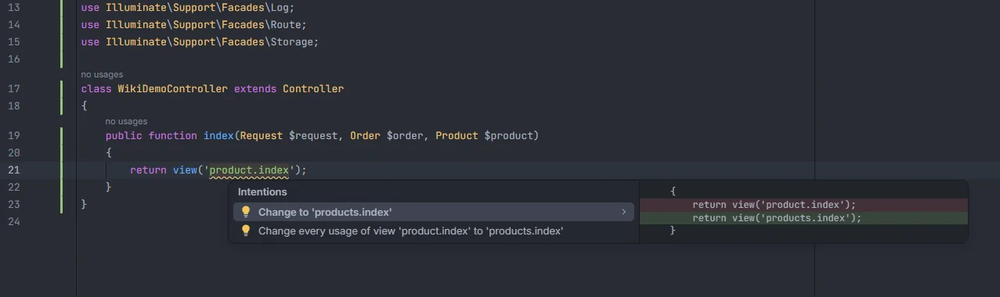

# Unknown views

Reports a view name that matches no file under `resources/views`, in `view()` calls, mailables, Blade `@include` and the other places a view is named. A typo or a view that was moved shows up as a warning instead of a `View [x] not found` exception at runtime, and the quick fix offers the view you most likely meant.

<p align="center"></p>
<p align="center"><sub>The warning on a view that doesn't exist</sub></p>

## How to use it

The check runs by itself in PHP and Blade files. The view name is checked in these places:

| Where | Argument checked |
| --- | --- |
| `view('…')` | first |
| `View::make('…')`, `View::exists('…')` | first |
| `View::first(['…', '…'])` | every name in the array |
| `Route::view('/uri', '…')` | second |
| `->view('…')`, `->markdown('…')`, `->text('…')`, `->layout('…')` on any object (mailables, `MailMessage`, Livewire layouts…) | first |
| `@include`, `@includeIf`, `@extends`, `@each`, `@component` | first |
| `@includeWhen`, `@includeUnless` | second |
| `@includeFirst([...])` | every name in the array |

```php
return view('products.missing');          // View 'products.missing' not found

Route::view('/about', 'pages.abuot');     // View 'pages.abuot' not found
```

```blade
@extends('layouts.app')
@include('partials.misssing')
```

## What you see

- **Severity:** Warning.
- **Code:** `laravel.unknown-view`.
- **Message:** `View '<name>' not found`.
- **Range:** the view name inside the quotes.

<p align="center"></p>
<p align="center"><sub>The two quick fixes for a view that was renamed</sub></p>

**Quick fixes.** With the cursor on the name, Alt+Enter offers up to two candidate views, each with two actions:

| Action | What it changes |
| --- | --- |
| *Change to '&lt;view&gt;'* | Replaces the name in this string only. The first one is the preferred fix. |
| *Change every usage of view '&lt;old&gt;' to '&lt;view&gt;'* | Replaces every usage of the old name, in the current file and in the PHP and Blade files under `app/`, `routes/`, `resources/views/`, `tests/`, `database/` and `config/` (up to 5,000 files per folder). It uses the same view contexts as the table above. If no usage is found it reports `no usage of '<old>' to change`. |

The candidates are chosen like this:

1. **Moved views first.** A view whose name ends with `.<old>` (the file was moved into a folder: `orders.index` → `shop.orders.index`), or whose name is the end of the old one (moved out of a folder: `admin.orders.index` → `orders.index`).
2. **Otherwise the closest names.** Views within an edit distance of a third of the name's length (at least 2), closest first, then alphabetically.

At most two candidates are kept. When nothing is close enough there is no quick fix.

## Details

- **Where the views come from.** Every `.blade.php` and `.php` file under `resources/views/` (up to 10,000 files), named by its path with dots: `resources/views/shop/orders/index.blade.php` is `shop.orders.index`. The index is rebuilt when a file under `resources/views/` is saved or changes on disk.
- **Namespaced views are skipped.** Names with `::` (`mail::message`, `package::view`) belong to packages or `View::addNamespace()` and are not checked.
- **Views added from elsewhere aren't known.** Views a package loads with `loadViewsFrom()` without a namespace, or extra locations added with `View::addLocation()`, are reported as missing.
- **Dynamic names are skipped.** Concatenated strings (`'emails.' . $type`), names with `$`, `{` or `*`, empty strings and strings you are still typing are not checked.
- **Existence checks are checked too.** `View::exists('…')`, `@includeIf` and `@includeFirst` are checked like the others, even though their point is to cope with a missing view.
- **Any `->view()` method counts.** The plugin doesn't know the type of the object, so `->view()`, `->markdown()`, `->text()` and `->layout()` on any object treat their first string as a view name.
- **Comments are skipped**, and in Blade only the PHP parts are read (`{{ }}`, `{!! !!}`, `@php`, `<?php ?>` and directive lines; `{{-- --}}` is skipped).
- **The quick fixes don't depend on the setting.** With the inspection turned off, Alt+Enter on a name that matches no view still offers the candidates.

## Settings and permissions

| Setting | Label | Default |
| --- | --- | --- |
| `unknownViewInspection` | Report unknown views | on |

See [Settings](Settings.md). No optional permission is needed.

## Related

- [Inspections overview](Inspections.md)
- [Views](Views.md): completion and Ctrl+click on view names
- [Blade](Blade.md)
- [Gutter markers](Gutter-Markers.md): the view icon next to `view()` calls
- [Views in the hub](Hub-Views.md)

---
[← Wiki home](Home.md)
