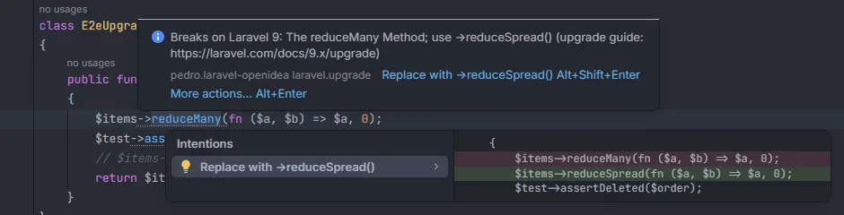

# Upgrade

Points at code that breaks on the next major Laravel version, from the official upgrade guide of that version: a method that was removed or renamed, a property that no longer works, a class that moved. Mechanical renames come with a quick fix. The [Upgrade](Hub-Upgrade.md) section lists the same findings for the whole project and for every later version.

<p align="center">reduceMany(...) in a Laravel 8 project with the info Breaks on Laravel 9: The reduceMany Method; use ->reduceSpread(), and the Replace with ->reduceSpread() fix with its preview" width="760"></p>
<p align="center"><sub>In a Laravel 8 project, <code>reduceMany()</code> is renamed in Laravel 9</sub></p>

## How to use it

Nothing to set up. The installed version comes from `composer.lock`, and the file is checked against the guide for the next major version only:

```php
// Laravel 8 installed
$items->reduceMany(fn ($a, $b) => $a, 0);   // Breaks on Laravel 9: … use ->reduceSpread()
$this->assertDeleted($order);               // Breaks on Laravel 9: … use ->assertModelMissing()

// Laravel 9 installed
protected $dates = ['paid_at'];             // Breaks on Laravel 10: … use protected $casts
Bus::dispatchNow(new ChargeOrder($order));  // Breaks on Laravel 10: … use Bus::dispatchSync()
```

## What you see

- **Severity:** Info (a dotted underline): the code works today.
- **Code:** `laravel.upgrade`.
- **Message:** `Breaks on Laravel <next>: <section of the guide>; use <replacement> (upgrade guide: <url>)`, or `… <call> was removed (…)` when the guide gives no replacement.
- **Range:** the matched code.

**Quick fix.** *Replace with &lt;replacement&gt;* when the guide's change is a pure rename with the same arguments and meaning: `Blade::component` → `aliasComponent`, the `TestResponse` and `Assert` namespaces, `retryAfter` → `backoff`, `Mail::sendNow` → `send`, `castUsing()`, `reduceWithKeys` → `reduce`, `reduceMany` → `reduceSpread`, `Fideloper\Proxy\TrustProxies`, the exception handler's `ignore()`, `Bus::dispatchNow` and `dispatch_now`, `HasVersion7Uuids` → `HasUuids`, and the Bootstrap 3 pagination view names. Changes that alter arguments, types or meaning (`$dates` to `$casts`, `assertDeleted`, the Swift Mailer methods, `decayMinutes` now in seconds…) have no fix.

## Details

- **The rules.** 63 changes taken from the official guides, from 6 → 7 to 12 → 13, limited to what a text match finds with few false positives: removed or renamed methods, functions, classes, properties and facade calls. Behaviour changes, dependency bumps and config values aren't checked. The [Upgrade](Hub-Upgrade.md) page lists them by version.
- **Matching.** Comments are skipped; strings are not, since some changes are strings (`'swift.mailer'`, `pagination::default`). A pattern that starts or ends with a name must be a whole word: `dispatch_now(` doesn't match `my_dispatch_now(`, and `protected $dates` doesn't match `protected $datesFormat`.
- **Conditional rules.** `protected function ignore(` only counts in `app/Exceptions/Handler.php`; `array_first(` and `array_last(` only when `composer.json` requires `laravel/helpers`, as the 13.x guide only warns about that package.
- **Version.** Read from the `laravel/framework` entry of `composer.lock` (`v8.83.27` and `8.x-dev` both give 8). Without `composer.lock`, nothing is reported.
- Checked files: PHP files under `app/`, `routes/`, `config/`, `database/`, `tests/`, `bootstrap/app.php` and Blade views.

## Settings and permissions

| Setting | Label | Default |
| --- | --- | --- |
| `upgradeInspection` | Point at code that breaks on the next major Laravel version, from the official upgrade guide | on |

## Related

- [Upgrade](Hub-Upgrade.md), every version ahead in one table
- [Inspections overview](Inspections.md)

---
[← Wiki home](Home.md)
