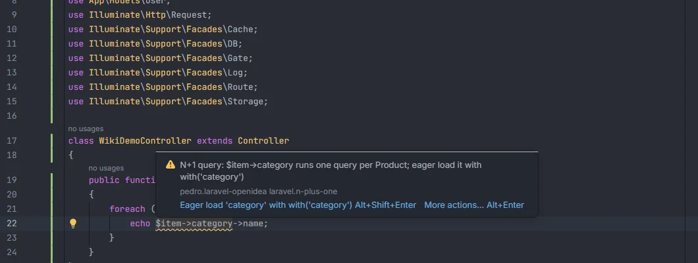
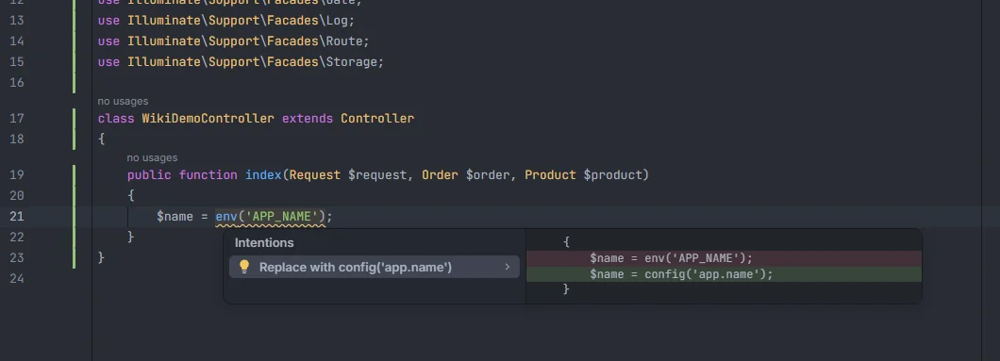
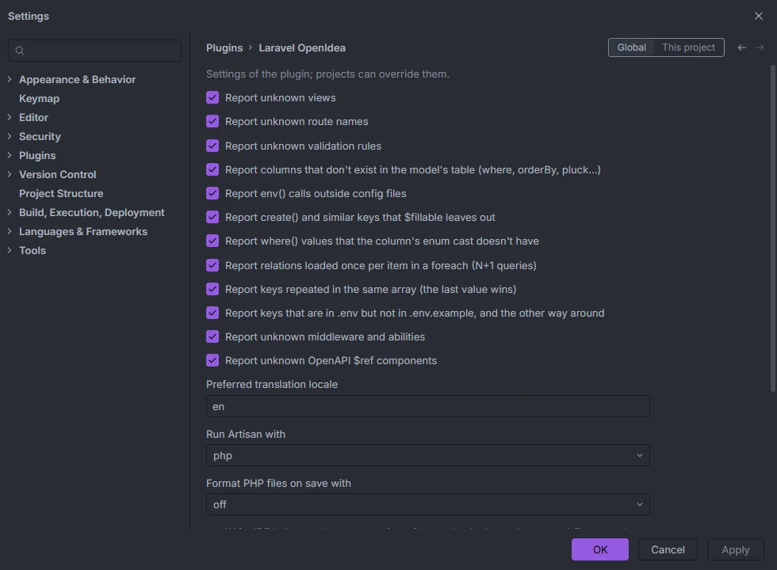

# Inspections overview

Laravel OpenIDEA checks your PHP, Blade and `.env` files against what it knows about the project (views, routes, migrations, models, casts, config files, the installed Laravel) and underlines the mistakes it finds: a view that doesn't exist, a column that isn't in the table, a relation loaded once per loop item, an `env()` call that stops working after `config:cache`. Most of them come with a quick fix on Alt+Enter.

category inside a foreach, with the eager-load fix in the tooltip" width="760">

An inspection in the editor: the wavy underline, the message, the diagnostic code and the preferred quick fix

## All inspections

| Inspection | Diagnostic code | Severity | Files | Setting | Default | Quick fix |
| --- | --- | --- | --- | --- | --- | --- |
| [Unknown views](Inspection-Unknown-Views.md) | `laravel.unknown-view` | Warning | PHP, Blade | `unknownViewInspection` | on | Change to the closest view, here or in every usage |
| [Unknown route names](Inspection-Unknown-Routes.md) | `laravel.unknown-route` | Warning | PHP, Blade | `unknownRouteInspection` | **off** | none |
| [Unknown validation rules](Inspection-Unknown-Rules.md) | `laravel.unknown-validation-rule` | Warning | PHP, Blade | `unknownRuleInspection` | on | none |
| [Unknown columns](Inspection-Unknown-Columns.md) | `laravel.unknown-column` | Warning | PHP | `unknownColumnInspection` | on | Change to the closest column |
| [Enum values](Inspection-Enum-Values.md) | `laravel.unknown-enum-value` | Warning | PHP | `enumValueInspection` | on | Change to the closest enum value |
| [N+1 queries](Inspection-N-Plus-One.md) | `laravel.n-plus-one` | Warning | PHP | `nPlusOneInspection` | on | Eager load the relation with `with()` |
| [`env()` outside config](Inspection-Env-Outside-Config.md) | `laravel.env-outside-config` | Warning | PHP | `envCallInspection` | on | Replace with `config('…')` (up to three keys) |
| [Keys `$fillable` leaves out](Inspection-Fillable.md) | `laravel.not-fillable` | Warning | PHP | `fillableInspection` | on | Add the key to the model's `$fillable` |
| [Duplicate array keys](Inspection-Duplicate-Keys.md) | `laravel.duplicate-key` | Warning | PHP | `duplicateKeyInspection` | on | Remove the overwritten entry |
| [`.env` keys](Inspection-Env-Keys.md) | `laravel.env-keys` | Warning in `.env`, Info in `.env.example` | `.env`, `.env.example` | `envKeysInspection` | on | Add the key to the other file |
| [Unknown middleware and abilities](Inspection-Unknown-Middleware.md) | `laravel.unknown-middleware`, `laravel.unknown-ability` | Warning | PHP, Blade | `unknownAuthInspection` | **off** | none |
| [Unknown OpenAPI refs](Inspection-Unknown-OpenAPI-Refs.md) | `laravel.unknown-openapi-ref` | Warning | PHP | `unknownOpenApiRefInspection` | on | none |
| [Security](Inspection-Security.md) | `laravel.mass-assign-input`, `laravel.raw-sql-variable`, `laravel.unescaped-request` | Warning | PHP, Blade | `securityInspection` | on | Use `validated()`; escape with `{{ }}` |
| [Missing translations](Inspection-Missing-Translations.md) | `laravel.missing-translation` | Warning | PHP, Blade | `missingTranslationInspection` | on | Add the key to each missing locale's file |
| [Upgrade](Inspection-Upgrade.md) | `laravel.upgrade` | Info | PHP, Blade | `upgradeInspection` | on | Replace with the new name, for plain renames |

"PHP" means `.php` files that are not Blade templates. "Blade" means `.blade.php` files.

## How to use it

There is nothing to start. Open a file of a Laravel project and the plugin checks it; keep typing and the warnings follow the text. To fix one, put the cursor inside the underlined text and press **Alt+Enter**.

A project counts as Laravel when it has an `artisan` file and its `composer.json` mentions `laravel/framework` or `laravel/laravel`. In any other project the plugin reports nothing.

## What you see

- **The underline.** Each problem underlines exactly the part that is wrong: the column name inside its quotes, the whole `env('…')` call, `$item->relation` in a loop, the key of an `.env` line.
- **The tooltip.** Hovering the underline shows the message, then a line with the plugin id `pedro.laravel-openidea` and the diagnostic code (for example `laravel.unknown-column`), then *More actions… Alt+Enter*. When the inspection has a preferred fix, the tooltip also offers it as a link with **Alt+Shift+Enter**, for example *Replace with config('services.stripe.secret') Alt+Shift+Enter*.
- **The counter.** The top right corner of the editor counts the warnings (and infos) of the file, with arrows to jump between them.
- **The problems list.** The diagnostics are published to the IDE like those of any other tool, so they are listed with the file's other problems (PHP language server warnings, spelling) in OpenIDEA's problems view.

Alt+Enter lists the quick fixes under Intentions, with a preview of the change

**Quick fixes.** Alt+Enter opens the IDE's *Intentions* list. The first quick fix is the preferred one. The right side of the popup previews the change as a before and after diff; when a fix also edits another file (adding a key to a model's `$fillable`, adding a key to `.env.example`) the preview says *Also changes 1 other file*. Fixes are computed from the text as it is at that moment, so they always match what you see.

## Details

### When inspections run

| Moment | What is checked |
| --- | --- |
| A file is opened | That file. For `.env` or `.env.example`, both files. |
| A file is saved | That file. The project facts are rebuilt, because a saved migration, model or config file can change the answer. |
| While you type in a PHP file | The open file, each time the editor asks the plugin for gutter markers or code actions on a new version of the text. The warnings appear and go away without saving. |
| Files change on disk (a `git pull`, a generator, another editor) | Each changed file. A batch of more than 200 changes makes the plugin forget its indexes and rebuild them. |
| A version control change (branch switch) | The indexes are forgotten and rebuilt. |
| `.env`, `.env.example`, `composer.lock`, `bootstrap/cache/routes-v7.php` and the other single files the plugin reads change outside the editor | Picked up on the next event, by comparing size and modification time, because OpenIDEA doesn't report changes to git-ignored files. |

Live checking while you type applies to PHP files only. Blade files and the `.env` pair are checked when they are opened or saved, and when they change on disk.

Live checking starts once the project's facts are ready (see below). Until then, opening or saving a file runs the inspections, building the facts first.

### Where the data comes from

The inspections never run PHP and need no optional permission: they read files.

- **Index inspections** (views, routes, rules, middleware, abilities, OpenAPI refs) look the string up in the plugin's indexes, the same ones that drive completion: view files under `resources/views`, route files, the installed framework under `vendor/laravel/framework`, `bootstrap/app.php` and `app/Http/Kernel.php`, gates and policies, swagger-php attributes. Each index is built the first time it is needed and rebuilt when a file that feeds it changes. Validation rules and the built-in middleware aliases follow the Laravel version installed in `vendor/`, so a rule added in a later Laravel is reported in an older project; without `vendor/` (before `composer install`) built-in lists are used.
- **Fact inspections** (columns, enum values, N+1, `env()`, `$fillable`, duplicate keys) use a set of *project facts* built once per project: every model with its table, file, source, relations and enum casts; the columns of every table from the migrations; and, for each config key, the environment variable its `env()` call reads. The facts are kept per project, so switching windows doesn't rebuild them, and they are dropped and rebuilt after any save or change on disk.
- **`.env` keys** compare the two files directly.

The first time a project is touched the plugin indexes it as a background task, *Indexing the Laravel project*, shown in the status bar.

### What is never checked

- Text in comments. In Blade, text outside `{{ }}`, `{!! !!}`, `@php … @endphp`, `<?php … ?>` and `@directive(...)` lines, and anything inside `{{-- --}}`.
- Strings that are still being typed (no closing quote yet).
- Index inspections skip strings built by concatenation (`'admin.' . $page`) and strings that contain `$`, `{` or `*`.
- Fact inspections skip Blade files altogether.

### Diagnostics from other tools

When [PHPStan on save](Tools-on-Save.md) is turned on, its errors for a file are published in the same list as the inspections, so a live update never hides them.

## Settings and permissions

Every inspection has a checkbox in **Settings › Plugins › Laravel OpenIdea**. Use the *Global* / *This project* switch at the top to turn a check on or off for one project only. The settings are read every time the inspections run, so a change applies the next time the file is checked (typing, saving or reopening it). Turning one off clears its warnings from the file on that run.

The inspection checkboxes. In this screenshot the two checks that are off by default, route names and middleware and abilities, have been turned on.

| Setting | Label | Default |
| --- | --- | --- |
| `unknownViewInspection` | Report unknown views | on |
| `unknownRouteInspection` | Report unknown route names | off |
| `unknownRuleInspection` | Report unknown validation rules | on |
| `unknownColumnInspection` | Report columns that don't exist in the model's table (where, orderBy, pluck…) | on |
| `envCallInspection` | Report env() calls outside config files | on |
| `fillableInspection` | Report create() and similar keys that $fillable leaves out | on |
| `enumValueInspection` | Report where() values that the column's enum cast doesn't have | on |
| `nPlusOneInspection` | Report relations loaded once per item in a foreach (N+1 queries) | on |
| `duplicateKeyInspection` | Report keys repeated in the same array (the last value wins) | on |
| `envKeysInspection` | Report keys that are in .env but not in .env.example, and the other way around | on |
| `unknownAuthInspection` | Report unknown middleware and abilities | off |
| `unknownOpenApiRefInspection` | Report unknown OpenAPI $ref components | on |

The inspections only need the permissions every installation has (`project.read` and `events`). See [Settings](Settings.md) and [Permissions](Permissions.md).

## Related

- [Settings](Settings.md)
- [How it works](How-It-Works.md): indexes, time budgets and background indexing
- [Tools on save](Tools-on-Save.md): Pint, PHP CS Fixer and PHPStan
- [Rename route](Rename-Route.md) and [Rename translation](Rename-Translation.md): the other Alt+Enter actions
- [Live Audit](Hub-Live-Audit.md): N+1 and slow queries found while the app runs
- [Troubleshooting and logs](Troubleshooting.md)

---
[← Wiki home](Home.md)
