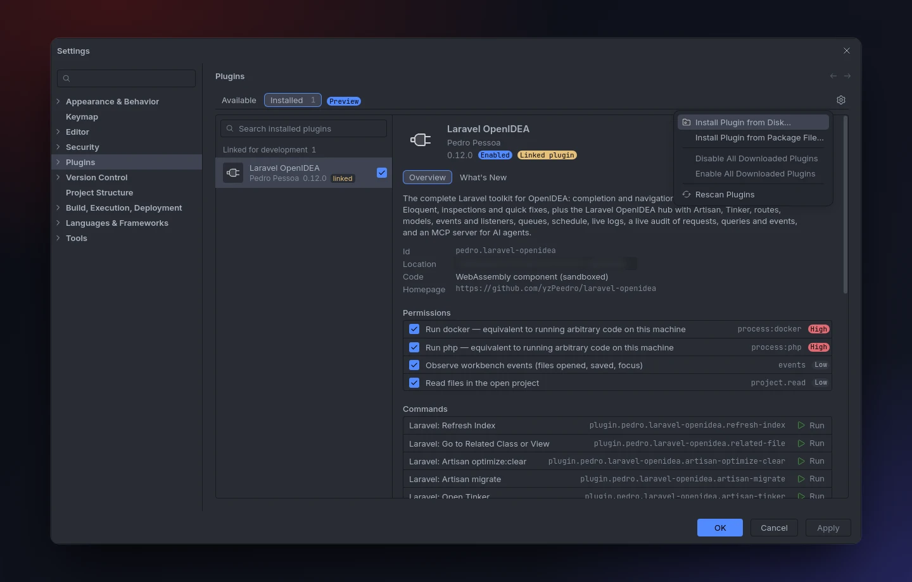
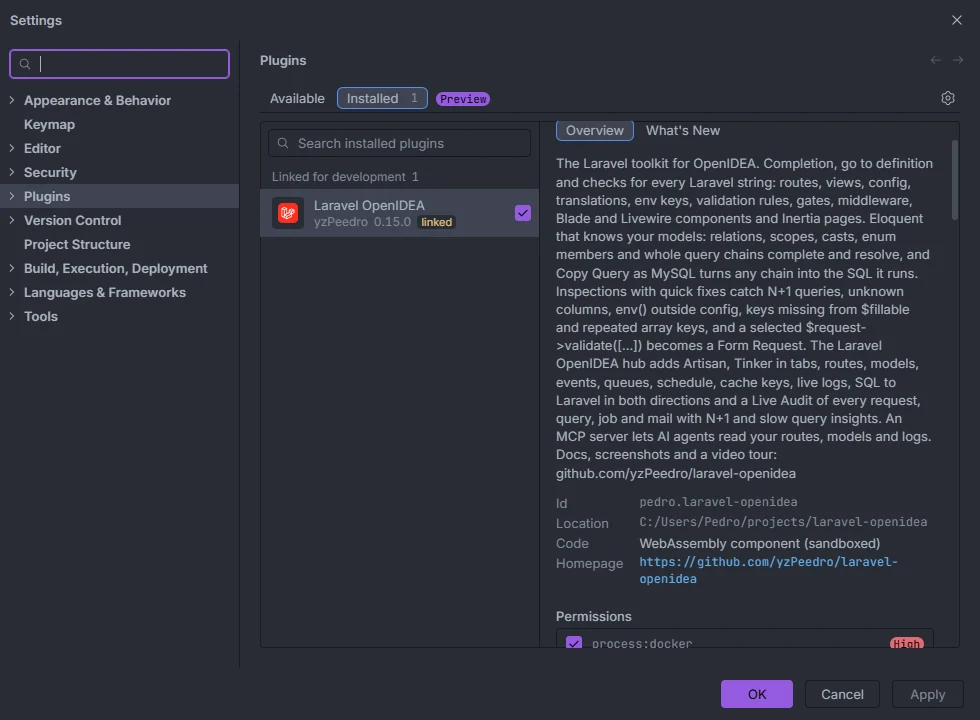
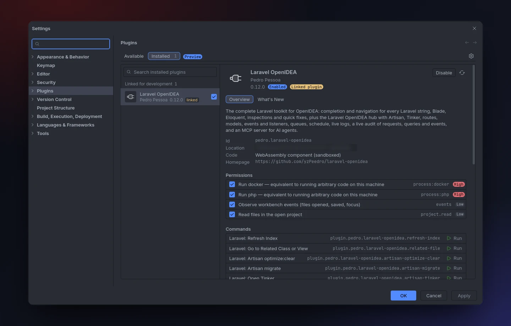

# Installation

Laravel OpenIDEA is an OpenIDEA plugin: a sandboxed WebAssembly component with a hub web view, file templates, file icons, a Blade and a NEON language. This page covers what you need, the three ways to install it (marketplace, package file, development link) and what happens the first time you open a Laravel project.

<p align="center"></p>
<p align="center"><sub>Settings › Plugins › ⚙ › Install Plugin from Package File…</sub></p>

## Requirements

| What | Version | Why |
| --- | --- | --- |
| [OpenIDEA](https://github.com/l0ng-ai/openidea/releases/latest) | 0.1.40 or newer | The plugin declares `engines.openidea = "^1.4"` (plugin API 1.4). 0.1.40 is the first release with the plugin's own gutter icon (`markers` and `tooltip` on marker icons), the document indexer behind [gutter usages](Gutter-Usages.md), indexed usages on Windows and a status bar item per window. |
| A Laravel project | Laravel 6 to 13 tested | Completion and inspections follow the Laravel version installed in `vendor/laravel/framework`. The runtime features (hub runs, Tinker, Live Audit, MCP) are tested on Laravel 10 and newer. |
| PHP or Docker Compose | Any PHP your app runs on | Only for the runtime features: Artisan, Tinker, Live Audit, the Cache browser, the MCP server, tools on save, Extract Form Request. Completion, navigation and inspections need neither. |

A project counts as a Laravel project when its root has an `artisan` file **and** its `composer.json` mentions `laravel/framework` or `laravel/laravel`. Anything else is ignored: no indexing, no status bar item, no hub data.

Without `vendor/` (before `composer install`) the plugin still works, but falls back to its built-in lists of validation rules, Blade directives, casts, middleware aliases and builder methods instead of reading the installed framework.

## Install from the marketplace

1. In OpenIDEA open **Settings › Plugins › Available**.
2. Search for **Laravel OpenIDEA** and install it.

Since 0.14.1 the plugin is listed with its own icon in the Frameworks, Tools and AI categories. Each release also ships `pedro.laravel-openidea-<version>.oiplugin`, the signed package the marketplace installs. A new version reaches the marketplace once the [OpenIDEA plugin registry](https://github.com/l0ng-ai/openidea-plugins) merges the pull request that lists it, which the release workflow opens (see [Development](Development.md#the-marketplace-registry)); until then the marketplace offers the previous version and the new one installs from its package file.

## Install from a package file

1. Download `laravel-openidea-<version>.zip` from the [latest release](https://github.com/yzPeedro/laravel-openidea/releases/latest). Each zip comes with a `.sha256` file you can check it against.
2. In OpenIDEA open **Settings › Plugins**, click the gear (⚙) next to the *Installed* tab and pick **Install Plugin from Package File…**.
3. Choose the zip.

The zip contains `plugin.toml`, `settings.schema.json`, `LICENSE`, `README.md`, `dist/plugin.wasm` and the `icons/`, `languages/`, `templates/` and `web/` folders.

Once installed, the plugin appears under **Settings › Plugins › Installed** with its version and a **Running** badge. The screenshot shows a checkout [linked for development](#link-a-checkout-for-development), which adds the *Linked plugin* badge:

<p align="center"></p>

## Grant the permissions

<p align="center"></p>
<p align="center"><sub>The plugin's page in Settings › Plugins: id, sandboxed WebAssembly code, permissions and commands</sub></p>

The plugin's page in **Settings › Plugins** lists its permissions. Three are required: `project.read`, `events` and `storage`. The others are optional:

- Allow **`process:php`** (or **`process:docker`** for a Docker Compose project) for Artisan, Tinker, Live Audit, the Cache browser, the hub tabs, the MCP server and tools on save. Completion, navigation, inspections and the index-based hub sections work without them.
- On Windows, also allow **`process:php-win`** (the `php-win.exe` next to `php.exe`): background PHP calls then run without flashing a console window.
- Allow **`clipboard`** for *Laravel: Copy Query as MySQL* and the copy button of SQL to Laravel, and **`editor.read`** / **`editor.write`** for the editor commands and *insert at cursor*.

Every permission and what needs it is listed in [Permissions](Permissions.md).

## Open a Laravel project

The plugin activates when a PHP or Blade file is opened, or when the project has an `artisan` file (`activation = ["on-language:php", "on-language:blade", "on-file:artisan"]`). Then:

1. The first time any feature touches the project, it is indexed as a background task titled **Indexing the Laravel project**, shown in the status bar. See [How it works](How-It-Works.md) for the time budgets.
2. The status bar shows **Laravel &lt;version&gt;**, read from `composer.lock` ([Status bar](Status-Bar.md)).
3. The Laravel icon appears at the bottom of the left tool bar. Click it to open [the hub](Hub.md).
4. With `process:php` or `process:docker` allowed, the plugin keeps its helper files in `storage/openidea` up to date when you focus an editor: the [IDE helper stub](IDE-Helpers.md), the hub tab files and, if you connected AI agents, the MCP server. That folder has its own `.gitignore` (`*`), so nothing shows up in git.

Try it: open a controller and type `route('`.

## Link a checkout for development

To run the plugin from a clone of the repository instead of a package, build it and link the folder:

```sh
git clone https://github.com/l0ng-ai/openidea --branch v0.1.40
git clone https://github.com/yzPeedro/laravel-openidea
cd laravel-openidea
rustup target add wasm32-wasip2
cargo install --path ../openidea/crates/ide-host --bin openidea-plugin
cargo build --release --target wasm32-wasip2
cp target/wasm32-wasip2/release/openidea_plugin_laravel_openidea.wasm dist/plugin.wasm
openidea-plugin link .
```

A linked plugin shows under **Linked for development** in Settings › Plugins with a *linked* badge. After each build use **Reload Plugins**. See [Development](Development.md) for the full setup, tests and packaging (`./scripts/package.sh` builds the same zip as a release).

## Update

Install the newer package the same way. You don't need to touch the files in `storage/openidea`: the plugin compares them with the versions it carries and rewrites them when they differ (MCP server, installer, recorder source, access level, IDE helper stub, hub tab files). The Live Audit recorder itself (`storage/openidea/Recorder.php` and its `vendor/autoload.php` hook) is written when you turn it on from the hub.

## Uninstall

Remove the plugin in **Settings › Plugins**. The plugin never writes tracked files on its own, but some features you turned on leave files behind:

| Feature | Files | How to remove them |
| --- | --- | --- |
| IDE helpers | `storage/openidea/ide-helpers.php` | Turn `ideHelpers` off before uninstalling, or delete the file |
| Hub editor tabs | `storage/openidea/hub/` | Delete the folder |
| Live Audit | `storage/openidea/Recorder.php`, a marked hook in `vendor/autoload.php`, `storage/logs/openidea-audit.jsonl` | *Turn off* in the Live Audit section before uninstalling; `composer dump-autoload` also rewrites `vendor/autoload.php` |
| AI agents | `storage/openidea/mcp.php` and friends, a `laravel-openidea` entry in `.mcp.json` and the other client configs, a marked block in `AGENTS.md` | *Disconnect* in the AI Agents section |

## Related

- [Permissions](Permissions.md)
- [Settings](Settings.md)
- [Status bar](Status-Bar.md)
- [How it works](How-It-Works.md)
- [Troubleshooting and logs](Troubleshooting.md)
- [Development](Development.md)

---
[← Wiki home](Home.md)
