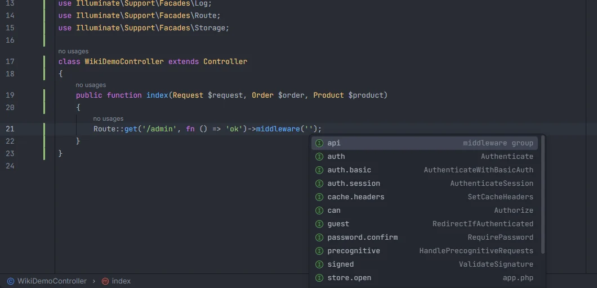
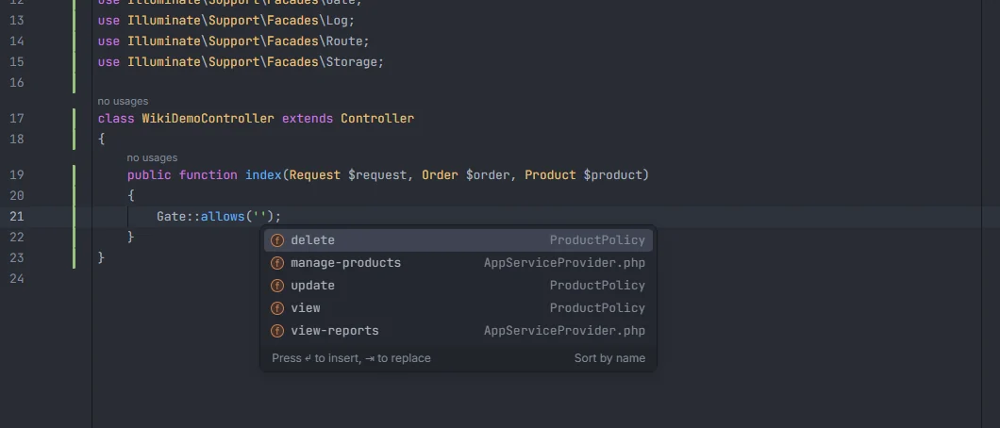

# Middleware, gates and policies

Middleware aliases and groups complete in `->middleware()`, and so do their parameters: the guard in `auth:`, the ability in `can:`, the rate limiter in `throttle:`, token abilities, roles and permissions. Abilities, from `Gate::define()` and your policies' methods, complete in `Gate::allows()`, `$user->can()`, `$this->authorize()`, `@can` and the rest. Ctrl+click opens the alias or the ability's definition, and Ctrl+click on a `Gate::define()` name lists every place the ability is checked.

<p align="center">middleware('') listing api, auth, auth.basic, auth.session, cache.headers, can, guest, password.confirm, precognitive, signed and store.open with the class or file behind each" width="760"></p>
<p align="center"><sub>Middleware aliases and groups in <code>->middleware('')</code>: Laravel's own, and <code>store.open</code> from <code>bootstrap/app.php</code></sub></p>

## Middleware

### Where it completes

| Context | Arrays too |
| --- | --- |
| `Route::middleware('…')`, `Route::withoutMiddleware('…')` | yes |
| `->middleware('…')`, `->withoutMiddleware('…')` on anything (routes, route groups, controllers) | yes |
| `$middleware = […]` (a property or variable named `$middleware`) | yes |
| `return […]` inside a method named `middleware` (such as `public static function middleware(): array` on a controller) | yes |

```php
Route::middleware(['auth:sanctum', 'throttle:uploads'])->group(function () {
    Route::get('/admin', AdminController::class)->middleware('can:view-reports');
});
```

Only string values count: `new Middleware('auth')` objects in a controller's `middleware()` method are not completed.

### Parameters after the colon

The part before `:` is the middleware; after it, the plugin knows what some built-in and package middleware take:

| Middleware | Parameter | Suggests |
| --- | --- | --- |
| `auth`, `auth.basic`, `auth.session`, `guest` | any | Guards of `config/auth.php` (plus `sanctum` when installed) |
| `can` | 1st | Abilities (gates, policy methods and Spatie permissions) |
| `throttle` | 1st, unless it starts with a digit (`throttle:60,1`) | Rate limiters from `RateLimiter::for()` |
| `abilities`, `ability` | any | Sanctum token abilities |
| `role`, `role_or_permission` | any | Spatie roles |
| `permission` | any | Spatie permissions |

Parameters are separated by `,`. Picking a suggestion replaces only the current part, up to the next `:` or `,`.

### What you see

| Source | Detail |
| --- | --- |
| An alias or group from `bootstrap/app.php` | `app.php` |
| An alias or group from `app/Http/Kernel.php` | `Kernel.php` |
| Laravel's default aliases, read from the installed framework | The class name (`Authenticate`, `ThrottleRequests`…) |
| Laravel's default groups (`web`, `api`) | `middleware group` |

### Where the names come from

1. `bootstrap/app.php` (Laravel 11 and newer): the keys of `$middleware->alias([…])`, and the group names in `->group('name', …)`, `->appendToGroup('name', …)` and `->prependToGroup('name', …)` (also as array keys).
2. `app/Http/Kernel.php` (Laravel 10 and older): the keys of `$middlewareAliases`, `$routeMiddleware` and `$middlewareGroups`.
3. With `vendor/laravel/framework` installed: the default aliases and groups of the installed version, read from `Illuminate\Foundation\Configuration\Middleware::defaultAliases()` and `getMiddlewareGroups()`. That class only exists from Laravel 11; on older versions the Kernel's own lists are the whole set, as in a real app.
4. Without `vendor/`: a built-in list of `auth`, `auth.basic`, `auth.session`, `cache.headers`, `can`, `guest`, `password.confirm`, `precognitive`, `signed`, `throttle`, `verified`, `web`, `api` and `bindings`.

A name is listed once; your own definition wins over the framework's.

## Abilities

<p align="center"></p>
<p align="center"><sub>Gates from <code>AppServiceProvider.php</code> and methods of <code>ProductPolicy</code> in <code>Gate::allows('')</code></sub></p>

### Where they complete

| Context | Argument | Arrays too |
| --- | --- | --- |
| `Gate::allows`, `denies`, `check`, `any`, `none`, `authorize`, `inspect`, `has`, `raw` | 1st | yes |
| `->can('…')`, `->cannot('…')`, `->cant('…')` (users, `Route::…->can()`) | 1st | yes |
| `->authorize('…')` (controllers, Form Requests) | 1st | yes |
| `->authorizeForUser($user, '…')` | 2nd | yes |
| `@can`, `@cannot`, `@canany`, `@elsecan`, `@elsecannot` | 1st | yes |
| `can:` in middleware | 1st parameter | |

```php
Gate::allows('manage-products');
$this->authorize('update', $product);
$user->can(['view-reports', 'export-reports']);
```

```blade
@can('update', $product)
    <a href="{{ route('products.edit', $product) }}">Edit</a>
@endcan
```

### What you see and where it comes from

| Source | Detail |
| --- | --- |
| `Gate::define('name', …)` in any file under `app/` (up to 5000 files) | The file name (`AppServiceProvider.php`) |
| Every public method of every class in an `app/**/Policies/` folder, except `before`, `after` and `__construct` | The policy class (`ProductPolicy`) |
| Spatie Permission permissions | The file that creates them (see [Packages](Packages.md#spatie-laravel-permission)) |

A method name shared by several policies (`update`, `view`…) is listed once, from the first policy found.

### Ctrl+click

| Ctrl+click on | Opens |
| --- | --- |
| An ability in any context above | The `Gate::define()` string, or the policy method (the first policy that has it) |
| The name in `Gate::define('…')` | A list of every place that checks it: `Gate::allows`/`denies`/…, `authorize()`, `can()`, `@can` and `can:` middleware, in `app/`, `routes/`, `resources/views/`, `tests/`, `database/` and `config/` |
| A middleware alias | Its definition in `bootstrap/app.php` or `app/Http/Kernel.php`, or the alias in the framework's `Middleware` class |
| A rate limiter in `throttle:` | Its `RateLimiter::for()` string |
| A guard in `auth:` | The guard in `config/auth.php` |

## Rate limiters

Rate limiter names come from `RateLimiter::for('name', …)` in any file under `app/`, with the file name as detail. They complete in `throttle:` (see above); a first parameter that starts with a digit (`throttle:60,1`) is a count, so nothing is suggested there.

## Details

- Facade and method names are matched case-insensitively, and fully qualified facades work.
- Strings with `$`, `{` or `*`, and strings joined with `.` to other values, are never reported as unknown.
- The middleware index is rebuilt when `bootstrap/app.php`, `app/Http/Kernel.php`, `composer.lock` or `vendor/composer/installed.json` changes; abilities and rate limiters when a file under `app/` changes.
- In `Gate::define('name', fn`, typing `fn` completes `fn (User $user) =>` with the import ([Typed closures](Typed-Closures.md)).
- Nothing here runs PHP.

## Settings and permissions

- `unknownAuthInspection` (off by default) reports middleware aliases and abilities nobody defines. See [Unknown middleware and abilities](Inspection-Unknown-Middleware.md).
- Only `project.read` is needed. See [Settings](Settings.md) and [Permissions](Permissions.md).

## Related

- [Unknown middleware and abilities](Inspection-Unknown-Middleware.md)
- [Drivers and connections](Drivers-and-Connections.md): guards
- [Packages](Packages.md): Sanctum token abilities and Spatie roles and permissions
- [Middleware in the hub](Hub-Middleware.md) and [Auth & Policies in the hub](Hub-Auth-and-Policies.md)

---
[← Wiki home](Home.md)
