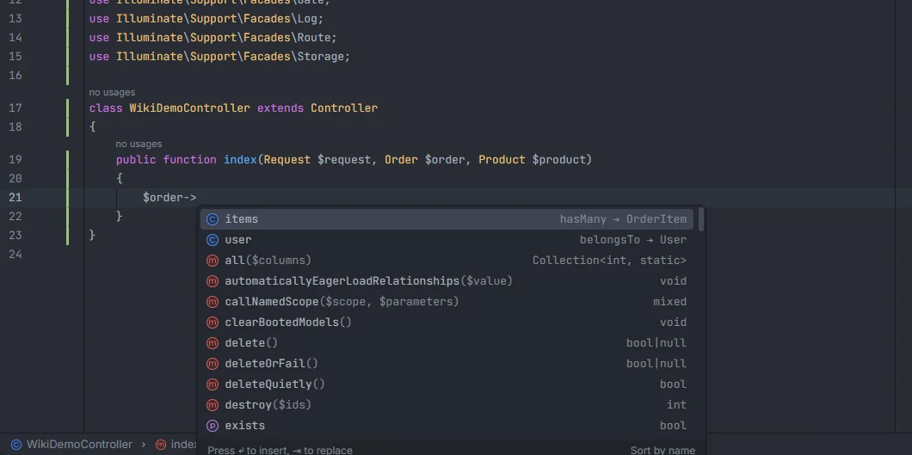
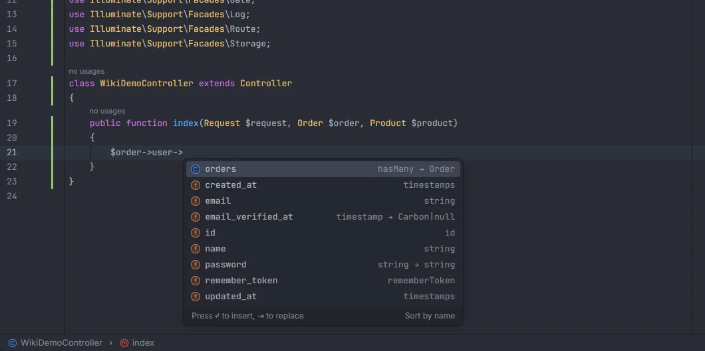
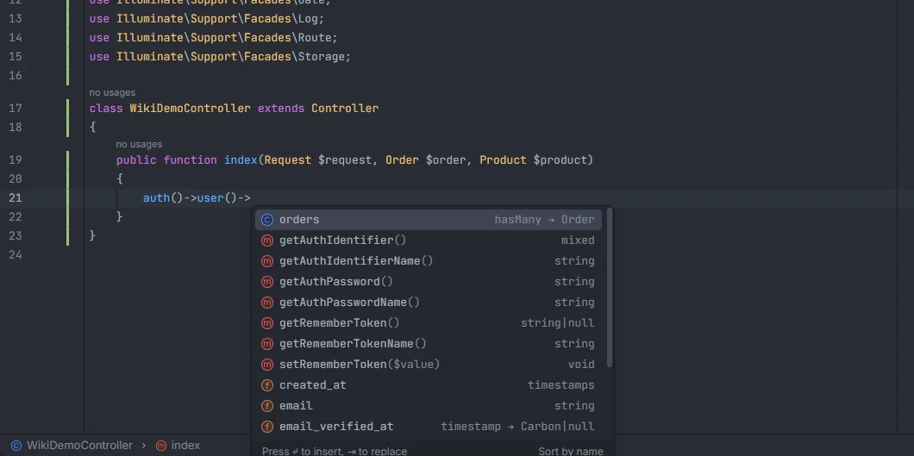

# Model members

After `->` on a variable that holds a model, the plugin lists that model's columns, with their database type and what their cast turns them into, and its relations, with their kind and target model. It follows relations (`$order->user->`), `$this` in a model and `auth()->user()`, and Ctrl+click on a member opens the relation's model, the cast's class or the migration of the column.

<p align="center"> showing the items and user relations with their kind and target, above the methods listed by the PHP language server" width="760"></p>
<p align="center"><sub><code>$order-></code>: the relations <code>items</code> (hasMany → OrderItem) and <code>user</code> (belongsTo → User), with the model's methods from the PHP language server below</sub></p>

## How to use it

Type `->` (or `?->`) after a model variable, or press Ctrl+Space after it:

```php
public function show(Order $order)
{
    $order->            // columns and relations of Order
    $order->user->      // columns and relations of User
    $order->user?->na   // filtered by what you typed
    $this->             // in a model: the model's own members

    foreach ($order->items as $item) {
        $item->         // members of OrderItem
    }

    auth()->user()->    // members of User
}
```

### How the model of a variable is found

The plugin reads the current function (from the nearest `function` keyword before the cursor) and takes the last thing that tells it what the variable is:

| Code | `$x` is |
| --- | --- |
| A typed parameter: `function show(Order $order)`, `?Shop $shop` | the class of the type |
| `$x = new Order(…)` | `Order` |
| `$x = Order::create(…)` and any static chain whose last call is `find`, `findOrFail`, `findOrNew`, `first`, `firstOrFail`, `firstOrNew`, `firstOrCreate`, `firstWhere`, `sole`, `create`, `forceCreate`, `make`, `updateOrCreate`, `findSole`, `fresh` or `replicate` | one `Order` |
| `$x = Order::where(…)->get()` and static chains ending in `get`, `all`, `paginate`, `simplePaginate`, `cursorPaginate`, `lazy`, `cursor`, `findMany` or `hydrate` | a collection of `Order` |
| `$x = $order->user` (a property chain without calls) | the model at the end of the chain |
| `foreach ($order->items as $item)`, `foreach ($list as $key => $row)` | one item of the collection |
| `/** @var Order $x */` (or with a fully qualified name) | `Order`; a docblock wins over everything else |
| `$this` in a model class | the model itself |
| `auth()->user()`, `Auth::user()`, `$request->user()`, `request()->user()`, `$this->user()` | the `User` model |
| An untyped closure parameter | see [Eloquent columns and relations](Eloquent-Columns-and-Relations.md#closures) |

A static chain that ends with anything else, such as `$builder = Order::query()->where(…)`, gives no model to the variable. The type must be a model the plugin knows (a class under a `Models` folder in `app/`, see [Eloquent columns and relations](Eloquent-Columns-and-Relations.md#details)); `Request $request` and other non-model types are ignored.

## What you see

- **Columns** use the field icon. The detail is the migration's column type (`string`, `foreignId`, `timestamp`…), followed by what a cast turns it into when the model casts the column: `status · string → OrderStatus`, `email_verified_at · timestamp → Carbon|null`, `password · string → string`. See [Casts](Casts.md) for how that target is worked out.
- **Relations** use the class icon and show `kind → Target`, such as `hasMany → OrderItem` or `belongsTo → User`. They sort after the columns. Picking one inserts the name without parentheses (a property access).
- Items whose name starts with what you typed rank first. Matching ignores case.
- The PHP language server adds its own items to the same popup (methods such as `delete()` or `exists`); the plugin's items are the columns and relations.

<p align="center">user-> showing the orders relation and the columns of the users table with their types and casts" width="760"></p>
<p align="center"><sub><code>$order->user-></code> follows the <code>belongsTo</code> to <code>User</code>: its <code>orders</code> relation and its columns, with casts such as <code>timestamp → Carbon|null</code></sub></p>

### `auth()->user()`

`auth()->user()`, `Auth::user()`, `$request->user()`, `request()->user()` and `$this->user()` (in a Form Request) are the model named `User`, so the chain after them completes like any other model. When `auth()` or `Auth::` is preceded by another call or an object (`$x->auth()->user()`), it is not treated as the signed-in user. `$this->user()` is always read as the signed-in user, also in a model whose own `user()` method is a relation. A project without a `User` model gets nothing here.

<p align="center">user()-> showing the orders relation and user columns next to the authentication methods" width="760"></p>
<p align="center"><sub><code>auth()->user()-></code>: the <code>User</code> model's relations and columns; the <code>getAuth…</code> methods come from the PHP language server, typed by the <a href="IDE-Helpers.md">IDE helper</a></sub></p>

The [IDE helper](IDE-Helpers.md) stub types `auth()->user()` for Intelephense as well, so it stops reporting "Undefined method".

## Details

- **Relations are followed.** `$order->user->` walks the `user` relation to its target; each step must be a relation of the model reached so far. A to-many relation (`hasMany`, `belongsToMany`, `morphMany`, `morphToMany`, `morphedByMany`, `hasManyThrough`) gives a collection, and after it the collection's methods are listed instead; see [Eloquent chains](Eloquent-Chains.md).
- **Calls in the chain** (`$order->items()->first()->`, `Order::where(…)->first()->`) are followed as described in [Eloquent chains](Eloquent-Chains.md); when a call leads back to one model, its members are listed again.
- A cast column followed by `->` (`$coupon->status->`) lists the members of the enum or value object instead; see [Casts](Casts.md#members-of-enum-and-value-object-casts).
- `->pivot->` (or the accessor set with `->as()`) lists the pivot columns of many-to-many relations; see [Packages](Packages.md).
- Variables are typed from the code before the cursor in the current function only. A variable assigned in another method, or a property such as `$this->order`, is not followed.
- Inferring a variable from another variable is followed at most four levels deep.
- The columns and relations come from the indexes built from your saved migrations and models. A relation you have just written appears after the model file is saved.
- Completion inside a string argument is handled by [Eloquent columns and relations](Eloquent-Columns-and-Relations.md) instead.

### Go to definition

Ctrl+click on a member name after `->`:

| Member | Opens |
| --- | --- |
| A relation (`$order->user`) | the related model's class; the relation method when that model isn't indexed |
| A column cast to an enum | the enum declaration |
| A column cast to a class | the class or interface its `get()` returns; the cast class when `get()` returns a scalar or has no return type |
| Any other column | the line of the migration that created it |

On a collection (`$order->items->…`) Ctrl+click on a member does nothing.

## Settings and permissions

No setting and no optional permission. The `ideHelpers` setting (on by default) controls the stub that types `auth()` for Intelephense; see [IDE helpers](IDE-Helpers.md) and [Settings](Settings.md).

## Related

- [Eloquent chains](Eloquent-Chains.md)
- [Casts](Casts.md)
- [Eloquent columns and relations](Eloquent-Columns-and-Relations.md)
- [Snippets](Snippets.md): the `$fillable`, `casts()` and relation snippets inside a model
- [Generate model PHPDoc](Generate-Model-PHPDoc.md)
- [Helpers](Helpers.md) and [IDE helpers](IDE-Helpers.md)
- [N+1 queries](Inspection-N-Plus-One.md)

---
[← Wiki home](Home.md)
