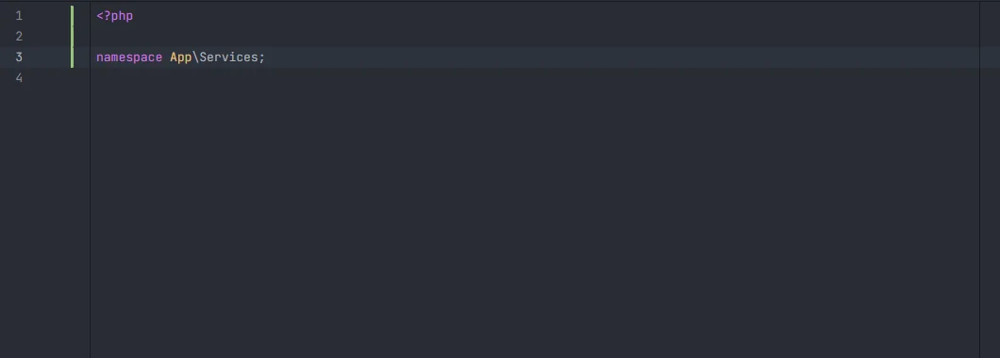

# PSR-4 namespaces

After `namespace ` in a PHP file, the plugin offers the namespace that the file's folder maps to through the PSR-4 autoload rules of your `composer.json`, with the semicolon. A new file in `app/Http/Controllers/Admin/` gets `App\Http\Controllers\Admin;` in one keystroke, and a test in `tests/Feature/Api/` gets `Tests\Feature\Api;`.

<p align="center"></p>
<p align="center"><sub>In <code>app/Services/WikiProbe.php</code>, the only candidate, <code>App\Services</code>, was applied directly with its semicolon</sub></p>

## How to use it

In a `.php` file (not a Blade template), type `namespace` and a space, optionally followed by the start of the namespace, and open the completion list:

```php
<?php

namespace |                 // App\Http\Controllers\Admin;
namespace App\H|            // still offered: what you typed is a prefix
namespace App\H|;           // a semicolon already follows: inserted without one
```

When there is a single candidate, the IDE may apply it straight away, as in the screenshot.

## What you see

- The namespace with the module icon and the detail `PSR-4 namespace of this folder`.
- The insert text ends with `;`, unless a `;` already follows the cursor on the same line (spaces and tabs before it are allowed).
- Only this list is shown after `namespace `; other completions are not mixed in.

## Details

- **Mapping:** the PSR-4 entries of `autoload` and `autoload-dev` in the project's `composer.json` are read; an entry can map to one folder or to a list of folders. When `composer.json` can't be read or has no PSR-4 entries, `App\` → `app/` is used.
- The file's folder (its path relative to the project, without the file name) must start with the entry's folder. The rest of the folder path becomes the namespace segments: `app/` + `Http/Controllers/Admin` under `App\` gives `App\Http\Controllers\Admin`. A file directly in `app/` gets `App`.
- When several entries match, one candidate is offered for each, ordered with the longest namespace prefix first, and duplicates are dropped.
- A folder outside every PSR-4 root (such as `routes/`) gets no candidate.
- Matching is a case-insensitive prefix match on the whole namespace: `App\H` matches `App\Http\Controllers`, `Foo` matches nothing.
- The trigger is the word `namespace` at the start of the line (indentation allowed), followed by at least one space, then only letters, digits, `_` and `\` up to the cursor. `$namespace = …` and `namespaces` don't trigger it.
- The same PSR-4 map is used to find classes for [casts](Casts.md), [factories](Factories.md), [typed closure](Typed-Closures.md) imports and the classes counted by [Gutter usages](Gutter-Usages.md).

## Settings and permissions

No setting and no optional permission.

## Related

- [composer.json](Composer-Json.md): `autoload` keys, PSR-4 namespaces and folders
- [Static completion](Static-Completion.md)
- [Types and inheritance](Types-and-Inheritance.md)
- [File templates](File-Templates.md)

---
[← Wiki home](Home.md)
