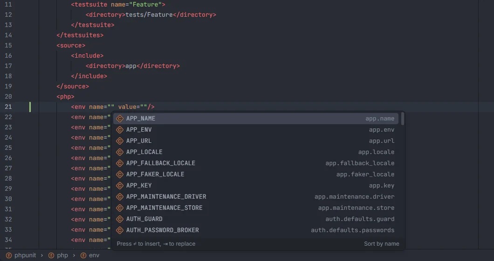

# phpunit.xml

In `phpunit.xml`, the plugin completes elements and attributes from the PHPUnit schema your project has installed, the variable names of `<env>` and `<server>` from your `.env` files and config, their values (connections, stores, drivers, booleans…), suite names, and the test folders and files of `<directory>` and `<file>`.

<p align="center"> in phpunit.xml listing APP_NAME, APP_ENV, APP_URL, APP_LOCALE, APP_FALLBACK_LOCALE, APP_FAKER_LOCALE, APP_KEY, APP_MAINTENANCE_DRIVER, APP_MAINTENANCE_STORE, AUTH_GUARD and AUTH_PASSWORD_BROKER with the config key that reads each" width="760"></p>
<p align="center"><sub><code>&lt;env name=""&gt;</code>: the variables your config reads, with the config key behind each</sub></p>

## How to use it

Open `phpunit.xml`, `phpunit.xml.dist` or `phpunit.dist.xml` (the name is matched ignoring case) and type:

- after `<` for an element name;
- after an element's name and a space for an attribute name;
- inside an attribute's quotes for its value;
- between `<directory>` / `<file>` and their closing tag for a path.

Comments, closing tags and processing instructions (`</…`, `<!…`, `<?…`) get no suggestions.

## What completes where

### Elements

The known PHPUnit elements come first, each with a hint: `testsuites`, `testsuite`, `directory`, `file`, `exclude`, `source`, `include`, `php`, `env`, `server`, `ini`, `const`, `coverage`, `report`, `logging`, `extensions`, `groups` and `group`. When the schema is installed, only the ones it declares are kept, and every other element of the schema follows with the detail *PHPUnit element*.

### Attributes

| Element | Attributes |
| --- | --- |
| `<phpunit>` | every attribute of the installed schema's `configAttributeGroup`, with its type as detail (`boolean`, `anyURI`, `executionOrderType`…) |
| `<env>` | `name`, `value`, `force` |
| `<server>`, `<ini>`, `<const>`, `<var>`, `<get>`, `<post>`, `<cookie>`, `<request>`, `<files>` | `name`, `value` |
| `<testsuite>` | `name` |
| `<directory>` | `suffix`, `prefix`, `phpVersion`, `phpVersionOperator` |
| `<source>` | `restrictNotices`, `restrictWarnings`, `ignoreSuppressionOfDeprecations`, `baseline` |
| `<html>` | `outputDirectory`, `lowUpperBound`, `highLowerBound` |
| `<clover>`, `<cobertura>`, `<junit>`, `<text>`, `<teamcity>`, `<testdoxHtml>`, `<testdoxText>` | `outputFile` |
| `<bootstrap>` | `class` |

### Values

| Attribute | Suggests |
| --- | --- |
| `<phpunit executionOrder="…">` | the values of the schema's `executionOrderType` (`default`, `random`…) |
| `<phpunit bootstrap="…">` | `vendor/autoload.php` |
| `<phpunit cacheDirectory="…">` | `.phpunit.cache` |
| `<phpunit columns="…">` | `max`, `80` |
| any boolean `<phpunit>` attribute (`colors`, `stopOnFailure`…) | `true`, `false` |
| `<testsuite name="…">` | `Unit`, `Feature`, `Integration`, `Browser`, `Arch` |
| `<env force="…">` | `true`, `false` |
| `<directory suffix="…">` | `Test.php`, `.php` |
| `<env name="…">`, `<server name="…">` | variable names (below) |
| `<env value="…">`, `<server value="…">` | values for the variable in the same tag's `name` (below) |

### `<env>` and `<server>` names

The same names as in `.env` files, each once, in this order:

1. every `env('…')` in your config files, with the config key that reads it as detail (`APP_NAME` · `app.name`);
2. the built-in list of usual Laravel variables (`APP_KEY`, `DB_CONNECTION`, `MAIL_MAILER`…);
3. the keys of `.env` and `.env.example`.

### `<env>` and `<server>` values

Once the tag has a `name`, its `value` completes like the value of that variable in `.env`: `DB_CONNECTION` with your database connections, `CACHE_STORE` with your cache stores, `QUEUE_CONNECTION`, `MAIL_MAILER`, `SESSION_DRIVER`, `LOG_LEVEL`, `APP_ENV`, locales for `*_LOCALE`, `true`/`false` for `*_DEBUG`, `*_ENABLED`… The full table is on [Environment variables](Environment-Variables.md#values-in-env-files). A variable without known values gets no suggestions.

```xml
<php>
    <env name="APP_ENV" value="testing"/>
    <env name="DB_CONNECTION" value="sqlite"/>
    <env name="DB_DATABASE" value=":memory:"/>
    <env name="CACHE_STORE" value="array"/>
</php>
```

### `<directory>` and `<file>`

Between the tags, the plugin lists the folders that hold PHP files under `tests/`, `app/` and `src/` (every level, such as `tests`, `tests/Feature`, `tests/Feature/Api`), with the detail *folder*. Inside `<file>`, the PHP files themselves are added with the detail *file*. Up to 3000 files are read under each folder.

## Where the schema comes from

The plugin reads `vendor/phpunit/phpunit/phpunit.xsd` from your project, so the elements, `<phpunit>` attributes and execution orders are the ones of the PHPUnit version you have installed. Without it (before `composer install`), the known elements are still offered, but `<phpunit>` attributes and `executionOrder` values aren't.

## Details

- Suggestions replace the whole attribute value, or the whole text between the tags.
- The plugin returns the suggestions in the order above and leaves filtering by what you typed to the editor.
- Nothing here runs PHPUnit or PHP.
- The plugin adds no Ctrl+click targets in `phpunit.xml`.

## Settings and permissions

There are no settings for this completion, and only `project.read` is needed. See [Settings](Settings.md) and [Permissions](Permissions.md).

## Related

- [Environment variables](Environment-Variables.md)
- [Pest](Pest.md): datasets and groups
- [composer.json](Composer-Json.md)
- [Run configurations](Run-Configurations.md): `artisan test`
- [Tests in the hub](Hub-Tests.md)

---
[← Wiki home](Home.md)
