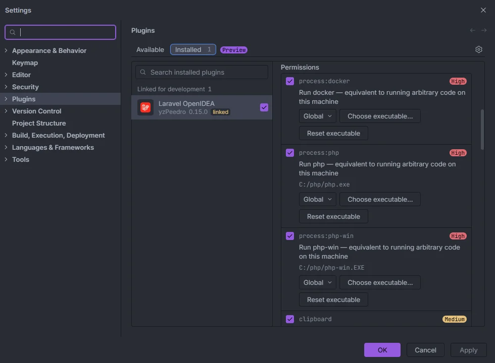

# Permissions

OpenIDEA runs every plugin in a WebAssembly sandbox: it can only read files, run programs or touch the editor through the capabilities you grant. Laravel OpenIDEA asks for three required capabilities and six optional ones, and every feature degrades cleanly when an optional one is missing.

<p align="center"></p>
<p align="center"><sub>Settings › Plugins › Laravel OpenIDEA › Permissions, with the executable the IDE resolved for each process permission</sub></p>

## Where to find them

Open **Settings › Plugins**, select **Laravel OpenIDEA** and scroll to **Permissions**. Each entry has:

- a checkbox to allow or deny it;
- a risk badge: the process permissions are **High** ("equivalent to running arbitrary code on this machine"), `clipboard` is **Medium**, `project.read` and `events` are **Low**;
- for process permissions, the executable the IDE resolved (for example `C:/php/php.exe`), a scope menu (**Global** in the screenshot), **Choose executable…** to point at another binary and **Reset executable** to go back to the default one.

## The list

Declared in `plugin.toml`:

```toml
[capabilities]
required = ["project.read", "events", "storage"]
optional = ["process:php", "process:php-win", "process:docker", "editor.read", "editor.write", "clipboard"]
```

| Permission | Kind | What uses it | Without it |
| --- | --- | --- | --- |
| `project.read` | required | Every index (routes, views, config, models, migrations…), completion, Go to Definition, inspections, the hub's index-based sections, publishing diagnostics | The plugin can't work |
| `events` | required | Files opened, saved and focused, files changed on disk, VCS changes: they keep the indexes fresh and trigger tools on save | The plugin can't work |
| `storage` | required | The plugin's own key-value storage in the IDE: Tinker tabs, the Artisan history (last 20 runs) and the SQL to Laravel state survive restarts | The plugin can't work |
| `process:php` | optional | Running PHP in your project: the hub's Artisan runs and terminals, Tinker, [Send request](Send-Request.md), [Generate test](Generate-Test.md), the Overview runtime chip, *Run Selection in Tinker*, the Cache browser, Live Audit on and off, AI agents and the MCP sync, the [IDE helper stub](IDE-Helpers.md), the hub tab files, [Extract Form Request](Extract-Form-Request.md), [tools on save](Tools-on-Save.md), the `Laravel: Artisan …` and `Open Tinker` commands, `composer require` from the Ecosystem section, the `artisan serve` and `artisan test` [run configurations](Run-Configurations.md) | Each of these says what to allow (see below); completion, navigation and inspections are unaffected |
| `process:php-win` | optional, Windows | Background PHP calls through `php-win.exe`, which has no console window | Background calls use `php.exe`, and a console window flashes on screen for each one |
| `process:docker` | optional | The same features as `process:php` when the [runner](Settings.md#artisanrunner) is Docker Compose (`docker compose run` or `docker compose exec`) | Same as `process:php` |
| `editor.read` | optional | Reading the current editor's text and selection from a command: *Copy Query as MySQL*, *Run Selection in Tinker*, *Extract Form Request…*, *Generate Feature Test…*, and SQL to Laravel's insert button | Those commands fail with a message naming the permission |
| `editor.write` | optional | Writing to the editor from a command: *Extract Form Request…* and SQL to Laravel's *insert at cursor* | Same |
| `clipboard` | optional | *Laravel: Copy Query as MySQL*, the copy button of SQL to Laravel and *Copy as cURL* in the request panel | "Allow "clipboard" for Laravel OpenIDEA in Settings › Plugins to copy queries." |

Code actions you pick with Alt+Enter (quick fixes, *Rename route*, *Rename translation*, *Generate @property PHPDoc*) don't need `editor.read` or `editor.write`: the IDE hands the document to the plugin and applies the edits itself. *Extract the validation into a Form Request* from Alt+Enter still needs a process permission, because it creates the new class file with PHP. *Generate a feature test* from Alt+Enter has the IDE create the file, and uses a process permission only to read the route's middleware.

## What works with no optional permission

- Completion, Go to Definition and gutter markers for every Laravel string, Eloquent, Blade, config files and front-end files.
- Every inspection and its quick fixes.
- [Rename route](Rename-Route.md), [Rename translation](Rename-Translation.md), [Generate model PHPDoc](Generate-Model-PHPDoc.md), [Go to Related Class or View](Related-Class-or-View.md).
- The hub's sections built from your files: routes, controllers, models, database, views, config, env, translations, events, listeners and the rest.
- The [status bar](Status-Bar.md) and *Laravel: Refresh Index*.
- [File templates](File-Templates.md) and [file icons](File-Icons.md).

The [run configurations](Run-Configurations.md) `artisan serve` and `artisan test` are run by the IDE, but OpenIDEA offers them only while `process:php` is allowed for the plugin.

## Messages when a permission is missing

The plugin never fails silently. When a capability is denied, the feature tells you which one to allow:

| Where | Message |
| --- | --- |
| Hub Artisan runs and terminals | Allow "process:php" for Laravel OpenIdea in Settings › Plugins to run Artisan with php |
| *Copy Query as MySQL* | Allow "clipboard" for Laravel OpenIDEA in Settings › Plugins to copy queries. |
| *Run Selection in Tinker* | Allow "process:php" for Laravel OpenIDEA in Settings › Plugins to run Tinker. |
| *Extract Form Request* | Allow "process:php" for Laravel OpenIDEA in Settings › Plugins to create the Form Request. |
| *Generate test* | Allow "process:php" for Laravel OpenIDEA in Settings › Plugins to create the test. |
| Hub request panel, **Send** | Allow "process:php" for Laravel OpenIdea in Settings › Plugins to run Artisan with php |
| Hub request panel, **Copy as cURL** | Allow "clipboard" for Laravel OpenIDEA in Settings › Plugins to copy from the hub. |
| Overview runtime chip | **PHP not found**, with Allow "process:php" for Laravel OpenIDEA in Settings › Plugins to run PHP. |
| SQL to Laravel copy / insert | Allow "clipboard" for Laravel OpenIDEA in Settings › Plugins to copy from the hub. / Allow "editor.read" (or "editor.write") for Laravel OpenIDEA in Settings › Plugins to insert into the editor. |
| Hub tab files | allow process:php for Laravel OpenIDEA in Settings › Plugins (also written to the IDE log) |

With the Docker runner the messages name `process:docker` and the Docker command instead.

## `process:php-win` in detail

On Windows (a project root with a drive letter or a `\\` UNC path) and with the `php` runner, every background PHP call first tries `php-win`. If the IDE answers that the permission is denied, that the program isn't found, or fails to start `process:php-win`, the call silently falls back to `php`. Terminals opened by the plugin (Artisan, Tinker, `artisan serve`) always use `php`, because they are meant to be seen. Docker runs never use it.

## Related

- [Installation](Installation.md)
- [Settings](Settings.md)
- [Privacy and security](Privacy-and-Security.md)
- [How it works](How-It-Works.md)
- [Troubleshooting and logs](Troubleshooting.md)

---
[← Wiki home](Home.md)
