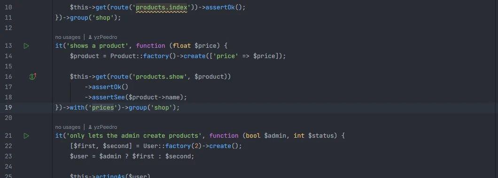
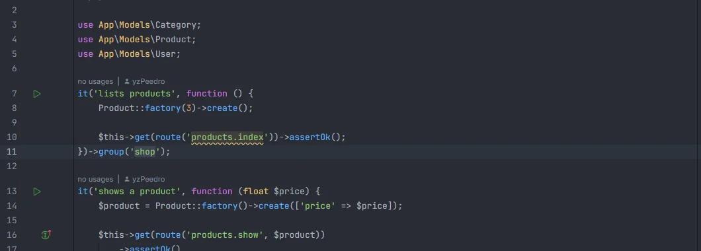

# Pest

In your tests, dataset names complete in `->with('…')` and group names complete in `->group('…')`, `->groups('…')` and `#[Group('…')]`, from the datasets and groups your test suite already declares.

<p align="center">with('prices')->group('shop'), with prices filled in from the project's datasets" width="760"></p>
<p align="center"><sub><code>->with('prices')</code>, picked from the datasets declared in <code>tests/</code></sub></p>

## How to use it

In a PHP file under a `tests/` folder, or in `Pest.php`, type inside the quotes of the first argument:

| Call | Suggests |
| --- | --- |
| `->with('…')` | dataset names |
| `->group('…')`, `->groups('…')` | group names |
| `#[Group('…')]` | group names (PHPUnit's attribute) |

```php
dataset('prices', [9.99, 19.99, 99.0]);

it('shows a product', function (float $price) {
    // …
})->with('prices')->group('shop');
```

<p align="center">group('shop'), with shop filled in from the project's groups" width="760"></p>
<p align="center"><sub><code>->group('shop')</code>, picked from the groups used in <code>tests/</code></sub></p>

## What you see

Each name once, in alphabetical order, with the detail *Pest dataset* or *test group*. The suggestion replaces the text between the quotes.

## Where the names come from

Every `*.php` file under `tests/` (up to 3000 files), plus the file you are editing as it is now, unsaved changes included:

- **Datasets**: the first string argument of every `dataset('…', …)`, whether it is in `tests/Datasets/`, `Pest.php` or a test file.
- **Groups**: the first string argument of every `->group('…')`, `->groups('…')` and `#[Group('…')]`. In `->group('slow', 'db')`, only `slow` is collected.

Names that are empty or span lines are skipped. The files are read as text; Pest doesn't run.

## Details

- Only the first argument completes, and only when it is a quoted string directly after the `(`: `->with(['a', 'b'])` (inline data) gets nothing.
- In test files, a string in `->with('…')` is always taken as a dataset name. An Eloquent `->with('relation')` on a query inside a test therefore suggests datasets, not relations. `Model::with('…')` (static) still completes relations.
- Ctrl+click on a dataset or group name isn't provided.
- The names are collected once per project and kept until a file under `tests/` is saved or changes on disk; the file you are editing is always read fresh.

## Settings and permissions

There are no settings for this completion, and only `project.read` is needed. See [Settings](Settings.md) and [Permissions](Permissions.md).

## Related

- [phpunit.xml](PHPUnit-Xml.md)
- [Snippets](Snippets.md): Pest and PHPUnit snippets
- [File templates](File-Templates.md): *Pest Test*
- [Run configurations](Run-Configurations.md): `artisan test`
- [Tests in the hub](Hub-Tests.md)

---
[← Wiki home](Home.md)
