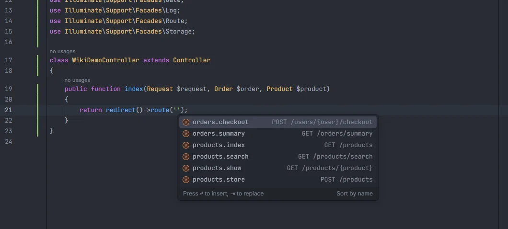

# Route names

Inside the strings Laravel reads as route names, the plugin suggests every named route of your app, with its HTTP verb and full URI next to each one, and Ctrl+click takes you to where the route is defined. Names come from your route files, Folio pages and the route cache, so package routes such as Sanctum's or Horizon's are there too once routes are cached.

<p align="center">route('') listing orders.checkout, orders.summary, products.index, products.search, products.show and products.store with their verb and URI" width="760"></p>
<p align="center"><sub>Route names in <code>redirect()->route('')</code>, each with its verb and URI</sub></p>

## How to use it

Type inside the quotes of any of these calls (or press the completion shortcut there). Method and facade names are matched case-insensitively, and a fully qualified facade (`\Illuminate\Support\Facades\Route::has()`) works the same as the short one.

| Call | Argument | Arrays too |
| --- | --- | --- |
| `route('…')` | 1st | no |
| `to_route('…')` | 1st | no |
| `->route('…')` on any object except `$request`, `request()` and `$this` (so `redirect()->route()`, `$url->route()`…) | 1st | no |
| `->signedRoute('…')`, `->temporarySignedRoute('…')` | 1st | no |
| `URL::route()`, `URL::signedRoute()`, `URL::temporarySignedRoute()` | 1st | no |
| `Redirect::route()`, `Redirect::signedRoute()`, `Redirect::temporarySignedRoute()` | 1st | no |
| `Route::has('…')` | 1st | yes: `Route::has(['a', 'b'])` |
| `->routeIs('…')` (for example `$request->routeIs('admin.*')`) | 1st | yes |
| `->named('…')` | 1st | yes |

```php
return redirect()->route('products.show', $product);
return to_route('orders.summary');
$url = URL::temporarySignedRoute('orders.checkout', now()->addHour(), ['user' => $user]);

if ($request->routeIs(['admin.*', 'products.index'])) {
    // …
}
```

The same strings work in Blade inside `{{ }}`, `{!! !!}`, `@php … @endphp` and directive lines:

```blade
<a href="{{ route('products.index') }}">Products</a>
```

`$request->route('…')`, `request()->route('…')` and `$this->route('…')` read route parameters, not names, so the plugin leaves them alone.

Route names in JavaScript, TypeScript, Vue and Svelte (`route('…')` from Ziggy) are covered on [Front-end files](Frontend-Files.md).

### Controller methods in route definitions

In a route definition, the method name next to a controller class completes with that controller's public methods:

```php
Route::get('/products', [ProductController::class, 'index']);
Route::match(['get', 'post'], '/search', [ProductController::class, 'search']);
$url = action([ProductController::class, 'show'], $product);
```

| Call | Argument |
| --- | --- |
| `Route::get`, `post`, `put`, `patch`, `delete`, `options`, `any` (static or chained, such as `Route::middleware('auth')->get(…)`) | 2nd |
| `Route::match` | 3rd |
| `action([Controller::class, '…'])` | 1st |

The class is the one written as `Controller::class` in the same array. The list comes from every class in an `app/**/Controllers/` folder: its public methods that don't start with `__`, plus `__invoke`. Each suggestion shows `Controller::method()`, and Ctrl+click opens the method.

## What you see

Each suggestion is the full route name, with the route's verb and URI as detail:

| Where the route comes from | Detail |
| --- | --- |
| `Route::get('/products', …)->name('products.index')` | `GET /products` |
| `Route::match(['get', 'post'], '/ping', …)` | `GET\|POST /ping` |
| `Route::view('/about', 'about')` | `VIEW /about` |
| `Route::resource('photos', …)` | `resource /photos` |
| A Folio page | `GET /users/{user}` |
| The route cache | `GET /sanctum/csrf-cookie` (the first method that isn't `HEAD`) |
| A named route declared another way, such as `Route::redirect()` | no detail |

The URI includes every group prefix around the route, joined with single slashes and always starting with `/`.

Suggestions whose name starts with what you typed come first, then the ones that only contain it, each group in alphabetical order. Typing filters the list by substring, ignoring case. At most 500 suggestions are listed.

Picking a suggestion replaces the whole string, up to the closing quote.

## Where the names come from

### Route files

Every `*.php` file under `routes/` (up to 1000 files) is read. A route is indexed when it has a name:

- `->name('…')` chained on a route.
- `'as' => '…'` in a route's action array.
- Group prefixes are added in front: `Route::name('admin.')->group(…)`, `Route::middleware('auth')->name('admin.')->prefix('admin')->group(…)` and `Route::group(['as' => 'api.', 'prefix' => 'api'], …)`. Groups can be nested; the prefixes add up.
- `->prefix('…')` before `->group()`, and `'prefix' => '…'` in a group array, add to the URI of the routes inside.
- `Route::resource('photos', PhotoController::class)` creates `photos.index`, `photos.create`, `photos.store`, `photos.show`, `photos.edit`, `photos.update` and `photos.destroy`. `Route::apiResource()` creates the same without `create` and `edit`. `->only([…])` and `->except([…])` (or a single string) are applied. Group name prefixes apply to them too, so `Route::name('v1.')->group(fn () => Route::apiResource('posts', …))` gives `v1.posts.index`…

```php
Route::middleware('auth')->name('admin.')->prefix('admin')->group(function () {
    Route::post('/users', [UserController::class, 'store'])->name('users.store');
    // admin.users.store · POST /admin/users

    Route::name('reports.')->group(function () {
        Route::get('/daily', DailyController::class)->name('daily');
        // admin.reports.daily · GET /admin/daily
    });
});
```

A `->name()` call is only taken as the route's name when it is chained at the statement level or inside group closures, so a `name()` call nested in another call's arguments isn't mistaken for one.

### Folio pages

[Laravel Folio](Packages.md#folio) pages are routes too. The plugin reads the mounts from `Folio::path(resource_path('…'))` and `Folio::route(resource_path('…'))` in `app/Providers/FolioServiceProvider.php`, with the URI prefix from `->uri('…')` or `uri: '…'` (default `/`). Without that provider, and only when `composer.json` requires `laravel/folio`, it uses `resources/views/pages` mounted at `/`.

Every `*.blade.php` file under a mount (up to 2000 per mount) is a page, except files in folders or with names starting with `_`. A page has a route name when it calls Folio's `name('…')` function inside a `<?php … ?>` block:

```blade
<?php
use function Laravel\Folio\name;

name('users.show');
?>
```

Its URI follows Folio's rules: `index.blade.php` maps to its folder, `[id]` becomes `{id}`, `[User]` becomes `{user}`, `[.App.Models.Post:slug]` becomes `{post:slug}` and `[...pages]` becomes `{pages...}`.

### The route cache

When `bootstrap/cache/routes-v7.php` exists (after `php artisan route:cache`), its named routes are added, except names that the route files or Folio already define and Laravel's generated names (`generated::…`). This is how routes registered by packages (Sanctum, Horizon, Filament…) complete.

## Ctrl+click

| Ctrl+click on | Opens |
| --- | --- |
| A route name in any of the calls above | The name in its route file (the `->name('…')` or `'as' => '…'` string), or the resource name for resource routes |
| A Folio page name | The `name('…')` string in the page |
| A name that only the route cache has | The route's line in `bootstrap/cache/routes-v7.php` |
| A route's name or URI string inside a file in `routes/` | The controller method the route calls (`[Controller::class, 'method']`, or `__invoke` for `Controller::class`) |
| The method name in `[Controller::class, 'method']` or `action([…])` | That method |

## Gutter icons

- Next to a closed route name that exists, a gutter icon (tooltip *Go to route `name` (`GET /uri`)*) jumps to the route definition.
- In a file under `Http/Controllers/`, each method that a route calls gets an icon whose tooltip lists every route (`GET /products · products.index`), and clicking it opens the first route.

See [Gutter markers](Gutter-Markers.md).

## Details

- The plugin reads files; it doesn't run `php artisan route:list`, so it needs no PHP or Docker and works before `composer install`.
- Routes added in `bootstrap/app.php` or service providers with code the parser doesn't follow (loops, variables as names) aren't found unless they are in the route cache.
- `->routeIs('admin.*')` accepts wildcards in Laravel, so a value with `*` is never reported as unknown.
- A named route with the same name in two files appears once in completion; Ctrl+click lists every definition.
- The index is rebuilt after a file under `routes/`, `bootstrap/app.php`, `bootstrap/cache/`, `app/Providers/` or `resources/views/` changes, whether you save it in the editor or it changes on disk. *Laravel: Refresh Index* (or a click on the Laravel version in the status bar) rebuilds every index.

## Settings and permissions

- `unknownRouteInspection` (off by default) reports route names that no route defines. See [Unknown route names](Inspection-Unknown-Routes.md).
- Completion and navigation only need the `project.read` permission. See [Settings](Settings.md) and [Permissions](Permissions.md).

## Related

- [Rename route](Rename-Route.md): change a `->name()` and update every usage
- [Unknown route names](Inspection-Unknown-Routes.md)
- [Gutter markers](Gutter-Markers.md)
- [Front-end files](Frontend-Files.md): Ziggy `route('…')` in JavaScript
- [Helpers](Helpers.md): URIs in `url()`, `redirect()` and `->to()`
- [Packages](Packages.md): Folio
- [Routes in the hub](Hub-Routes.md)

---
[← Wiki home](Home.md)
