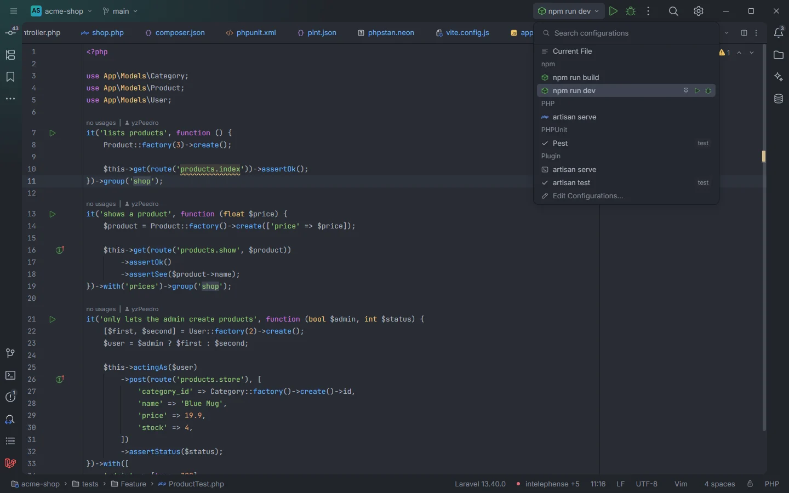

# Run configurations

In a Laravel project, the IDE's run menu gets two ready-made configurations from the plugin: **artisan serve**, which starts the development server, and **artisan test**, which runs your test suite. They appear without any setup when the project has an `artisan` file and the plugin may run `php`.

The run menu: the plugin's two configurations are under <b>Plugin</b>

## How to use it

1. Open the run configuration menu in the toolbar (it shows the current configuration, `npm run dev` in the screenshot).
2. Under **Plugin**, pick **artisan serve** or **artisan test**.
3. Press the run button next to the menu, as for any other configuration.

| Configuration | Runs | Kind |
| --- | --- | --- |
| **artisan serve** | `php artisan serve` | A run configuration |
| **artisan test** | `php artisan test` | A test configuration, marked *test* in the menu; its results go to the IDE's test tree |

## What you see

The menu groups configurations by where they come from. The entries under **Plugin** are the plugin's; the others (*Current File*, the `npm` scripts, *PHP › artisan serve*, *PHPUnit › Pest* in the screenshot) are detected by the IDE itself or by other plugins.

## Details

- **Detection.** The configurations are run detectors (`[[contributes.runDetectors]]` in `plugin.toml`) keyed on an `artisan` file at the project root: a project without it doesn't get them.
- **Only with `process:php`.** OpenIDEA treats a run detector's command as a process permission of the plugin: the configurations are offered only while `process:php` is allowed for Laravel OpenIDEA, and the IDE checks the approved `php` executable right before starting one. Without it, starting one says to allow `process:php` for the plugin in Settings › Plugins.
- **Always `php`.** The IDE runs them as `php artisan serve` and `php artisan test` in the project root, with the `php` executable approved in the permission. They don't follow the plugin's [`artisanRunner`](Settings.md#artisanrunner) setting, so in a Docker Compose project use *Laravel: Artisan serve* or the hub's Artisan section instead, which run in the container.
- **No arguments.** `artisan test` runs the whole suite. To run one test, a group or a filter, use the hub's [Tests](Hub-Tests.md) section or the gutter run icons of your test framework.

*Laravel: Artisan serve* ([Commands](Commands.md)) does the same as the **artisan serve** configuration, in a terminal tab and with your runner.

## Settings and permissions

No setting applies. The configurations need the plugin's `process:php` permission, and use the executable chosen there. See [Permissions](Permissions.md).

## Related

- [Commands and shortcuts](Commands.md)
- [Artisan](Hub-Artisan.md)
- [Tests](Hub-Tests.md)
- [Settings](Settings.md)

---
[← Wiki home](Home.md)
