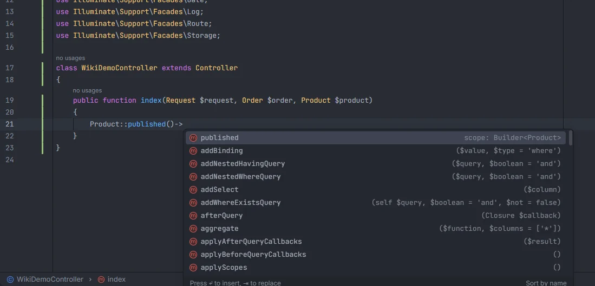

# Scopes

Local scopes, written as `scopePublished()` or as a method with the `#[Scope]` attribute, complete as `published` after `Product::` and anywhere a query of that model is being built. Ctrl+click goes both ways: on a call it opens the scope's declaration, on the declaration it lists every call, and a gutter icon next to each scope lists its usages too.

<p align="center"> with the published scope first, detail scope: Builder<Product>" width="760"></p>
<p align="center"><sub>Scopes come first in a query chain, with the detail <code>scope: Builder&lt;Product&gt;</code></sub></p>

## How to use it

```php
class Product extends Model
{
    public function scopePublished(Builder $query): void   // the scope "published"
    {
        $query->whereNotNull('published_at');
    }

    #[Scope]
    protected function cheap(Builder $query): void          // the scope "cheap"
    {
        $query->where('price', '<', 10);
    }
}

Product::                       // published, cheap, then the query methods
Product::published()->          // the scopes again, and the query methods
Product::query()->cheap()->     // same
$category->products()->latest()->  // the scopes of Product, through the relation
```

- **Completion:** type `Product::`, `Product::query()->`, `Product::where(…)->`, `Product::published()->` or most other steps that lead to a query of the model ([Eloquent chains](Eloquent-Chains.md)). The model's scopes are listed before every other method.
- **From a call to the declaration:** Ctrl+click on `published` in `Product::published()`, `$query->published()` or `Product::query()->published()`.
- **From the declaration to the calls:** Ctrl+click on `scopePublished` (or on `cheap` under `#[Scope]`) in the model.
- **Gutter:** the Laravel icon next to each scope declaration in a model lists its usages; see [Gutter usages](Gutter-Usages.md).

## What you see

- Each scope is listed by its call name: `scopePublished` becomes `published`, `scopeOnSale` becomes `onSale`, and a `#[Scope]` method keeps its own name.
- Scopes use the method icon, insert `published()` with the cursor between the parentheses, and show `scope: Builder<Product>`.
- They sort before the query methods, whatever you typed. Filtering keeps the items whose name contains what you typed.

## Details

### Which methods are scopes

- In every model (see [Eloquent columns and relations](Eloquent-Columns-and-Relations.md#details) for what counts as a model), a method whose name is `scope` followed by an uppercase letter is a scope, whatever its visibility.
- A method preceded by `#[Scope]` is a scope with its own name. The attribute must be in the same declaration, with no `;` or `}` between it and the method.
- A model that extends another model inherits its parent's scopes, unless it declares one with the same name ([Types and inheritance](Types-and-Inheritance.md)).
- Scopes are read from the saved model files and re-read when a model changes.

### Where scopes complete

- After `Model::` with nothing else, after `query()`, `where…()`, `latest()` and every other step that keeps a query, and after another scope.
- Right after a relation call (`$category->products()->`) the list is the relation's own methods and the query methods, without scopes; one step later (`$category->products()->latest()->`) the target model's scopes are back.
- On a single model (`$product->`) a scope call turns the chain into a query, so `$product->published()->` completes the query methods. On a collection (`$products->`), scopes are not offered.
- `static::` and `self::` inside a model are that model.

### Ctrl+click on a call

The model is read from the call:

- `Product::published()`: the class before `::` (its short name).
- `$x->published()`: the model the chain before it resolves to ([Model members](Model-Members.md)).

The scope with that name on that model is opened. When the model can't be worked out, or has no such scope, every model's scope with that name is offered.

### Ctrl+click on a declaration

Ctrl+click on the method name of a scope (`scopePublished`, or a `#[Scope]` method) searches the project for its calls:

- the files under `app/`, `routes/`, `resources/views/`, `tests/`, `database/` and `config/` (up to 5000 files per folder);
- a call counts when the name is followed by `(` and preceded by `->` (any receiver), or by `Product::`, `static::` or `self::`, where `Product` is the model of the open file;
- comments are left out; the file you are in is searched as it is in the editor, saved or not.

For example, with `scopePublished` in `Product`, `Product::published()`, `$query->published()` and `static::published()` are calls, while `Order::published()` and `$published` are not.

The [gutter icon](Gutter-Usages.md) uses the same rules, kept current by the IDE's own index.

## Settings and permissions

No setting and no optional permission.

## Related

- [Eloquent chains](Eloquent-Chains.md)
- [Gutter usages](Gutter-Usages.md)
- [Go to definition](Go-to-Definition.md)
- [Snippets](Snippets.md): `scope` and `scopeattr`
- [Scopes](Hub-Scopes.md) in the hub (local and global scopes)
- [SQL to Laravel](Hub-SQL-to-Laravel.md) and [Copy Query as MySQL](Copy-Query-as-MySQL.md), which apply local scopes when they translate a chain

---
[← Wiki home](Home.md)
