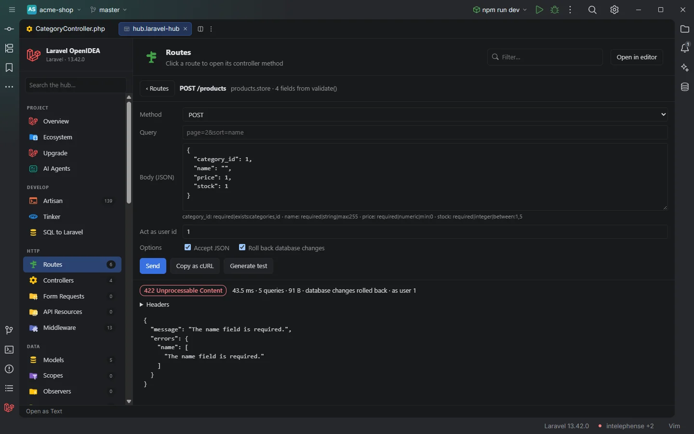

# Send request

Call a route of your app from the hub without starting a server: pick a route, fill in its parameters, query and body, optionally act as a user, and read the status, headers, body, time and query count of the response. The request runs inside the app through its HTTP kernel, and database changes are rolled back by default.

POST /products of the acme-shop demo, sent as user 1 with an empty name

## How to use it

1. Open [Routes](Hub-Routes.md) in the hub.
2. Click **Request** at the end of a row (the row itself still opens the controller).
3. Adjust the form and click **Send**. **‹ Routes** goes back to the table.

### The form

| Field | Content |
| --- | --- |
| **Method** | The route's verbs, without `HEAD`. A `Route::resource()` row gets the verb of its action (`POST` for `store`, `PUT` for `update`…) |
| One box per `{param}` | The values for the URI's parameters, such as `{product}` or `{user}`; optional parameters (`{page?}`) can stay empty |
| **Query** | A query string without `?`, such as `page=2&sort=name` |
| **Body (JSON)** | Prefilled from the validation rules, see below. Ignored for `GET` |
| **Act as user id** | Empty sends the request as a guest; an id logs that user in on the default guard for this request only |

### Options

| Option | Default | Effect |
| --- | --- | --- |
| **Accept JSON** | on for URIs under `/api`, off otherwise | Sends `Accept: application/json` and the body as JSON; off sends `Accept: text/html` and the body as form fields |
| **Roll back database changes** | on | Runs the request inside a transaction on the default connection and rolls it back afterwards. When no transaction can be started, nothing is sent |

With **Roll back database changes** off, a request other than `GET` writes for real. The first click on **Send** then turns the button into *Click again to send POST: it writes to your database*; a second click within four seconds sends it.

### The prefilled body

The plugin reads the fields of the route's action, without booting the app:

- the `rules()` of a Form Request type-hinted in the controller method, or
- the array of the first `validate([...])` call in the method (`$request->validate`, `request()->validate`, `$this->validate`).

Each field gets a sample value from its rules and name:

| Rules or name | Value |
| --- | --- |
| `boolean`, `accepted` | `true` |
| `integer`, `numeric`, or a name ending in `_id` | `1` |
| `array` | `[]` |
| `email`, or a name containing `email` | `"user@example.com"` |
| `date` | `"2026-01-01"` |
| `url` | `"https://example.com"` |
| a name containing `password` | `"password"` |
| any other required field | `"Example"` |
| any other optional field | `""` |

Wildcard fields (`items.*.sku`) are left out.

### The response

A status badge (`200 OK`, `422 Unprocessable Content`…), then the time in milliseconds, the number of queries, the size, *database changes rolled back* and *as user N* when they apply, the `Location` of a redirect, the headers and the body. JSON bodies are pretty-printed. Bodies are cut at 200 KB.

### Copy as cURL

**Copy as cURL** copies the same request as a `curl` command for `APP_URL` (or `http://localhost` when it isn't set), with the method, the `Accept` header, the query and, except for `GET`, the body as JSON. The acting user isn't part of it, since cURL has no session. It needs the `clipboard` permission.

**Generate test** writes a feature test for the route: see [Generate test](Generate-Test.md).

## Details

### What runs

`php/request.php` is passed to PHP with the project's [runner](Settings.md#artisanrunner) (`php` on your machine, or the Docker Compose service). It:

1. boots the app (`vendor/autoload.php`, `bootstrap/app.php`, the HTTP kernel's bootstrappers);
2. swaps the CSRF middleware (`VerifyCsrfToken`, `ValidateCsrfToken`, `PreventRequestForgery` and `App\Http\Middleware\VerifyCsrfToken`) for a pass-through, for this call only;
3. opens a transaction on the default connection when rolling back and checks that it is open, or stops there with *Nothing was sent: …*; then counts the queries, and shows *queries not counted* when the connection doesn't allow it;
4. builds the request with `Request::create()`, logs in the user (`auth.providers.users.model::find($id)` on the default guard) when an id is given;
5. runs `$kernel->handle()` and `$kernel->terminate()`, then rolls back every open transaction level.

Nothing listens on a port, and the request doesn't go through your web server, so server-level rewrites, TLS and headers added by a proxy don't apply. Middleware, route model binding, validation, policies and exception rendering do.

### What isn't rolled back

Only the default database connection is in the transaction. Writes to other connections, files, the cache, queues (unless the queue is `sync` on the default connection), mail and external HTTP calls happen for real. Set `MAIL_MAILER=log` and `QUEUE_CONNECTION=sync` in `.env` when you send requests that mail or dispatch.

### Masking

`Set-Cookie` headers are shown as `•••`. The body is shown as the app returned it.

### Errors

| Message | Cause |
| --- | --- |
| *The app did not boot: …* | `vendor/` is missing or the app throws while booting |
| *No user with id 999 in App\Models\User.* | The **Act as user id** doesn't exist |
| *The body isn't valid JSON: …* | The body box doesn't parse; nothing is sent |
| *Nothing was sent: Roll back database changes is on, but no transaction could be started on the default connection (…)* | The default connection can't be reached or doesn't start a transaction; turn the option off to send the request for real |
| The exception class and message | The request threw outside Laravel's exception handler |

## Settings and permissions

Sending needs `process:php` (on Windows `process:php-win` avoids a console window) or `process:docker`. Copy as cURL needs `clipboard`. See [Settings](Settings.md), [Permissions](Permissions.md) and [Privacy and security](Privacy-and-Security.md).

## Related

- [Routes](Hub-Routes.md)
- [Generate test](Generate-Test.md)
- [Live Audit](Hub-Live-Audit.md), to see the queries, events and jobs of the request
- [The hub](Hub.md)

---
[← Wiki home](Home.md)
