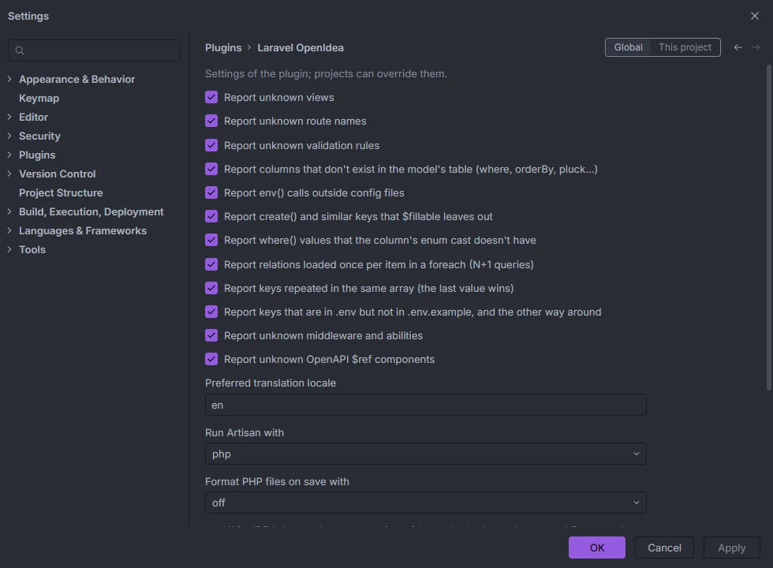
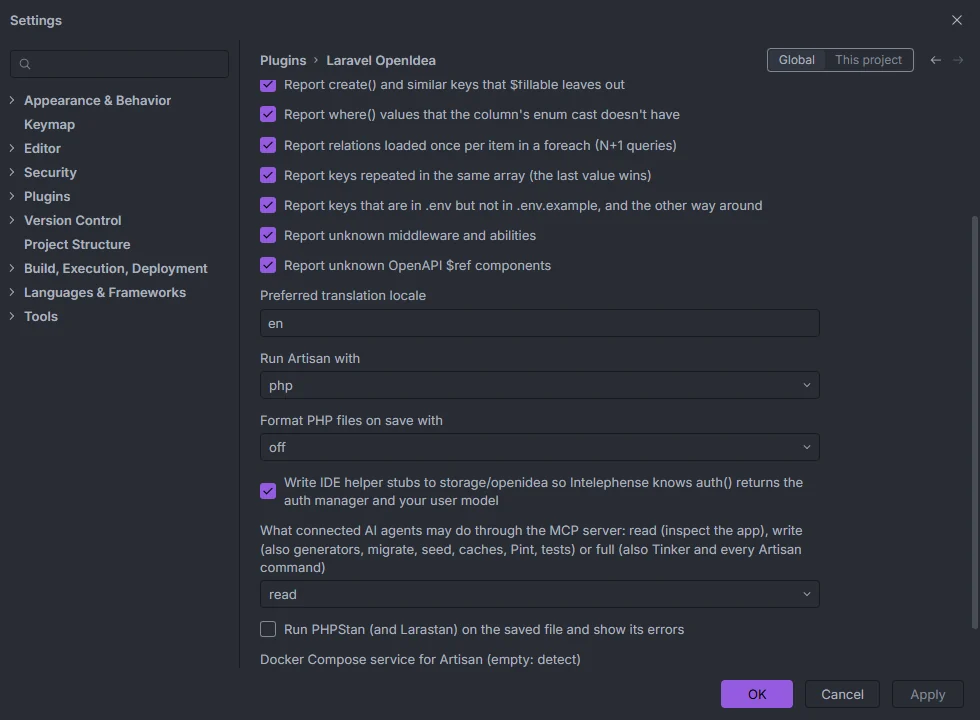

# Settings

Laravel OpenIDEA has 19 settings: twelve inspection switches, the translation locale, how to run PHP, the Docker Compose service, tools on save, the IDE helper stub and what AI agents may do. Each one can be set globally and overridden per project.

Settings › Plugins › Laravel OpenIdea, first half (the demo project has every inspection turned on)

## Where they are

Open **Settings › Plugins › Laravel OpenIdea** (search the settings for "Laravel OpenIdea" to jump there). The page starts with "Settings of the plugin; projects can override them."

The **Global / This project** switch in the top-right corner picks what you edit:

- **Global** applies to every project.
- **This project** stores an override for the open project only. A project override wins over the global value; settings you don't override keep following the global one.

The settings are declared in `settings.schema.json`, and the page is generated from it: booleans are checkboxes, settings with a list of values are drop-downs, and the rest are text fields.

The second half: runner, tools on save, IDE helpers, MCP access and the Docker Compose service

## All settings

| Key | Label in the dialog | Type | Default |
| --- | --- | --- | --- |
| `unknownViewInspection` | Report unknown views | checkbox | on |
| `unknownRouteInspection` | Report unknown route names | checkbox | **off** |
| `unknownRuleInspection` | Report unknown validation rules | checkbox | on |
| `unknownColumnInspection` | Report columns that don't exist in the model's table (where, orderBy, pluck…) | checkbox | on |
| `envCallInspection` | Report env() calls outside config files | checkbox | on |
| `fillableInspection` | Report create() and similar keys that $fillable leaves out | checkbox | on |
| `enumValueInspection` | Report where() values that the column's enum cast doesn't have | checkbox | on |
| `nPlusOneInspection` | Report relations loaded once per item in a foreach (N+1 queries) | checkbox | on |
| `duplicateKeyInspection` | Report keys repeated in the same array (the last value wins) | checkbox | on |
| `envKeysInspection` | Report keys that are in .env but not in .env.example, and the other way around | checkbox | on |
| `unknownAuthInspection` | Report unknown middleware and abilities | checkbox | **off** |
| `unknownOpenApiRefInspection` | Report unknown OpenAPI $ref components | checkbox | on |
| `securityInspection` | Report every input field passed to create() or update(), variables in raw SQL and request data printed with {!! !!} | checkbox | on |
| `missingTranslationInspection` | Report translation keys that exist in some locales but not in others | checkbox | on |
| `upgradeInspection` | Point at code that breaks on the next major Laravel version, from the official upgrade guide | checkbox | on |
| `locale` | Preferred translation locale | text | `en` |
| `artisanRunner` | Run Artisan with | `auto`, `php`, `docker-run`, `docker` | `auto` |
| `formatOnSave` | Format PHP files on save with | `off`, `pint`, `php-cs-fixer` | `off` |
| `ideHelpers` | Write IDE helper stubs to storage/openidea so Intelephense knows auth() returns the auth manager and your user model | checkbox | on |
| `mcpAccess` | What connected AI agents may do through the MCP server: read (inspect the app), write (also generators, migrate, seed, caches, Pint, tests) or full (also Tinker and every Artisan command) | `read`, `write`, `full` | `read` |
| `phpstanOnSave` | Run PHPStan (and Larastan) on the saved file and show its errors | checkbox | off |
| `dockerService` | Docker Compose service for Artisan (empty: detect) | text | empty |

## When a change takes effect

The plugin reads each setting when it is used, so most changes apply right away:

- Inspection switches apply the next time a file is inspected: when you type in it, open it or save it. Warnings already shown in other files stay until those files are inspected again.
- `artisanRunner` and `dockerService` apply to the next Artisan, Tinker, hub or tool run.
- `formatOnSave` and `phpstanOnSave` apply to the next save.
- `ideHelpers` and `mcpAccess` apply the next time you focus an editor in the project, when the plugin syncs `storage/openidea`.
- `locale` is read when the plugin starts. Reload the plugins (or restart the IDE) after changing it.

## Inspections

Each inspection has its own page with examples and quick fixes:

| Key | Page |
| --- | --- |
| `unknownViewInspection` | [Unknown views](Inspection-Unknown-Views.md) |
| `unknownRouteInspection` | [Unknown route names](Inspection-Unknown-Routes.md) |
| `unknownRuleInspection` | [Unknown validation rules](Inspection-Unknown-Rules.md) |
| `unknownColumnInspection` | [Unknown columns](Inspection-Unknown-Columns.md) |
| `envCallInspection` | [`env()` outside config](Inspection-Env-Outside-Config.md) |
| `fillableInspection` | [Keys `$fillable` leaves out](Inspection-Fillable.md) |
| `enumValueInspection` | [Enum values](Inspection-Enum-Values.md) |
| `nPlusOneInspection` | [N+1 queries](Inspection-N-Plus-One.md) |
| `duplicateKeyInspection` | [Duplicate array keys](Inspection-Duplicate-Keys.md) |
| `envKeysInspection` | [`.env` keys](Inspection-Env-Keys.md) |
| `unknownAuthInspection` | [Unknown middleware and abilities](Inspection-Unknown-Middleware.md) |
| `unknownOpenApiRefInspection` | [Unknown OpenAPI refs](Inspection-Unknown-OpenAPI-Refs.md) |
| `securityInspection` | [Security](Inspection-Security.md) |
| `missingTranslationInspection` | [Missing translations](Inspection-Missing-Translations.md) |
| `upgradeInspection` | [Upgrade](Inspection-Upgrade.md) |

`unknownRouteInspection` and `unknownAuthInspection` are the two that start off. Turning an inspection off only hides its warnings; completion and navigation for the same strings keep working. See [Inspections overview](Inspections.md).

## `locale`

The locale whose text you'd like to see first. Translation keys that exist in several locales list the preferred locale's entry first in completion, and the *Add translation* quick fix writes a missing key to that locale's existing files: `lang/<locale>/<file>.php` for a dotted key such as `shop.heading`, and `lang/<locale>.json` (both under `resources/lang/` on older projects). An empty value means `en`. See [Translations](Translations.md).

## `artisanRunner`

How the plugin runs PHP in your app: Artisan commands, Tinker, the Cache browser, Live Audit, the MCP server, tools on save and the small scripts that write `storage/openidea`.

| Value | Runs | Notes |
| --- | --- | --- |
| `auto` | Docker Compose (like `docker-run`) when the project root has `compose.yaml`, `compose.yml`, `docker-compose.yaml` or `docker-compose.yml`; `php` otherwise | The default |
| `php` | `php artisan …` in the project root | Needs `process:php` (and uses `process:php-win` on Windows when allowed) |
| `docker-run` | `docker compose run --rm --no-deps --entrypoint php <service> artisan …` | A throwaway container that doesn't start the service's dependencies. Background runs add `-T` (no TTY) |
| `docker` | `docker compose exec <service> php artisan …` | Uses the running container. Background runs add `-T`. `docker-exec` is accepted as an alias |

The Docker modes need `process:docker`. In `docker-run` mode, tools on save point `TMPDIR` at `storage/framework/cache/openidea`, a folder inside the project that outlives each throwaway container, and the scripts give the files they create back to the owner of the project folder when they run as root.

The [run configurations](Run-Configurations.md) (`artisan serve`, `artisan test`) are run by the IDE with `php` and don't follow this setting.

## `dockerService`

The Compose service that runs PHP. Leave it empty to detect it: the plugin reads the top-level `services:` of the compose file and picks the first of `app`, `laravel.test`, `laravel`, `php`, `api` and `web` that exists, then the first service listed, then `app`.

## `formatOnSave` and `phpstanOnSave`

`formatOnSave` runs `vendor/bin/pint` or `vendor/bin/php-cs-fixer` on each PHP file you save; `phpstanOnSave` runs `vendor/bin/phpstan` on it when the project has a PHPStan config, and shows its errors as warnings. Both are off by default. See [Tools on save](Tools-on-Save.md).

## `ideHelpers`

Keeps `storage/openidea/ide-helpers.php`, a stub that tells Intelephense what `auth()` returns. Turning it off deletes the file. See [IDE helpers](IDE-Helpers.md).

## `mcpAccess`

What AI agents connected to the plugin's MCP server may do: `read` (inspect the app), `write` (also generators, `migrate`, `db:seed`, cache commands, Pint and tests) or `full` (also Tinker and every Artisan command). Any other value counts as `read`. The level is written to `storage/openidea/mcp-access.json`, which the server reads on every call. See [AI agents and MCP](AI-Agents.md).

## Not settings: Live Audit variables

Two environment variables in your app's `.env` control the Live Audit recorder: `OPENIDEA_AUDIT=false` turns it off (and `OPENIDEA_AUDIT=true` turns it on outside the local environments), and `OPENIDEA_AUDIT_SHOW_PII=true` stops masking personal data. See [Live Audit](Hub-Live-Audit.md) and [Privacy and security](Privacy-and-Security.md).

## Related

- [Permissions](Permissions.md)
- [Inspections overview](Inspections.md)
- [Tools on save](Tools-on-Save.md)
- [IDE helpers](IDE-Helpers.md)
- [AI agents and MCP](AI-Agents.md)
- [How it works](How-It-Works.md)

---
[← Wiki home](Home.md)
