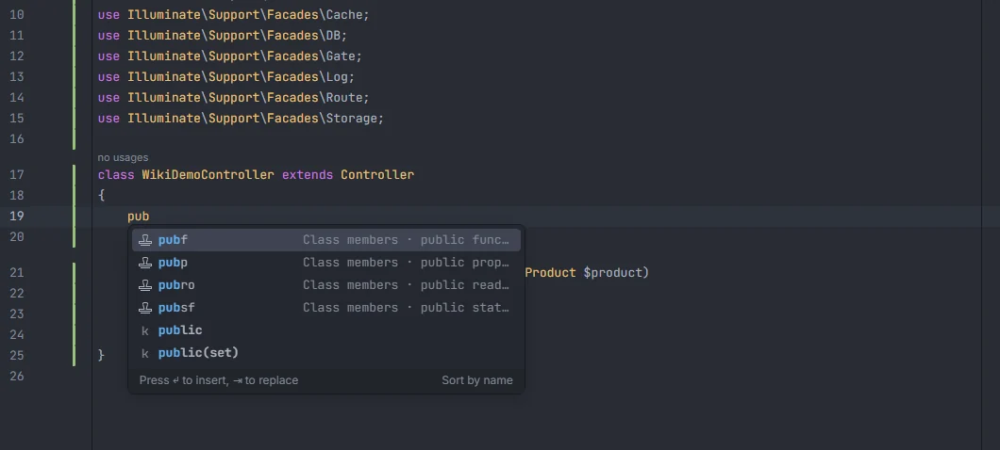
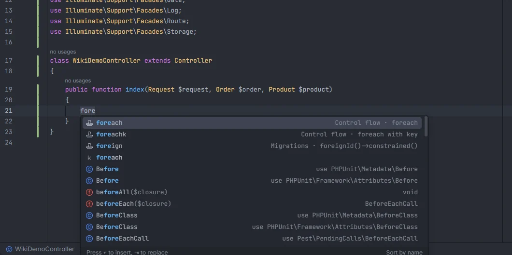
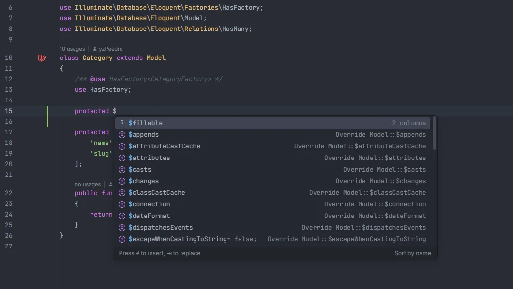
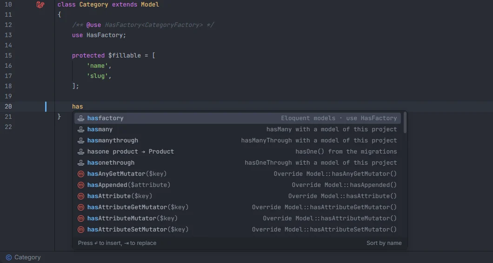

# Snippets

About 200 PHP and Laravel snippets expand from a short prefix (`pubf`, `ctorp`, `foreach`, `rget`, `qwhere`, `cremember`, `it`…), each offered only where it makes sense (outside a class, in a class body, or in code) and adding the `use` statements it needs. Blade block directives come with their closing tag, and inside a model the relation snippets write the relations your migrations suggest, with the real model and method names. The complete list is in [docs/snippets.md](../docs/snippets.md).

<p align="center"></p>
<p align="center"><sub><code>pub</code> in a class body: the <code>pubf</code>, <code>pubp</code>, <code>pubro</code> and <code>pubsf</code> snippets</sub></p>

## How to use it

Type the start of a prefix where the snippet belongs and pick it from the completion list. The placeholders are visited with Tab, and the cursor ends where the snippet's last stop is.

```php
<?php                       // empty file: "php" writes the opening tag

class InvoiceController     // in the file: "class" writes a class named after the file
{
    pubf                    // in a class body: public function name(): void { … }

    public function index()
    {
        fore                // in code: foreach, foreachk, foreign
    }
}
```

<p align="center"></p>
<p align="center"><sub><code>fore</code> in a method: <code>foreach</code>, <code>foreachk</code> (with key) and <code>foreign</code> (a migration column)</sub></p>

## What you see

- The label is the prefix, with the snippet icon.
- The detail is the group and a description, such as `Control flow · foreach` or `Class members · public function`.
- The documentation shows the code the snippet writes, with the placeholders filled with their defaults (`class ClassName` for snippets named after the file).
- Snippets sort after the other completion items.
- When the snippet needs classes, the missing `use` lines are added after the last `use`, `namespace` or `<?php` line at the top of the file. A class already imported (by its full name, or by any `use` line ending with its short name) isn't imported again.

## The categories

| Group | Snippets | Where | Examples |
| --- | --- | --- | --- |
| PHP | 13 | file | `php`, `strict`, `class`, `fclass`, `aclass`, `rclass`, `cext`, `interface`, `trait`, `enum`, `enums`, `enumi`, `func` |
| Class members | 23 | class | `pubf`, `prof`, `prif`, `pubsf`, `absf`, `ctor`, `ctorp`, `pubp`, `pubro`, `const`, `case`, `get`, `set`, `invoke`, `tostring`, `magicget`, `magiccall` |
| Control flow | 18 | file, code | `if`, `ifel`, `elif`, `foreach`, `foreachk`, `for`, `while`, `do`, `switch`, `match`, `try`, `tryf`, `trycf`, `throw`, `fn`, `closure`, `ret` |
| Laravel helpers | 30 | file, code | `dd`, `dump`, `validate`, `validator`, `retview`, `retjson`, `retredirect`, `back`, `abortif`, `gate`, `authuser`, `cremember`, `cforever`, `cforget`, `clock`, `dispatch`, `event`, `chain`, `mail`, `notify`, `httpget`, `httppost`, `sput`, `logi`, `loge`, `collect`, `retry`, `rescue`, `throwif` |
| Eloquent models | 21 | class | `fillable`, `guarded`, `hidden`, `visible`, `appends`, `with`, `table`, `primarykey`, `hasfactory`, `timestamps`, `connection`, `perpage`, `touches`, `casts`, `castsp`, `scope`, `scopeattr`, `accessor`, `mutator`, `attr`, `booted` |
| Eloquent relations | 11 | class (models only) | `hasone`, `hasmany`, `belongsto`, `belongstomany`, `hasonethrough`, `hasmanythrough`, `morphto`, `morphone`, `morphmany`, `morphtomany`, `morphedbymany`; see below |
| Eloquent and queries | 15 | file, code | `qwhere`, `qfirst`, `qfind`, `qcreate`, `qupdate`, `qfoc`, `quoc`, `qwith`, `qwherehas`, `qpaginate`, `qchunk`, `qlazy`, `dbtrans`, `dbtable`, `dbselect` |
| Laravel classes | 29 | class | controller actions (`index`, `create`, `store`, `show`, `edit`, `update`, `destroy`, `resource`), Form Request (`authorize`, `rules`, `messages`, `prepare`), jobs and commands (`handle`, `failed`, `tries`, `signature`), `mhandle`, `policy`, `register`, `boot`, notifications and mail (`via`, `tomail`, `toarray`, `envelope`), `definition`, `state`, `run`, `render`, `observer` |
| Migrations | 5 | class, file, code | `up`, `uptable`, `down`, `migration`, `foreign` |
| Routes | 13 | file, code | `rget`, `rpost`, `rput`, `rpatch`, `rdelete`, `rview`, `rredirect`, `rresource`, `rapi`, `rgroup`, `rprefix`, `rcontroller`, `rfallback` |
| Tests (PHPUnit) | 16 | class, file, code | `test`, `testattr`, `setup`, `getok`, `postjson`, `actingas`, `assertdb`, `assertmissing`, `factory`, `factorycount`, `fakeevent`, `fakequeue`, `fakemail`, `fakenotification`, `fakestorage`, `fakehttp` |
| Pest | 9 | file, code | `it`, `ptest`, `describe`, `beforeeach`, `aftereach`, `dataset`, `expect`, `uses`, `arch` |
| Blade blocks | 20 | after `@` in Blade | `@if`, `@unless`, `@isset`, `@empty`, `@auth`, `@guest`, `@foreach`, `@forelse`, `@for`, `@while`, `@switch`, `@section`, `@push`, `@once`, `@can`, `@error`, `@php`, `@verbatim`, `@production`, `@env` |

[docs/snippets.md](../docs/snippets.md) has every snippet with what it inserts and where it works. It is generated from the same table the plugin uses, and a test fails when the two differ.

## Details

### Where a snippet is offered

Each snippet has the places it works in:

- **file**: PHP code outside any class or function, such as a route file, a Pest test or a script;
- **class**: directly inside a class, trait, interface or enum body (anonymous classes included);
- **code**: inside a function, method or closure body, or any other block that isn't a class body.

"file, code" snippets work in both. The place is worked out from the braces between the last `<?php` and the cursor.

A prefix is offered when:

- what you typed is the start of the prefix (`fore` offers `foreach`, `foreachk` and `foreign`; `each` offers nothing), ignoring case;
- the word starts with a letter or `_` and is preceded by none of `$`, `>`, `:`, `\`, `@`, `.` or `-` (so `$this->pubf` and `Foo::pubf` don't expand);
- the word doesn't follow `function`, `new`, `class`, `extends`, `implements`, `fn`, `const`, `case`, `enum`, `interface` or `trait`;
- the cursor is not inside a string, a `//` or `#` comment, or an open `/* … */` comment, and not after a `?>`.

Outside `<?php`, in a file whose text before the word is empty or whitespace, only `php` is offered.

The relation group is never offered as plain snippets: those prefixes come from the migrations, as described below.

### Blade blocks

In a Blade file, after `@`, the directive list gets a second item for each block directive, labelled `@foreach … @end` with the detail `@foreach … block`. It writes the opening directive, an indented line for the cursor and the closing directive (`@forelse` adds `@empty`, `@switch` adds a `@case` and `@default`). A block is offered only when its directive is available in the project: Laravel's built-in ones follow the installed version, and package directives need the package (see [Blade](Blade.md)).

### Inside a model

In a model's class body, at the start of a member (on its own line, optionally after `public`, `protected`, `private`, `static` or `function`), the list adds two kinds of items built from your migrations.

**Member items** fill in the model's properties from its table. Typing part of the name (with or without `$`) filters them, and picking one replaces the whole line from its indentation:

<p align="center"></p>
<p align="center"><sub><code>protected $</code> in <code>Category</code>: the plugin's <code>$fillable</code> item, built from the <code>categories</code> table, comes first</sub></p>

| Item | Detail | Writes |
| --- | --- | --- |
| `$fillable` | `N columns` | `protected $fillable = [...]` with every column except `id`, `created_at`, `updated_at`, `deleted_at` and `remember_token` |
| `$guarded` | only id | `protected $guarded = ['id'];` |
| `$hidden` | sensitive columns | `protected $hidden = [...]` with the columns named `password`, `remember_token`, `api_token`, `token`, `secret`, `two_factor_secret` or `two_factor_recovery_codes` |
| `casts()` | `N casts from the migrations` | `protected function casts(): array` returning a cast for each `date` (`date`), `dateTime`/`timestamp` and their `Tz` variants (`datetime`), `boolean`, `json`/`jsonb` (`array`), `decimal` (`decimal:2`), `float`/`double` and integer column, leaving out `created_at` and `updated_at`. On Laravel versions without the `casts()` method it is the `$casts` item and writes the property instead |
| `$table` | the table name | `protected $table = 'products';` |
| `$primaryKey`, `$keyType`, `$incrementing`, `$timestamps`, `$connection`, `$with`, `$withCount`, `$appends`, `$touches`, `$perPage`, `$attributes` | what each one is for | the property with a typical value |
| `booted()` | model events | an empty `protected static function booted(): void` |
| `user()` and other `belongsTo` methods | `belongsTo(User) via user_id` | a `belongsTo` for each `*_id` column whose table (the plural of the name) has a model |
| `orders()` and other `hasMany` methods | `hasMany(Order) via orders.user_id` | a `hasMany` for each other table with a `{singular of this table}_id` column and a model |

Relation methods the model already has are left out.

**Relation snippets.** Typing the start of a relation prefix (`has`, `hasm`, `belongsto`, `morph`…) offers the relations your migrations suggest for this model:

| Prefix | Suggested when | Example label |
| --- | --- | --- |
| `belongsto` | this model's table has a `*_id` column and the table named after it (the plural of `customer` for `customer_id`, or of its last part, so `billing_address_id` finds `addresses`) has a model | `belongsto billingAddress → Address` |
| `hasmany`, `hasone` | another table with a model has a `{singular of this table}_id` column (`orders.user_id` for `users`) | `hasmany orders → Order`, `hasone order → Order` |
| `belongstomany` | another table without a model (a pivot table) has that column and other `*_id` columns whose tables have models (`role_user` for `users` → `roles`) | `belongstomany roles → Role` |
| `morphto` | this model's table has both `x_id` and `x_type` | `morphto commentable` |
| `morphmany`, `morphone` | another table with a model has `xable_id` and `xable_type` columns | `morphmany comments → Comment` |

Each suggestion has the detail `hasMany() from the migrations` (with its own relation) and writes the complete method:

```php
public function orders(): HasMany
{
    return $this->hasMany(Order::class);
}
```

`morphMany` and `morphOne` pass the morph name (`$this->morphMany(Comment::class, 'commentable')`) and `morphTo` writes `$this->morphTo()`. The relation class (`Illuminate\Database\Eloquent\Relations\HasMany`) is imported, and so is the related model when it lives in another namespace.

<p align="center"></p>
<p align="center"><sub><code>has</code> in <code>Category</code>: <code>hasone product → Product</code> comes from the migrations; <code>hasmany</code>, <code>hasmanythrough</code> and <code>hasonethrough</code> fall back to a choice of models</sub></p>

**When nothing fits** a prefix (no suggestion, or all of them already exist), the prefix itself is offered with the detail `hasMany with a model of this project`. It writes the method with a `related` name to fill in and a choice of the project's other models; the through relations offer the model choice twice, and `morphOne`, `morphMany`, `morphToMany` and `morphedByMany` add a `'taggable'` placeholder for the morph name. Without other models in the project, only `morphto` falls back this way.

Other rules:

- A method name the model already has as a relation (in the saved model file) is never suggested again.
- Method names are the camel case of the column or table (`billing_address_id` → `billingAddress`, `order_items` → `orderItems`), singular for `hasOne` and `morphOne`.
- Tables and columns are those of the [column index](Eloquent-Columns-and-Relations.md#details); models and their tables come from the model index.
- Both kinds of items appear only in a class the plugin recognises as a model.

## Settings and permissions

No setting and no optional permission.

## Related

- [docs/snippets.md](../docs/snippets.md): every snippet
- [Typed closures](Typed-Closures.md)
- [Static completion](Static-Completion.md)
- [Blade](Blade.md): directives and components
- [Model members](Model-Members.md) and [Casts](Casts.md)
- [File templates](File-Templates.md)

---
[← Wiki home](Home.md)
