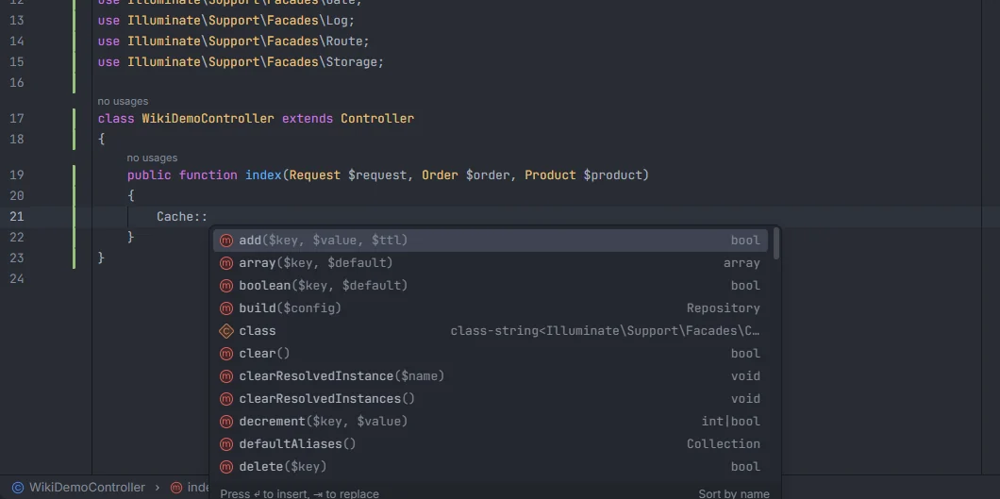
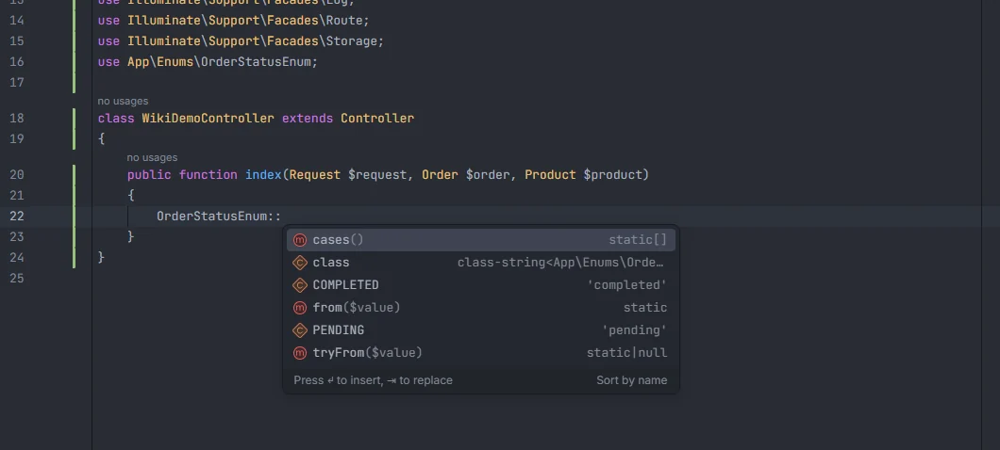

# Static completion

Classes you only ever use with `::` complete with the `::` already written: start typing `Cac` in a method and pick `Cache::`, or `OrderSt` and pick `OrderStatus::`. The list holds the Laravel facades of your installed version, your enums and your classes with only static methods, and the `use` statement is added for you. In `$casts` and `casts()`, enums and cast classes complete as `OrderStatus::class` instead.

<p align="center"></p>
<p align="center"><sub>Once <code>Cache::</code> is in place, the PHP language server lists the facade's methods</sub></p>

## How to use it

Inside a function or method body, type the start of the class name:

```php
public function index()
{
    Cac          // Cache::   (Laravel facade, adds use Illuminate\Support\Facades\Cache;)
    $status = OrderSt     // OrderStatus::   (enum, adds use App\Enums\OrderStatus;)
    $total = Mon          // Money::   (a project class whose public methods are all static)
}
```

In a model's casts, without quotes:

```php
protected $casts = [
    'status' => OrderSt,   // OrderStatus::class
];
```

## What you see

- Each item is labelled with the class's short name followed by `::` (`Cache::`, `OrderStatus::`) and uses the class icon.
- The detail says what it is: `Laravel facade` for a facade, `Laravel Arr` style for aliases that aren't facades (the alias name after `Laravel`), `enum` for your enums and `static class` for your static-only classes and your own facades.
- Names that start with what you typed rank first, then names that contain it. Matching ignores case.
- Picking an item inserts `Name::` and, when the class is in another namespace and not imported yet, a `use` line under the existing ones. From there, the PHP language server lists the static members.

<p align="center"></p>
<p align="center"><sub>After <code>OrderStatusEnum::</code>, the enum's cases and static methods (from the PHP language server)</sub></p>

## Details

### Where the candidates come from

| Candidate | Source |
| --- | --- |
| Laravel facades | `Facade::defaultAliases()` of the installed `vendor/laravel/framework`; on versions without that method (Laravel 8 and older) or without `vendor/`, the `aliases` array of `config/app.php` |
| Enums | every `enum` declared in your project files |
| Your facades | classes that extend `Facade` |
| Static classes | classes with at least one public method, all of them static, and no constructor |

Project classes are read from the PHP files under `app/`, `database/factories/`, `database/seeders/` and `routes/`, plus `bootstrap/app.php` and `bootstrap/providers.php`, and must declare a namespace. Ordinary classes (with instance methods or a constructor) are not offered: `Billing::` won't appear for a service you instantiate.

When two candidates share a short name, the project's class wins over the facade.

### Where it is offered

The `Name::` items are offered only where an expression can start inside code:

- in a function, method or closure body (not at the top level of a file, not in a class body);
- not after `use`, `instanceof`, `namespace`, `catch`, `insteadof`, `as`, `public`, `protected`, `private`, `new`, `function`, `fn`, `class`, `extends`, `implements`, `const`, `case`, `enum`, `interface` or `trait`;
- not after `->`, `::`, `$`, `\`, `@`, `.` or `-`, after `|`, `&` or `?`, after `#[`, after `):` (a return type), or inside the parameter list of a function or arrow function;
- not inside strings or comments;
- the word must start with a letter.

They come together with the [snippets](Snippets.md) that start with the same letters.

### `::class` in casts

After `=>` in a `$casts` array or the array of `casts()` (the cursor still inside its brackets), the list is replaced by `Name::class` items for your enums and for your classes that implement `CastsAttributes`, `CastsInboundAttributes` or `Castable`. See [Casts](Casts.md).

### Refreshing

The project classes are kept by the plugin's project store, which is read in the background and updated when a file is saved or changed on disk. *Laravel: Refresh Index* reports how many facades and helpers it found ([Commands](Commands.md)).

## Settings and permissions

No setting and no optional permission.

## Related

- [Casts](Casts.md)
- [Types and inheritance](Types-and-Inheritance.md): classes after `extends`, `implements` and `use`
- [PSR-4 namespaces](Namespaces.md)
- [Enums](Hub-Enums.md) and [All Classes](Hub-Classes.md) in the hub

---
[← Wiki home](Home.md)
