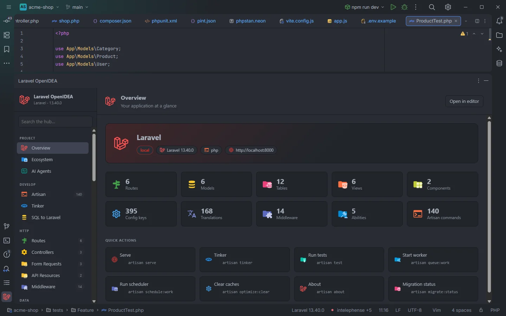

# Status bar

Each OpenIDEA window with a Laravel project shows that project's Laravel version in the status bar. Clicking it runs *Laravel: Refresh Index*. While the plugin works in the background (indexing, tools on save, Tinker, syncing `storage/openidea`) its tasks show up in the status bar too.

"Laravel 13.40.0" in the status bar, next to the language server item, with the hub's tool window open

## How to use it

- **Read it:** the item shows `Laravel 13.40.0`, the version of `laravel/framework` your project has installed.
- **Hover it:** the tooltip reads "Laravel OpenIdea — click to refresh the index".
- **Click it:** runs [Laravel: Refresh Index](Commands.md#laravel-refresh-index), which rebuilds the project's indexes. It stops waiting after about **3.5 seconds** and lets the rest finish in the background, so the IDE never hangs on a large project.

## What you see

| Text | When |
| --- | --- |
| `Laravel 13.40.0` | `composer.lock` lists `laravel/framework`; its `version` is shown without the leading `v` |
| `Laravel` | The project is a Laravel project but `composer.lock` is missing or doesn't list `laravel/framework` (before `composer install`, for example) |
| No item | The window's project is not a Laravel project (no `artisan` file, or a `composer.json` without `laravel/framework` or `laravel/laravel`) |

## Details

### One version per window

Since 0.15.0 the item belongs to each window: the plugin sets it with the IDE's per-window status item, so two windows with two Laravel projects show two versions. Before 0.15.0 every window showed the version of the first Laravel project opened.

The item of a window is set (or refreshed from the cache) when:

- the plugin first recognises the project as a Laravel project, whatever feature touched it;
- a file of the project is opened;
- an editor of the project gets focus;
- the hub in that window sends any message to the plugin (opening a section, searching, running something);
- *Laravel: Refresh Index* runs.

### Cache and refresh

The text is computed once per project and cached. It is computed again when:

- `composer.lock` changes, whether you save it in the editor, Composer rewrites it on disk, or a git checkout replaces it. The plugin watches the file through the IDE's file events and also compares its size and modification time on each event and completion, because the IDE doesn't report changes to every file;
- you run *Laravel: Refresh Index*.

So after `composer update laravel/framework` the item shows the new version without restarting anything.

### Background tasks

Long work runs as an IDE task, which shows its title in the status bar while it lasts. Opening a task also lets that plugin call run for up to 60 seconds instead of 5 (see [How it works](How-It-Works.md)).

| Task title | What runs |
| --- | --- |
| Indexing the Laravel project | The first indexing of a project, the slices that finish it, and *Refresh Index* |
| Laravel: pint, Laravel: phpstan, Laravel: pint and phpstan… | [Tools on save](Tools-on-Save.md) |
| Laravel: updating the IDE helper stubs | Writing `storage/openidea/ide-helpers.php` ([IDE helpers](IDE-Helpers.md)) |
| Laravel: preparing the hub tabs | Writing `storage/openidea/hub` for [hub editor tabs](Hub.md) |
| Laravel: updating the MCP server | Bringing the MCP server files in `storage/openidea` up to date ([AI agents](AI-Agents.md)) |
| Laravel: indexing the hub for search | Building the tables the hub's search box looks through |
| Laravel: everything about &lt;Model&gt; | The detail page of a model in the hub's [Models](Hub-Models.md) section |
| php artisan &lt;command&gt; | An Artisan command whose output the hub captures ([Artisan](Hub-Artisan.md)) |
| Tinker | A run in the hub's [Tinker](Hub-Tinker.md) |
| Reading the cache | The [Cache](Hub-Cache.md) browser reading a store |
| Live audit: &lt;action&gt; | Turning the [Live Audit](Hub-Live-Audit.md) recorder on or off, or clearing it |
| AI agents | Connecting, disconnecting or checking [AI agents](Hub-AI-Agents.md) |

The tasks of the last five rows can be cancelled from the status bar.

## Settings and permissions

The item needs no setting and no optional permission: it reads `composer.lock` with `project.read`. *Refresh Index* needs none either. See [Permissions](Permissions.md).

## Related

- [Commands and shortcuts](Commands.md)
- [How it works](How-It-Works.md)
- [Installation](Installation.md)
- [Troubleshooting and logs](Troubleshooting.md)

---
[← Wiki home](Home.md)
