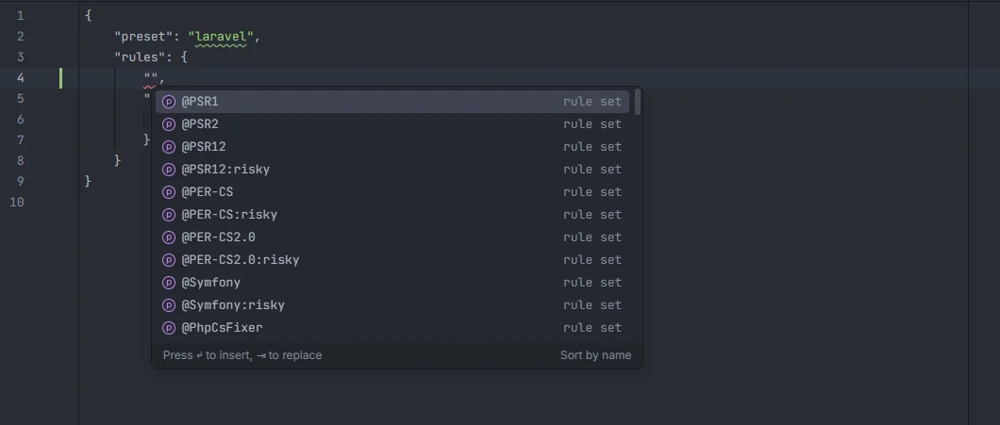
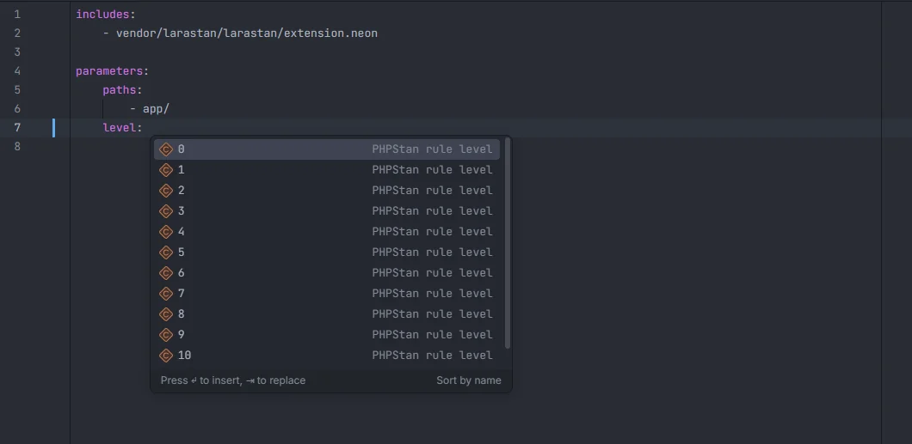

# Pint, PHP CS Fixer and PHPStan configs

The config files of Laravel's code quality tools complete as you write them: presets, rule sets and PHP CS Fixer rules in `pint.json` and `.php-cs-fixer.php`, and parameters (Larastan's included), levels, booleans, includes and paths in `phpstan.neon` and other `.neon` files. NEON files also get syntax highlighting.

<p align="center"></p>
<p align="center"><sub>Rule sets, then rules, as keys of <code>"rules"</code> in <code>pint.json</code></sub></p>

## pint.json

Type inside a quoted key or value of `pint.json`:

| Cursor in | Suggests |
| --- | --- |
| A top-level key | `preset`, `rules`, `exclude`, `notName`, `notPath`, `cache-file`, each with a hint |
| The value of `preset` | `laravel`, `per`, `psr12`, `symfony`, `empty` |
| A key inside `rules` | 19 rule sets, then 222 PHP CS Fixer rules |

```json
{
    "preset": "laravel",
    "rules": {
        "declare_strict_types": true,
        "ordered_imports": { "sort_algorithm": "alpha" }
    }
}
```

The rule sets are `@PSR1`, `@PSR2`, `@PSR12`, `@PSR12:risky`, `@PER-CS`, `@PER-CS:risky`, `@PER-CS2.0`, `@PER-CS2.0:risky`, `@Symfony`, `@Symfony:risky`, `@PhpCsFixer`, `@PhpCsFixer:risky`, `@DoctrineAnnotation`, `@PHP80Migration` to `@PHP84Migration` and `@PHPUnit100Migration:risky` (detail *rule set*). The rules run from `align_multiline_comment` to `yoda_style` (detail *PHP CS Fixer rule*). Rule options (the values) aren't completed.

## .php-cs-fixer.php

In `.php-cs-fixer.php` and `.php-cs-fixer.dist.php`, a quoted key directly inside the array of `->setRules([…])` completes with the same rule sets and rules:

```php
return (new PhpCsFixer\Config())
    ->setRules([
        '@PSR12' => true,
        'ordered_imports' => true,
    ]);
```

The key must start right after `[` or a `,`; values and nested option arrays (`'array_syntax' => ['syntax' => 'short']`) get no suggestions.

## phpstan.neon

<p align="center"></p>
<p align="center"><sub><code>level:</code> completes the rule levels 0 to 10 and <code>max</code></sub></p>

In any file ending in `.neon` or `.neon.dist` (`phpstan.neon`, `phpstan.neon.dist`, `phpstan.dist.neon`…):

| Cursor | Suggests |
| --- | --- |
| A key at the start of a line, no indent | `includes`, `parameters`, `services`, `rules`, `conditionalTags` |
| A key indented under `parameters:` | 50 PHPStan and Larastan parameters (below) |
| After `level:` | `0` to `10` and `max` |
| After `phpVersion:` | `80100`, `80200`, `80300`, `80400`, `80500` |
| After `errorFormat:` | `table`, `raw`, `json`, `github`, `gitlab`, `checkstyle`, `junit`, `teamcity` |
| After a key starting with `check`, `report`, `no`, `treat`, `disable`, `generalize`, `polluteScope`, `remember` or `infer` | `true`, `false` |
| A `- ` item under `includes:` | `vendor/larastan/larastan/extension.neon`, `vendor/phpstan/phpstan-strict-rules/rules.neon`, `vendor/phpstan/phpstan-deprecation-rules/rules.neon`, `vendor/phpstan/phpstan/conf/bleedingEdge.neon`, `phpstan-baseline.neon` |
| A `- ` item under `paths:`, `excludePaths:` or `scanDirectories:` | `app`, `config`, `database`, `routes`, `tests`, `bootstrap` |

```neon
includes:
    - vendor/larastan/larastan/extension.neon

parameters:
    paths:
        - app/
    level: 5
    noEnvCallsOutsideOfConfig: true
```

The parameters, each with a one-line description:

- **PHPStan**: `level`, `paths`, `excludePaths`, `bootstrapFiles`, `scanFiles`, `scanDirectories`, `tmpDir`, `ignoreErrors`, `reportUnmatchedIgnoredErrors`, `treatPhpDocTypesAsCertain`, `checkMissingCallableSignature`, `checkUninitializedProperties`, `checkImplicitMixed`, `checkExplicitMixed`, `checkBenevolentUnionTypes`, `checkFunctionNameCase`, `checkInternalClassCaseSensitivity`, `checkTooWideReturnTypesInProtectedAndPublicMethods`, `inferPrivatePropertyTypeFromConstructor`, `polluteScopeWithLoopInitialAssignments`, `polluteScopeWithAlwaysIterableForeach`, `rememberPossiblyImpureFunctionValues`, `reportMaybesInMethodSignatures`, `reportStaticMethodSignatures`, `reportWrongPhpDocTypeInVarTag`, `phpVersion`, `parallel`, `universalObjectCratesClasses`, `stubFiles`, `earlyTerminatingMethodCalls`, `dynamicConstantNames`, `exceptions`, `editorUrl`, `errorFormat`.
- **Larastan** (detail starts with *Larastan:*): `noModelMake`, `noUnnecessaryCollectionCall`, `noUnnecessaryCollectionCallOnly`, `noUnnecessaryCollectionCallExcept`, `noEnvCallsOutsideOfConfig`, `checkModelProperties`, `checkModelAppends`, `checkOctaneCompatibility`, `checkConfigTypes`, `checkUnusedViews`, `checkModelMethodVisibility`, `generalizeEnvReturnType`, `databaseMigrationsPath`, `squashedMigrationsPath`, `disableMigrationScan`, `disableSchemaScan`.

Comment lines (`# …`) get no suggestions.

### The NEON language

The plugin registers **NEON** for `*.neon` files and for `phpstan.neon.dist`, `phpstan.dist.neon` and `phpstan-baseline.neon`, with `#` line comments, four-space indentation and the editor's YAML highlighting, so keys, strings and comments are coloured instead of plain text.

## Details

- The plugin returns the suggestions in the order listed and leaves filtering by what you typed to the editor. A pick replaces the word or quoted string under the cursor.
- The lists are built into the plugin; nothing reads the installed Pint, PHP CS Fixer or PHPStan, and nothing runs PHP.
- The plugin adds no Ctrl+click targets in these files.
- Running these tools when you save a file is a separate feature: see [Tools on save](Tools-on-Save.md).

## Settings and permissions

Completion in these files has no setting and only needs `project.read`. The `formatOnSave` and `phpstanOnSave` settings belong to [Tools on save](Tools-on-Save.md). See [Settings](Settings.md) and [Permissions](Permissions.md).

## Related

- [Tools on save](Tools-on-Save.md)
- [composer.json](Composer-Json.md)
- [phpunit.xml](PHPUnit-Xml.md)
- [`env()` outside config](Inspection-Env-Outside-Config.md): the plugin's own check, like Larastan's `noEnvCallsOutsideOfConfig`

---
[← Wiki home](Home.md)
